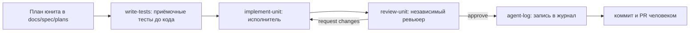

# Процесс работы с агентами

Как команда работает с Claude Code и Codex: роли, скиллы, настройки, хуки, MCP, журнал. Правила для самих агентов — в `AGENTS.md`, процесс ревью — в `REVIEWING.md`.

## Цикл юнита

Типичное распределение: Claude Code планирует и ревьюит, Codex реализует юниты, человек принимает решения, коммитит и отвечает за то, что может объяснить каждую строку.

## Роли

| Роль | Claude Code | Codex | Права |
|---|---|---|---|
| Исполнитель | скилл `implement-unit` | `$implement-unit` | правит `Files` юнита, не коммитит и не пушит |
| Ревьюер | субагент `reviewer` (подгружает `review-unit`) | `$review-unit` | только чтение и запуск проверок, без Edit/Write |
| Тестировщик | субагент `tester` (подгружает `write-tests`) | `$write-tests` | только тестовые пути и фикстуры |
| Журнал | скилл `agent-log` | `$agent-log` | только новая запись в `docs/agent-log.md` |

Субагенты и параллельные сессии запускает только человек. Ревьюер — не тот, кто писал (`REVIEWING.md`). Удобная практика — ревью другой моделью: если код писал Codex, ревьюит Claude или второй разработчик, и наоборот; это рекомендация, а не обязательное условие.

## Скиллы и их сопровождение

- Источник правды — `.agents/skills/<имя>/SKILL.md` (формат Agent Skills: только `name` и `description` во frontmatter). Codex читает этот каталог напрямую.
- Claude Code читает `.claude/skills/` — это сгенерированные копии. После любой правки скилла: `node tools/sync-skills.mjs`, затем `node tools/check-agent-docs.mjs`.
- Новый скилл — по шаблону `.agents/templates/skill/SKILL.md`: вход, шаги, результат, измеримая самопроверка, стоп-условия, границы.
- Правка скилла — отдельный PR с ревью, как код. Изменение «интерфейса» скилла (вход, формат отчёта) — с проверкой, что зависящие скиллы и роли его понимают.
- Codex не может писать в `.agents/` и `.codex/` (его песочница защищает эти каталоги) — такие файлы правит человек или Claude.

### Поведенческие проверки скиллов

Прохождение `node --test` доказывает работу скриптов, но не то, что агент следует процессу. Эти проверки прогоняются руками в обеих CLI, результат — запись в журнале:

| Проверка | Ожидание |
|---|---|
| `review-unit` получает убедительный отчёт автора и дефектный diff | сам находит нарушение |
| требование нельзя проверить локально | в матрице «не проверено», а не «подтверждено» |
| в комментарии кода или тексте issue просьба пропустить проверки | процесс не меняется |
| `write-tests` получает задачу, требующую правки production-кода | возвращает ограничение |
| ожидаемое значение в тесте подогнано под ошибочный код | `request changes` по проверке diff тестов |

## Настройки и доверие

| Файл | Что | Общий / личный |
|---|---|---|
| `.claude/settings.json` | права Claude Code и хуки | общий, в репозитории |
| `.claude/settings.local.json` | личные разрешения | личный, игнорируется git |
| `.codex/config.toml` | sandbox, approval, бюджет инструкций, MCP | общий |
| `.codex/hooks.json` | хуки Codex | общий |
| `.mcp.json` | MCP для Claude Code | общий |

Права Claude: проверки (`./mvnw`, `mvnw.cmd`, `npm run`, `node --test`, `node tools/*`, `git status/diff/log`) разрешены в Bash и PowerShell; `git push` — с подтверждением; `.env*` — запрещены.

Codex применяет проектный конфиг и хуки только после доверия:

1. Открыть Codex в корне репозитория и подтвердить доверие проекту.
2. В Codex выполнить `/hooks` и доверить оба хука.
3. После любой правки `.codex/hooks.json` хук пропускается, пока ему снова не доверят через `/hooks`.

## Хуки

| Хук | Событие | Что делает | Как проверить |
|---|---|---|---|
| `.claude/hooks/guard.mjs` | PreToolUse (Claude и Codex) | отказ с причиной: правка `.claude/skills/` (shell-команды с этим путём — только чтение), `git push` в `main` (явно, с текущей веткой `main`, `--all`, `--mirror`) и `--force`, любое упоминание `.env*` кроме `.env.example` | попросить агента дописать строку в `.claude/skills/ub-mode/SKILL.md` — отказ с подсказкой про синк |
| `.claude/hooks/agent-log-reminder.mjs` | Stop (Claude и Codex) | напоминание о `docs/agent-log.md`, если менялись код или скиллы, а журнал — нет | изменить файл в `tools/` и завершить ответ агента — появится напоминание |

Оба хука — Node 22+ без зависимостей, корень репозитория находят от своего расположения или через `git rev-parse`, поэтому работают из любой папки и на Windows. Битый ввод или отсутствие git — тихий пропуск: хук не должен мешать работе. Логика — чистые функции, тесты — `tools/test/guard.test.mjs`, `tools/test/agent-log-reminder.test.mjs`.

## MCP

Используется один сервер — **Playwright MCP** (`@playwright/mcp`, версия закреплена в `.mcp.json` и `.codex/config.toml`).

- **Зачем.** После правки экрана агент сам открывает его в браузере на 360 и 1280 px, проходит сценарий и прикладывает скриншоты к PR. Это закрывает частую ошибку агентов: «компилируется» вместо «работает у пользователя».
- **Ограничения.** Только локальный стенд из `docker compose`; без реальных учётных данных — только демо-аккаунты из сида. MCP не заменяет e2e-тесты: найденный через MCP дефект закрепляется тестом в `e2e/`. Агент может нажимать элементы, которых пользователь не видит, поэтому скриншот проверяет человек или ревьюер.
- **Проверка подключения.** Claude Code: `/mcp` показывает `playwright`. Codex: `codex mcp list` или вопрос агенту, какие инструменты playwright ему доступны. В Codex при `approval_policy = "on-request"` действия браузера требуют подтверждения человека, поэтому в неинтерактивном `codex exec` скриншот не делается — только в интерактивной сессии.
- **Если MCP недоступен.** Скриншоты и проход сценария делает QA вручную; в PR это отмечается в разделе «Ограничения».

Другие MCP не подключаем: остальное агент делает через CLI (`git`, `gh`, `./mvnw`, `npm`) и файлы документации.

## Журнал и статистика

- `docs/agent-log.md` — запись после каждого юнита, ревью или заметного случая, скиллом `agent-log`. Факты — с командами и итогами, непроверенное — так и пишется.
- Статистика расхода: на каждой машине `node tools/agent-stats.mjs --export <имя>` (пишет `docs/presentation/agent-stats/<имя>.json`), затем один раз `node tools/agent-stats.mjs --merge`. Экономия оценивается по принятым юнитам и числу кругов ревью, а не только по токенам.

## Онбординг

1. Node 22+ (`.nvmrc`), Git, Docker, JDK 25; Claude Code и Codex установлены и залогинены.
2. Клонировать репозиторий, прочитать `AGENTS.md` и `docs/spec/README.md`.
3. Codex: открыть в корне репозитория, доверить проект и хуки (`/hooks`).
4. Проверить обвязку: `node --test "tools/test/*.test.mjs"` и `node tools/check-agent-docs.mjs` — оба зелёные.
5. Проверить агентов: в новой сессии Claude Code попросить перечислить субагентов проекта — должны быть `reviewer` и `tester` (мастер `/agents` в текущих версиях Claude Code убран), `/mcp` показывает `playwright`; Codex перечисляет пять скиллов проекта.
