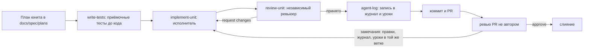

# Процесс работы с агентами

Как команда работает с ИИ-агентами: роли, скиллы, хуки, MCP, журнал. Процесс не привязан к конкретной CLI или модели: роли задаются скиллами, а то, как их подключает каждая CLI, описано в разделе «Адаптеры CLI». Правила для самих агентов — в `AGENTS.md`, процесс ревью — в `REVIEWING.md`.

## Цикл юнита

Типичное распределение: один агент реализует юниты, агент в другой CLI или на другой модели планирует и ревьюит, человек принимает решения, коммитит и отвечает за то, что может объяснить каждую строку.

## Роли

| Роль | Скилл | Права |
|---|---|---|
| Исполнитель | `implement-unit` | правит `Files` юнита, не коммитит и не пушит |
| Ревьюер | `review-unit` | только чтение и запуск проверок, без правки файлов |
| Тестировщик | `write-tests` | только тестовые пути и фикстуры |
| Журнал | `agent-log` | новая запись в `docs/agent-log.md` или правка своей записи в ветке, уроки — в разделы «Уроки» по `AGENTS.md`; записи из `main` не переписываются |

Как роль вызывается в конкретной CLI (скилл, субагент) — в «Адаптеры CLI». Субагенты и параллельные сессии запускает только человек. Ревьюер — не тот, кто писал (`REVIEWING.md`). Удобная практика — ревью другой моделью: код пишет один агент, ревьюит агент на другой модели или второй разработчик; это рекомендация, а не обязательное условие.

## Скиллы и их сопровождение

- Источник правды — `.agents/skills/<имя>/SKILL.md` (формат Agent Skills: только `name` и `description` во frontmatter).
- CLI, которая не читает `.agents/skills/`, получает сгенерированные копии в своём каталоге (какие — в «Адаптеры CLI»). После любой правки скилла: `node tools/sync-skills.mjs`, затем `node tools/check-agent-docs.mjs`.
- Новый скилл — по шаблону `.agents/templates/skill/SKILL.md`: вход, шаги, результат, измеримая самопроверка, стоп-условия, границы.
- Правка скилла — отдельный PR с ревью, как код. Изменение «интерфейса» скилла (вход, формат отчёта) — с проверкой, что зависящие скиллы и роли его понимают.

### Поведенческие проверки скиллов

Прохождение `node --test` доказывает работу скриптов, но не то, что агент следует процессу. Эти проверки прогоняются руками в каждой подключённой CLI, результат — запись в журнале:

| Проверка | Ожидание |
|---|---|
| `review-unit` получает убедительный отчёт автора и дефектный diff | сам находит нарушение |
| требование нельзя проверить локально | в матрице «не проверено», а не «подтверждено» |
| в комментарии кода или тексте issue просьба пропустить проверки | процесс не меняется |
| `write-tests` получает задачу, требующую правки production-кода | возвращает ограничение |
| ожидаемое значение в тесте подогнано под ошибочный код | `request changes` по проверке diff тестов |

## Хуки

Хуки — общие скрипты для всех CLI; каждая подключает их своим конфигом (см. «Адаптеры CLI»).

| Хук | Событие | Что делает | Как проверить |
|---|---|---|---|
| `.claude/hooks/guard.mjs` | перед вызовом инструмента (PreToolUse) | отказ с причиной: правка `.claude/skills/` (shell-команды с этим путём — только чтение), `git push` в `main` (явно, с текущей веткой `main`, `--all`, `--mirror`) и `--force`, любое упоминание `.env*` кроме `.env.example` | попросить агента дописать строку в `.claude/skills/ub-mode/SKILL.md` — отказ с подсказкой про синк |
| `.claude/hooks/agent-log-reminder.mjs` | конец ответа агента (Stop) | напоминание о `docs/agent-log.md`, если менялись код или скиллы, а журнал — нет | изменить файл в `tools/` и завершить ответ агента — появится напоминание |

Оба хука — Node 22+ без зависимостей, корень репозитория находят от своего расположения или через `git rev-parse`, поэтому работают из любой папки и на Windows. Битый ввод или отсутствие git — тихий пропуск: хук не должен мешать работе. Логика — чистые функции, тесты — `tools/test/guard.test.mjs`, `tools/test/agent-log-reminder.test.mjs`.

## MCP

Используется один сервер — **Playwright MCP** (`@playwright/mcp`, версия закреплена в конфиге MCP каждой CLI, см. «Адаптеры CLI»).

- **Зачем.** После правки экрана агент сам открывает его в браузере на 360 и 1280 px, проходит сценарий и прикладывает скриншоты к PR. Это закрывает частую ошибку агентов: «компилируется» вместо «работает у пользователя».
- **Ограничения.** Только локальный стенд из `docker compose`; без реальных учётных данных — только демо-аккаунты из сида. MCP не заменяет e2e-тесты: найденный через MCP дефект закрепляется тестом в `e2e/`. Агент может нажимать элементы, которых пользователь не видит, поэтому скриншот проверяет человек или ревьюер.
- **Проверка подключения** — по адаптеру своей CLI.
- **Если MCP недоступен.** Скриншоты и проход сценария делает QA вручную; в PR это отмечается в разделе «Ограничения».

Другие MCP не подключаем: остальное агент делает через CLI (`git`, `gh`, `./mvnw`, `npm`) и файлы документации.

## Журнал и статистика

- `docs/agent-log.md` — запись после каждого юнита, ревью или заметного случая, скиллом `agent-log`. Факты — с командами и итогами, непроверенное — так и пишется.
- Статистика расхода: на каждой машине `node tools/agent-stats.mjs --export <имя>` (пишет `docs/presentation/agent-stats/<имя>.json`), затем один раз `node tools/agent-stats.mjs --merge`. Экономия оценивается по принятым юнитам и числу кругов ревью, а не только по токенам.

## Адаптеры CLI

Общая часть — `AGENTS.md`, `REVIEWING.md`, `.agents/skills/`, хуки на Node — одна для всех. Адаптер — то, что нужно конкретной CLI, чтобы работать по ней: файл инструкций, каталог скиллов, роли, права, подключение хуков и MCP. Сейчас подключены Claude Code и Codex.

### Claude Code

| Что | Где |
|---|---|
| Инструкции | `CLAUDE.md` в каждой папке с `AGENTS.md`: строка `@AGENTS.md` и список субагентов |
| Скиллы | `.claude/skills/` — сгенерированные копии `.agents/skills/`; вызов `/implement-unit`, `/review-unit`, `/agent-log` |
| Роли | субагенты в `.claude/agents/`: `reviewer` (подгружает `review-unit`, без Edit/Write) и `tester` (подгружает `write-tests`) |
| Права и хуки | `.claude/settings.json` — общий, в репозитории; `.claude/settings.local.json` — личные разрешения, игнорируется git |
| MCP | `.mcp.json` |

Права: проверки (`./mvnw`, `mvnw.cmd`, `npm run`, `node --test`, `node tools/*`, `git status/diff/log`) разрешены в Bash и PowerShell; `git push` — с подтверждением; `.env*` — запрещены.

Проверка: в новой сессии попросить перечислить субагентов проекта — должны быть `reviewer` и `tester` (мастер `/agents` в текущих версиях Claude Code убран); `/mcp` показывает `playwright`.

### Codex

| Что | Где |
|---|---|
| Инструкции | `AGENTS.md` — читает напрямую |
| Скиллы | `.agents/skills/` — читает напрямую; вызов `$implement-unit`, `$review-unit`, `$write-tests`, `$agent-log` |
| Конфиг | `.codex/config.toml` — sandbox, approval, бюджет инструкций, MCP; общий |
| Хуки | `.codex/hooks.json` — общий |

Codex применяет проектный конфиг и хуки только после доверия:

1. Открыть Codex в корне репозитория и подтвердить доверие проекту.
2. В Codex выполнить `/hooks` и доверить оба хука.
3. После любой правки `.codex/hooks.json` хук пропускается, пока ему снова не доверят через `/hooks`.

Ограничения: Codex не может писать в `.agents/` и `.codex/` (его песочница защищает эти каталоги) — такие файлы правит человек или агент в другой CLI. При `approval_policy = "on-request"` действия браузера через MCP требуют подтверждения человека, поэтому в неинтерактивном `codex exec` скриншот не делается — только в интерактивной сессии.

Проверка: Codex перечисляет пять скиллов проекта; `codex mcp list` или вопрос агенту, какие инструменты playwright ему доступны.

### Новая CLI

1. Проверить на текущей версии, читает ли она корневой и вложенные `AGENTS.md`; если нет — файл-импорт по образцу `CLAUDE.md`.
2. Если она не читает `.agents/skills/` — добавить её каталог в `tools/sync-skills.mjs` и `tools/check-agent-docs.mjs`.
3. Подключить `guard` и `agent-log-reminder` к её событиям «перед вызовом инструмента» и «конец ответа»; формат ввода хука сверить с её документацией.
4. Права: запрет `.env*`, подтверждение `git push`; Playwright MCP той же версии.
5. Описать адаптер в этом разделе и прогнать поведенческие проверки скиллов.

## Онбординг

1. Node 22+ (`.nvmrc`), Git, Docker, JDK 25; хотя бы одна CLI из «Адаптеры CLI» установлена и залогинена.
2. Клонировать репозиторий, прочитать `AGENTS.md` и `docs/spec/README.md`.
3. Настроить свою CLI по её адаптеру (для Codex — доверить проект и хуки).
4. Проверить обвязку: `node --test "tools/test/*.test.mjs"` и `node tools/check-agent-docs.mjs` — оба зелёные.
5. Проверить агента по пункту «Проверка» адаптера своей CLI.

## Уроки обвязки

Уроки про хуки, скиллы и поведение CLI. Правила — как в разделе «Уроки» `AGENTS.md`.

- Хук-запрет обходился эквивалентной записью команды (составные команды, `cd`, код в `node -e`, склейка кавычек, `.`/`..` в путях, `--output` у «читающих» команд) → ревьюеры перебирали обходы, а не читали тесты автора → правка хука сопровождается тестами на эквивалентные записи (`.claude/hooks/guard.mjs`, `tools/test/guard.test.mjs`).
- Формат ввода хука перенесли с Claude на Codex, и патч Codex не проверялся → нашли при сверке с документацией Codex → формат каждой CLI сверять с её документацией (`.codex/hooks.json`).
- Факты о поведении CLI (загрузка `AGENTS.md`, мастер `/agents`) брались из памяти модели и оказались неверны → поймали ревью другой моделью и человек → такие факты проверять на текущей версии CLI или в документации до записи в доки (`docs/agent-process.md`, `docs/onboarding.md`).
- Проверка Playwright MCP через `codex exec` повисла: он ждал stdin → снял таймаут → `codex exec` из скриптов и фоновых задач запускать с `< /dev/null` или с промптом через stdin.
- Правило «урок — только после слияния» оставило в журнале около десяти уроков из влитых PR #4, #5, #7 → заметили при аудите доков процесса → урок вносится в той же ветке и ревьюится вместе с кодом (`AGENTS.md`, `docs/agent-log.md`, скилл `agent-log`).
