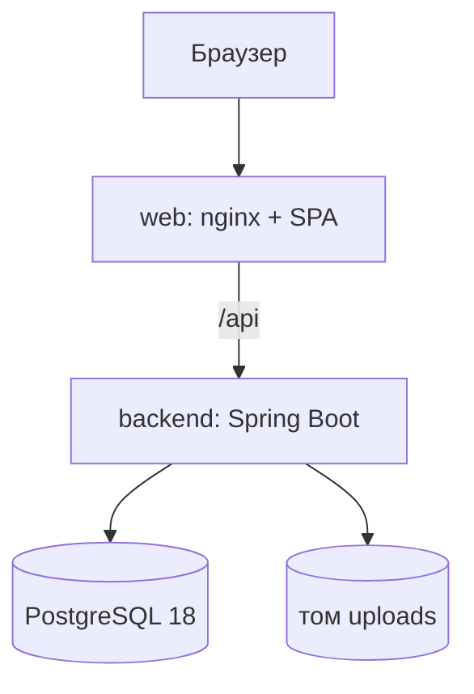
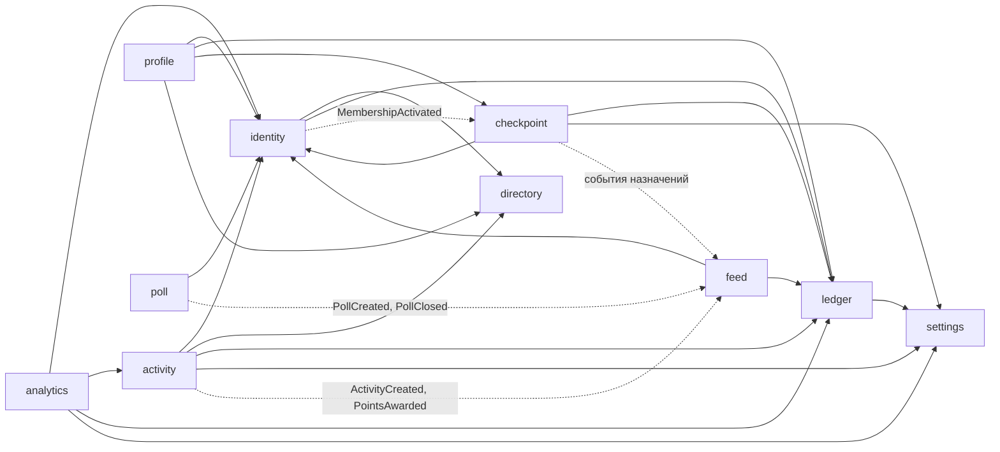
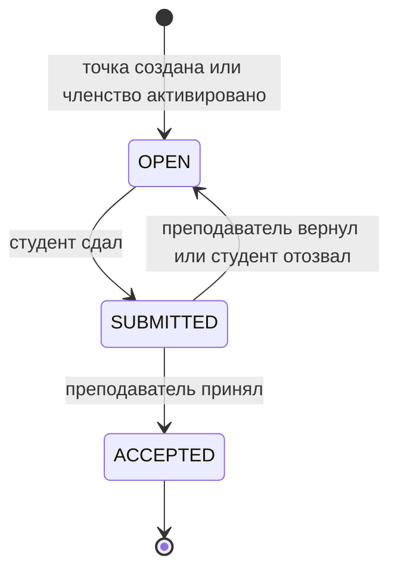

# Архитектура Campus Rating

Краткий обзор для защиты. Решения и их обоснование — в [мастер-плане](../spec/plans/2026-10-31-001-feat-campus-rating-mvp-plan.md#key-technical-decisions) (KTD) и [ADR](../spec/architecture-decisions/index.md); здесь — как они сложились в работающую систему.

## Стек

| Слой | Технологии |
|---|---|
| Backend | Java 25, Spring Boot 4.1, Spring Modulith, PostgreSQL 18, Liquibase |
| Frontend | React 19, Vite, TypeScript, Mantine, React Router, TanStack Query, `openapi-fetch` |
| Контракт | OpenAPI 3.1 в `docs/spec/api/openapi.yaml`, типы фронта генерирует `openapi-typescript`, моки — MSW |
| Тесты | JUnit и Testcontainers PostgreSQL, Vitest, Playwright |
| Запуск | Docker Compose: `postgres`, `backend`, `web` (nginx со сборкой SPA) |

## Развёртывание

Фронт и API отдаются с одного origin, поэтому вход — серверная сессия в HttpOnly-cookie с CSRF-токеном, без токенов в `localStorage` ([ADR003](../spec/architecture-decisions/adr003-server-sessions.md)). Профиль `demo` при каждом старте пересоздаёт схему, загружает демо-историю и очищает том файлов; профиль `prod` демо-данных не грузит и ничего не удаляет ([ADR008](../spec/architecture-decisions/adr008-run-modes-and-mail.md)).

## Модули backend

Модульный монолит: пакет на модуль, внутри — `api` (контроллеры и DTO), `domain` (чистые функции и типы), `internal` (репозитории и сервисы). Границы проверяет `ApplicationModules.verify()` — нарушение ломает сборку.

| Модуль | Ответственность | Состояние |
|---|---|---|
| `identity` | Регистрация, вход, подтверждение email, роли, членство в группе с подтверждением и старостами, допуск преподавателя и его доступные группы, пользователи администратора | реализован |
| `directory` | Факультеты, кафедры, группы | реализован |
| `settings` | Настройки с значениями по умолчанию из окружения | реализован |
| `ledger` | Журнал проводок АР, БУА, БОА и снимок балансов | реализован |
| `checkpoint` | Контрольные точки, назначения, сдача, приём, возврат, планировщик штрафов, начисление семестра | реализован |
| `activity` | Активности, запись, подтверждение участия, месячный бюджет преподавателя | реализован |
| `profile` | Сборка профиля и истории для чтения | реализован |
| `feed` | Лента наград, персональная лента событий, рейтинги групп | реализован |
| `poll` | Опросы: анонимные и именные, однократный голос, итоги, закрытие по сроку | реализован |
| `analytics` | Аналитика группы: начисления по датам и видам баллов, бюджет | реализован |
| `shared` | Технические порты: хранилище файлов, ошибки RFC 7807, `Clock`, режим почты | реализован |
| `admin`, `notification`, `ai` | Дополнительные модули P2–P4 | заготовки пакетов |

Сплошная стрелка — вызов API модуля, пунктир — доменное событие от издателя к подписчику через реестр публикаций Modulith в той же базе ([ADR005](../spec/architecture-decisions/adr005-module-events-outbox.md)). Так студент, чьё членство в группе подтвердили позже, получает назначения по уже созданным точкам, а `identity` о точках не знает. Схема собрана по импортам модулей в коде.

## Ключевые решения

- **Журнал проводок и снимок баланса** ([ADR001](../spec/architecture-decisions/adr001-ledger-with-balance-snapshot.md)). Любое изменение баллов — неизменяемая проводка с уникальным ключом идемпотентности; снимок баланса обновляется в той же транзакции, `CHECK` держит АР в 0…1000. Инвариант «снимок = сумма журнала» проверяют интеграционные тесты, включая `DemoStoryIT` на демо-данных.
- **Штраф по слотам** ([ADR002](../spec/architecture-decisions/adr002-penalty-slots.md)). Шаг и интервал копируются в точку при создании. Планировщик вычисляет текущий слот и пишет проводку с ключом `penalty:{assignmentId}:{slot}`; повторный проход и параллельный запуск безопасны благодаря ключу.
- **Хранимое состояние против вычисляемого статуса.** В базе — `OPEN`, `SUBMITTED`, `ACCEPTED`; «Просрочено» вычисляет чистая функция от состояния, дедлайна и `Clock`, поэтому статус не расходится с реальностью.
- **Единый порядок блокировок:** назначение, затем бюджет, затем баланс — без взаимных блокировок и гонки «штраф против сдачи».
- **Доступ преподавателя** ([ADR007](../spec/architecture-decisions/adr007-teacher-access.md)). Регистрация открыта, допуск — из списка почт или администратором; доступные группы считает одна функция `TeacherScope`, остальные модули её вызывают.
- **Contract-first** ([ADR004](../spec/architecture-decisions/adr004-api-contract-first.md)). Юнит сначала расширяет `openapi.yaml`, затем реализует. Фронт разрабатывается против моков MSW, backend сверяется с контрактом в `ContractCompatibilityIT`; ошибки — RFC 7807.
- **Схема — Liquibase formatted SQL** ([ADR006](../spec/architecture-decisions/adr006-liquibase.md)). Папка на модуль и `includeAll`: параллельные ветки не конфликтуют в master-changelog. Демо-данные — в контексте `demo`.

## Жизненный цикл назначения

Штраф возможен только в `OPEN` после дедлайна и не больше стоимости точки.

## Frontend

SPA на Mantine с темой «Редакция» ([ADR009](../spec/architecture-decisions/adr009-visual-style.md)): цвета, отступы и радиусы — только токены темы. Экраны собраны по [карте экранов](../spec/ux/) и сгруппированы по фичам в `frontend/src/features/` (`auth`, `tasks`, `activities`, `groups`, `polls`, `analytics`, `profile`, `feed`, `admin`). Клиент API типизирован из контракта, поэтому расхождение фронта с контрактом ловит компилятор.

## Качество

| Ворота | Где |
|---|---|
| Модульные тесты чистых доменных функций, интеграционные — на Testcontainers PostgreSQL | `mvnw verify` |
| JaCoCo ≥ 80 % строк и CRAP ≤ 10 для `*.domain`; PMD CPD | `mvnw verify`, `tools/crap.mjs` |
| PIT ≥ 70 % для `ledger.domain`, `checkpoint.domain`, `activity.domain`, `poll.domain` | `mvnw -Pquality verify` |
| Линт контракта и свежесть сгенерированных типов | CI |
| Lint, typecheck и Vitest фронта | `npm --prefix frontend run check` |
| e2e Playwright против compose-стека: регистрация, штраф по точке, бюджет активности, лента | CI, `e2e/tests/base/` |

Всё перечисленное запускает CI на каждом PR.

## Работа с агентами

Правила — в `AGENTS.md` и вложенных `AGENTS.md`, процесс — в [agent-process.md](../agent-process.md). Юнит идёт по циклу: план → приёмочные тесты отдельной сессией → реализация скиллом `implement-unit` → независимое ревью `review-unit` с повтором проверок → запись в [журнал](../agent-log.md). Запреты (пуш в `main`, `.env`, правка сгенерированных скиллов) закреплены хуком, а не только текстом. Статистика токенов и стоимости — в [agent-stats.md](agent-stats.md).
