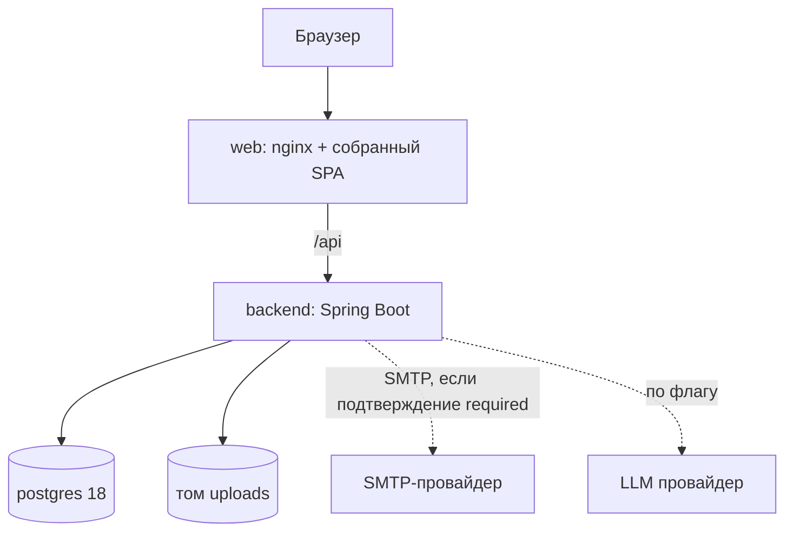
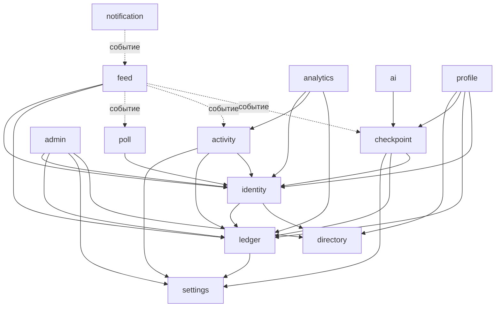
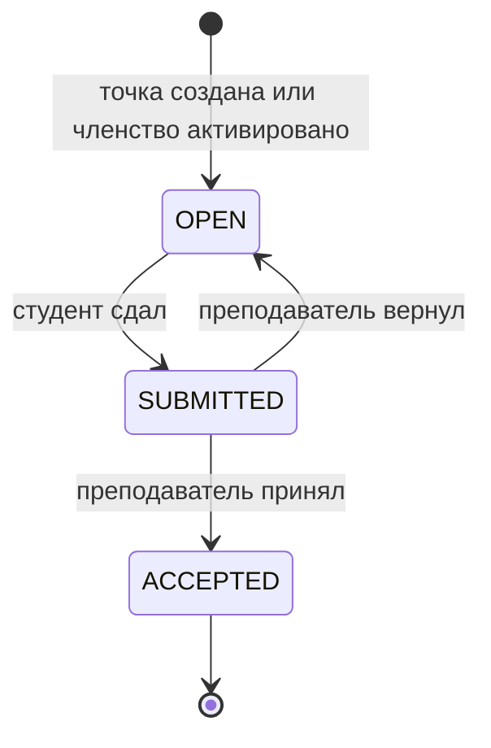
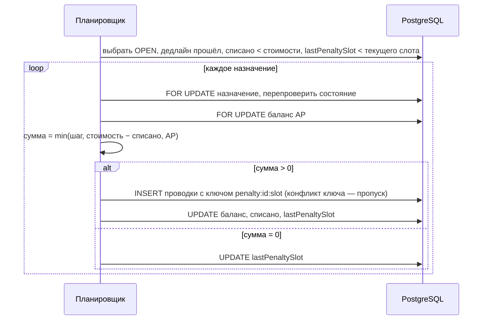
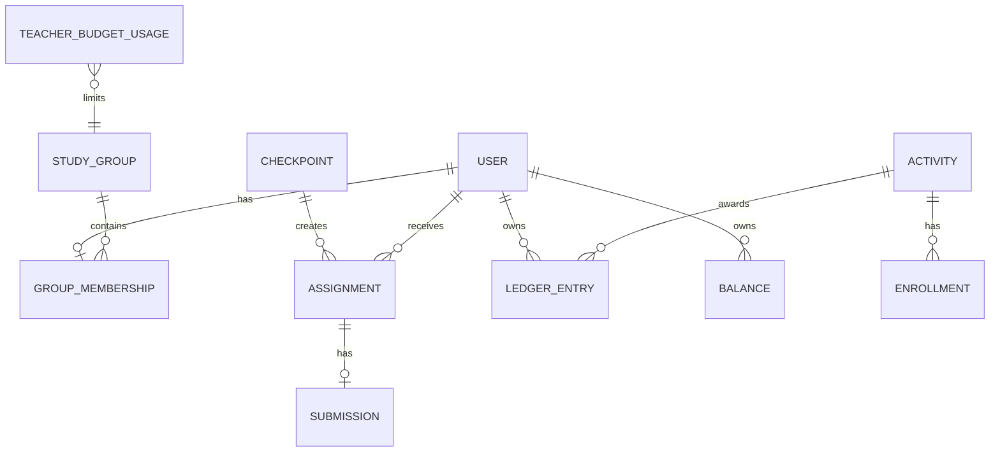

# Campus Rating MVP - Plan

## Goal Capsule

- **Цель.** MVP университетской соцсети по ТЗ хакатона 2026 (`docs/spec/source/hackathon-task-2026.pdf`): академический рейтинг, баллы активности, ленты и выбранные доп. модули. Проект поднимается `docker compose up`, а агентский процесс оформлен как артефакты репозитория. Сдача — 12.11.2026, защита — 19.11.2026.
- **Иерархия источников.** Требования (R) решают продуктовое поведение. Решения (KTD) решают механизм в рамках своих R. Юнит не переопределяет ни R, ни KTD. Термины — только из `docs/spec/glossary.md`. ТЗ — первоисточник; там, где спека закрывает дыру ТЗ, действует спека.
- **Профиль исполнения.** Код юнита пишет Codex, Claude (или второй разработчик) делает ревью, сам гоняет проверки и коммитит (KTD16). Принципы `ub-mode` обязательны, доменная логика пишется test-first.
- **Остановись и спроси команду, если:**
  - юнит требует изменить R или KTD;
  - нужно ослабить инвариант журнала проводок (KTD3);
  - тест можно сделать зелёным только моком базы или реального времени;
  - работа выходит за `Files` юнита больше чем на смежный файл.
- **Хвост.** Каждый юнит — короткая ветка и PR в `main` с ревью. Прямых пушей в `main` нет. Приоритеты при нехватке времени — KTD20.

---

## Product Contract

### Summary

Веб-приложение, где преподаватели создают контрольные точки и активности, система автоматически списывает академический рейтинг за просрочки и начисляет баллы активности в пределах бюджетов, а студенты видят свой прогресс в профиле и лентах. Поверх базы — админка, персональная лента, подтверждение регистрации, опросы, аналитика, уведомления и в последнюю очередь ИИ-черновик задания.

### Problem Frame

ТЗ задаёт механику мотивации: штраф за просрочку и положительное подкрепление за активность. Но в нём есть дыры, которые агент закрыл бы догадкой: возобновление штрафа после возврата, бюджет «на группу», запись на учебные активности, студенты, пришедшие посреди семестра, поведение при простое сервера. Жюри оценивает не только продукт (базовая часть, доп. модули, UI), но и агентский процесс (25%) и умение объяснить каждое решение. Поэтому спека закрывает дыры явными требованиями с числовыми примерами и фиксирует архитектурные решения с обоснованием.

### Actors

- A1. Студент — регистрируется, сдаёт работы, записывается на активности, голосует.
- A2. Преподаватель — создаёт контрольные точки, активности и опросы, принимает работы, начисляет баллы в пределах бюджета.
- A3. Администратор — ведёт справочники, список преподавателей и их дополнительные группы, семестры, настройки, импорт (модуль 8).
- A4. Староста — студент, подтверждающий членство в своей группе (модуль 7).
- A5. Планировщик — системные фоновые задачи: штрафы, начисление семестра, напоминания.
- A6. Жюри — открывает демо после `docker compose up` с сид-данными или на сервере команды (U22).

### Requirements

**Доступ и справочники (база)**

- R1. Студент регистрируется по email и паролю, указывает ФИО, факультет и группу из справочника; группы фильтруются по факультету.
- R2. Преподаватель регистрируется по email и паролю, указывает ФИО и кафедру из справочника. Регистрация преподавателем возможна только с email из списка преподавателей, который ведёт администратор; иначе — отказ «Этой почты нет в списке преподавателей, обратитесь к администратору». Email из списка не регистрируется студентом. Роль задаётся один раз при регистрации.
- R3. Все страницы, кроме входа, регистрации и подтверждения email, требуют входа; права зависят от роли (`Role`) и принадлежности ресурса.
  - Доступные группы преподавателя — группы факультета его кафедры плюс группы, выданные администратором. Точки, активности и опросы создаются только для доступных групп; рейтинги, бюджеты и аналитика видны только по ним.
  - Преподаватель меняет только свои точки, активности и опросы; студент — только свои назначения и записи.
  - Материалы сдачи (ссылка, файл) и комментарий возврата видят студент-владелец, автор точки и администратор (только чтение).
  - Детальную статистику опроса видит только его автор (R35).
- R4. Справочники факультетов, групп и кафедр загружаются автоматически при первом запуске; демо-пользователи (почты демо-преподавателей — вместе со списком преподавателей) — в режиме demo (R47).

**Профиль (модуль 1)**

- R5. Профиль любого пользователя открыт всем вошедшим. Профиль студента показывает ФИО, факультет, группу, АР, БУА, БОА, историю проводок, активные и завершённые задачи. В чужом профиле задача — это название точки, дедлайн, статус и списанный штраф, без перехода к сдаче (R3).
- R6. Запись истории показывает дату, знаковую сумму с валютой, причину и автора; для начислений формат такой: `[Дата] - [+50 БОА] - «Помощь в организации конференции» от [ФИО преподавателя]`.

**Академический рейтинг (модуль 2)**

- R7. Преподаватель создаёт контрольную точку: название, описание, одна или несколько доступных групп (R3), дедлайн (дата и время), стоимость (целое > 0). Назначения создаются всем студентам выбранных групп с активным членством; у пары (точка, студент) не больше одного назначения. Шаг и интервал штрафа фиксируются в точке при её создании из текущих настроек.
- R8. При регистрации студент получает 1000 АР.
- R9. С началом семестра каждому зарегистрированному студенту (независимо от состояния членства) один раз начисляется N АР (настройка, по умолчанию 200) со срезкой до 1000. Факт обработки пары (семестр, студент) сохраняется, даже если начисление дало 0.
- R10. Студент сдаёт работу (ссылка или файл) из состояния `OPEN`, в том числе после дедлайна; сдача останавливает штрафы.
- R11. Пока назначение в `OPEN` и текущее время строго позже дедлайна, за каждый слот штрафа списывается `min(шаг, стоимость − уже списано по назначению, текущий АР)`. Если сумма равна 0, проводки нет. Шаг и интервал берутся из точки (R7); значения по умолчанию в настройках — 20 АР и 1 минута. Изменение настроек действует на новые точки.
- R12. В потолок стоимости точки идёт фактически списанное. Возврат на доработку не обнуляет уже списанное.
- R13. Пропущенные из-за простоя сервера слоты задним числом не списываются.
- R14. Страница точки у преподавателя показывает назначенных студентов со статусами. Преподаватель принимает одно или несколько назначений в `SUBMITTED` за раз или возвращает назначение с комментарием в `OPEN`; после дедлайна штрафы при этом возобновляются.
- R15. Студент видит свои задачи с дедлайнами и статусами «В процессе», «Сдано на проверку», «Просрочено», «Принято».
- R16. Студент, чьё членство стало активным, получает назначения по точкам своей группы, у которых дедлайн ещё не прошёл.

**Баллы активности (модуль 3)**

- R17. Преподаватель создаёт активность: название, описание, тип (`ACADEMIC` даёт БУА, `SOCIAL` даёт БОА), целевые группы из доступных (R3), дата и время начала, максимум баллов (целое ≥ 2, чтобы любой уровень давал хотя бы 1 балл). Студенты целевых групп видят её и максимум заранее.
- R18. Студент записывается на `SOCIAL`-активность и может отменить запись до времени начала. На `ACADEMIC`-активности записи нет.
- R19. После времени начала создатель активности подтверждает участников и уровень (25/50/75/100 %). Для `SOCIAL` участниками могут быть только записавшиеся, для `ACADEMIC` — любые студенты целевых групп. Начисление равно `round_half_up(максимум × уровень / 100)`, не больше одного на студента и активность.
- R20. Бюджет преподавателя — лимит на пару (преподаватель, группа) за календарный месяц по Europe/Moscow (настройка, по умолчанию 1000), общий для БУА и БОА. Подтверждение, превышающее остаток хотя бы одной группы, отклоняется целиком, с остатками в ответе.
- R21. Преподаватель видит остаток бюджета по доступным группам, историю и статистику своих начислений.
- R22. Преподаватель видит рейтинг студентов доступных групп по АР, БУА и БОА с сортировкой.

**Лента наград (модуль 4)**

- R23. Публичная лента наград для всех вошедших: студент, сумма с валютой, активность, преподаватель, дата. Новые сверху, постраничная прокрутка.

**Администрирование (модуль 8, приоритет P1)**

- R24. Администратор ведёт справочники факультетов, групп и кафедр (кафедра принадлежит факультету), список преподавателей и дополнительные группы преподавателя (R3), а также просматривает материалы сдачи (только чтение).
- R25. Администратор импортирует группы, студентов и список преподавателей из CSV или XLSX и получает отчёт: сколько создано, какие строки отклонены и почему.
- R26. Администратор ведёт семестры (дата начала; начисление R9 срабатывает при её наступлении или по кнопке «начать сейчас») и настройки: шаг и интервал штрафа, N семестра, лимит бюджета.
- R27. Администратор назначает старосту группы.

**Персональная лента (модуль 6, P1)**

- R28. События студента: новая задача для группы; до дедлайна меньше 24 часов (один раз на назначение); работу приняли или вернули; начислены баллы; для группы создан опрос или активность.
- R29. События преподавателя: студент сдал работу; созданный им опрос завершился.
- R30. Событие — блок с иконкой, текстом и временем, новые сверху.

**Подтверждение регистрации (модуль 7, P2)**

- R31. Вход возможен только после подтверждения email по ссылке из письма. Подтверждение — явная настройка стенда «обязательно / выключено» (R48), без значения по умолчанию; в режиме prod выключить нельзя.
- R32. Членство студента в группе подтверждает любой преподаватель или староста этой группы. До подтверждения студенту не создаются назначения и не начисляются баллы активности (`ACTIVITY_AWARD`). Стартовые 1000 АР (R8) и начисление семестра (R9) от подтверждения не зависят.

**Опросы (модуль 5, P2)**

- R33. Преподаватель создаёт опрос: название, описание, дата окончания, целевые группы из доступных (R3), признак анонимности, один или несколько вопросов типа `SINGLE` или `MULTIPLE`.
- R34. Студент целевой группы голосует один раз до даты окончания и после голосования видит агрегированную статистику.
- R35. Автор опроса видит детальную статистику; в неанонимном опросе — по студентам. Другим преподавателям и администратору детальная статистика недоступна. В анонимном опросе связь «студент — выбор» отсутствует в прикладной схеме, API и логах. Защита от администратора БД, имеющего доступ к системным полям PostgreSQL, не заявляется.

**Аналитика (модуль 10, P2)**

- R36. Преподаватель видит динамику среднего АР по группе по дням, рейтинги по БУА и БОА и расход бюджета по месяцам.

**Уведомления (модуль 9, P3)**

- R37. Email-уведомления о приближении дедлайна, приёме работы, начислении баллов и новой активности; пользователь включает и выключает их. Доставка «хотя бы один раз»: после сбоя возможен дубль письма, однократность не гарантируется.

**ИИ-функция (модуль 11, P4)**

- R38. Преподаватель получает черновик описания контрольной точки по нескольким тезисам. Без ключа API функция скрыта, приложение работает.

**Нефункциональные**

- R39. `docker compose up` из чистого клона поднимает всё приложение с сид-данными без ручных шагов (режим demo).
- R40. Интерфейс на русском, адаптивный от ширины 360 px.
- R41. Время хранится в UTC и показывается в Europe/Moscow; месяц бюджета считается по Europe/Moscow.
- R42. Логика рейтинга и баллов покрыта модульными тестами, основные сценарии — e2e.
- R47. Два режима запуска. Demo: синтетический сид; при каждом запуске база и файлы сдач пересоздаются, поэтому всё, что создано поверх сида, исчезает; на форме регистрации — пометка «Демо-стенд, данные удаляются». Prod: без сида, данные сохраняются между запусками.
- R48. Почта — только реальный SMTP-провайдер с отправкой от домена команды; локального почтового ящика (Mailpit) нет. Стенд без SMTP (локальный `docker compose up`, в том числе у жюри) явно запускается с выключенным подтверждением email: аккаунт активен сразу, письма не отправляются, ссылка установки пароля импортированного студента пишется в лог backend, на форме регистрации — пометка «Подтверждение email на этом стенде выключено». Если подтверждение обязательно, а SMTP не настроен, backend не стартует.

**Агентский процесс**

- R43. В репозитории есть `AGENTS.md` (и `CLAUDE.md` для Claude Code): контекст, архитектура, соглашения, запуск и тесты.
- R44. В `docs/spec/` лежат требования, архитектура и разбивка на задачи, написанные до основной разработки.
- R45. Роли ревьюера и тестировщика доступны в обеих CLI: общими скиллами (Claude Code и Codex) и субагентами Claude Code. Используемые MCP-серверы описаны: зачем, какой сценарий, ограничения, как проверить подключение.
- R46. `docs/agent-log.md` ведётся по шаблону: что поручили, где агент ошибся, как обнаружили и исправили, что сработало.

### Acceptance Examples

Во всех примерах шаг 20 АР и интервал 1 минута, если не сказано иное.

- AE1. Базовое списание.
  - **Covers:** R11
  - **Given:** АР 1000, точка стоимостью 60 с дедлайном 12:00, работа не сдана.
  - **When:** планировщик проходит в 12:00:00, 12:00:01, 12:01:01, 12:02:01 и 12:03:01.
  - **Then:** в 12:00:00 списания нет (дедлайн ещё не прошёл, статус «В процессе»). Затем три проводки по −20 (слоты 0, 1, 2), в 12:03:01 списаний нет, АР 940.
- AE2. Сдача останавливает штраф.
  - **Covers:** R10, R11
  - **Given:** как в AE1.
  - **When:** студент сдаёт в 12:01:30.
  - **Then:** списано 40 (слоты 0 и 1), дальше списаний нет, статус «Сдано на проверку».
- AE3. Возврат возобновляет штраф с общим потолком.
  - **Covers:** R12, R14
  - **Given:** АР 1000, стоимость 100; сдано в 12:01:30 после двух штрафов; после возврата планировщик проходит раньше 12:06:00.
  - **When:** в 12:05:10 преподаватель возвращает работу.
  - **Then:** −20 за слот 5 при ближайшем проходе планировщика, затем за слоты 6 и 7. Итого списано 100, дальше списаний нет, АР 900.
- AE4. Пол рейтинга.
  - **Covers:** R11, R12
  - **Given:** АР 10, стоимость 100.
  - **When:** наступает слот 0, затем слот 1.
  - **Then:** проводка −10 в слоте 0, в слоте 1 проводки нет. После начисления семестра +200 следующий слот списывает −20, всего по точке списано 30.
- AE5. Срезка начисления семестра.
  - **Covers:** R9
  - **Given:** у студента A АР 900, у студента B АР 1000, N = 200.
  - **When:** начинается семестр.
  - **Then:** A получает +100 (АР 1000), у B проводки нет. После штрафа B до 980 повторный запуск начисления того же семестра ничего не меняет: B остаётся с 980.
- AE6. Двойной запуск планировщика.
  - **Covers:** R11
  - **Given:** просроченное назначение в слоте 3.
  - **When:** два прохода планировщика выполняются одновременно.
  - **Then:** за слот 3 ровно одна проводка.
- AE7. Простой сервера.
  - **Covers:** R13
  - **Given:** дедлайн 12:00, сервер лежит с 12:00:30 до 12:05:30.
  - **When:** сервер поднимается.
  - **Then:** списан слот 0 (до падения) и слот 5. Слоты 1–4 не списаны.
- AE8. Бюджет отклоняет подтверждение целиком.
  - **Covers:** R20
  - **Given:** лимит 1000, преподаватель в ноябре уже начислил группе ИВТ-21 950 баллов.
  - **When:** он подтверждает двух студентов ИВТ-21 на 50 % от максимума 100.
  - **Then:** подтверждение отклонено, остаток 50 показан, проводок нет. В декабре остаток снова 1000.
- AE9. Округление уровня.
  - **Covers:** R19
  - **Given:** максимум 75.
  - **When:** подтверждён уровень 50 %.
  - **Then:** начислено 38.
- AE10. Запись на общественную активность.
  - **Covers:** R18, R19
  - **Given:** `SOCIAL`-активность, студент не записан.
  - **When:** преподаватель пытается подтвердить его участие.
  - **Then:** отказ с указанием студента; для `ACADEMIC`-активности то же подтверждение проходит.
- AE11. Новичок в группе.
  - **Covers:** R16
  - **Given:** у группы точка A с дедлайном вчера и точка B с дедлайном завтра.
  - **When:** членство студента становится активным.
  - **Then:** у него есть назначение только по точке B.

### Scope Boundaries

- Проводки не редактируются и не удаляются. Исправление ошибочного начисления сторнирующей проводкой — отложено.
- У пользователя одна роль. Перевод студента между группами — отложен.
- Обновление данных — опросом через TanStack Query, без WebSocket.
- Нет мобильных приложений и SSO вуза.
- Только синтетические данные. Прод-режим (R47) технически есть, но реальные персональные данные требуют согласия на обработку, политики и срока хранения — это вне MVP.

#### Deferred to Follow-Up Work

- Реальные персональные данные в прод-режиме: согласие, политика, срок хранения и порядок удаления.
- Привязка преподавателя к конкретным группам по расписанию (сейчас — факультет плюс ручная выдача, R3).
- Telegram-канал уведомлений (модуль 9 закрывается email-каналом).
- OTel-телеметрия агентов и дашборд (журнал агентов ведётся в md, KTD16).
- Объектное хранилище файлов вместо тома (порт под это есть, KTD12).
- ShedLock или db-scheduler для нескольких инстансов backend (KTD19).

---

## Planning Contract

### Key Technical Decisions

- KTD1. **Стек: Java 25, Spring Boot 4.1, PostgreSQL 18, React 19 + Vite + TypeScript + Mantine, Playwright.** Boot 4 — это Jackson 3 (`tools.jackson`), модульные стартеры (`spring-boot-starter-webmvc`, `spring-boot-starter-liquibase`) и `@MockitoBean` вместо `@MockBean`; агентам это указано в `backend/AGENTS.md`, потому что обучающие данные моделей в основном про Boot 3. Версии зависимостей задаёт BOM Boot; Spring Modulith и Spring AI подключаются своими BOM. (session-settled: user-directed — chosen over PHP: основной стек команды и готовые практики Spring.)
- KTD2. **Модульный монолит на Spring Modulith, пакеты по фичам.** Модули: `identity`, `directory`, `ledger`, `checkpoint`, `activity`, `profile`, `feed`, `poll`, `admin`, `notification`, `analytics`, `ai`, `settings`, плюс `shared` для технических портов (хранилище файлов, ошибки). `profile` — модуль-сборщик для чтения: он зависит от `identity`, `ledger` и `checkpoint`, поэтому они не зависят друг от друга по кругу. Тест `ApplicationModules.verify()` ломает сборку при нарушении границ — так агент не размоет архитектуру. Внутри модуля: `api` (контроллеры и DTO), `domain` (чистые функции и типы), `internal` (репозитории и сервисы).
- KTD3. **Журнал проводок плюс снимок баланса в одной транзакции.** Проводка неизменяема и имеет уникальный `idempotencyKey`. Таблица балансов `(студент, валюта)` обновляется в той же транзакции, что и проводка, и имеет `CHECK` на 0…1000 для АР. Чтение баланса и рейтингов идёт только из снимка. Инвариант «снимок = сумма журнала» проверяется интеграционным тестом и эндпоинтом сверки для админа. Цена: записи по одному студенту выполняются последовательно, а любое изменение баланса в обход `LedgerApi` ломает инвариант — поэтому запись в таблицы журнала и балансов закрыта границей модуля. (session-settled: user-approved — chosen over полей баланса с отдельной историей и над чистым `SUM` по журналу: идемпотентность и единый источник истории без цены на чтение.) Подробнее — ADR001 (`docs/spec/architecture-decisions/adr001-ledger-with-balance-snapshot.md`).
- KTD4. **Штраф по слотам с параметрами, зафиксированными в точке.** Шаг и интервал копируются в точку при создании, поэтому смена настроек не сдвигает нумерацию слотов уже идущих точек. Планировщик раз в `penalty.poll-period` (по умолчанию 1 с; выборка идёт по индексу и дешёвая) обрабатывает назначения в `OPEN` с прошедшим дедлайном и недобранным потолком. Для каждого он вычисляет текущий слот и пишет проводку с ключом `penalty:{assignmentId}:{slot}`. Обрабатывается только текущий слот, этим реализован R13. Поле `lastPenaltySlot` у назначения обновляется и при нулевой сумме: слот считается обработанным, поэтому пополнение АР внутри того же слота штраф за него не даёт (AE4). Гарантия однократности проводки — уникальный ключ. Минимальный интервал при создании точки — 2 × poll-period. Цена: простой сервера играет в пользу студентов; это осознанный выбор (R13), а не дефект. Подробнее — ADR002 (`docs/spec/architecture-decisions/adr002-penalty-slots.md`).
- KTD5. **Блокировки в одном порядке: назначение, затем бюджет, затем баланс.** Сдача, приём, возврат и штраф берут `SELECT … FOR UPDATE` назначения. Начисление по активности берёт строки бюджета `(преподаватель, группа, месяц)` по возрастанию id группы. Баланс всегда блокируется последним — внутри `LedgerApi`, который вызывается последним шагом транзакции. Несколько балансов в одной транзакции блокируются по возрастанию id студента. Единый порядок исключает взаимные блокировки, а повторная проверка состояния под блокировкой исключает гонку «штраф против сдачи».
- KTD6. **Время через `Clock`.** Весь код берёт время из инжектируемого `Clock`; тесты двигают фиксированные часы. Хранение в `timestamptz` (UTC), зона приложения `Europe/Moscow` (R41).
- KTD7. **Хранимое состояние против вычисляемого статуса.** В базе хранится `AssignmentState` (`OPEN`, `SUBMITTED`, `ACCEPTED`). Статус для UI вычисляет чистая функция от состояния, дедлайна и времени, поэтому статус «Просрочено» не может разойтись с реальностью.
- KTD8. **Аутентификация: серверная сессия в HttpOnly-cookie плюс CSRF-токен.** Фронт и API отдаются с одного origin через nginx. Сессию нельзя украсть через XSS из `localStorage`, её можно отозвать, и не нужна схема обновления токенов. Пароли — BCrypt. Цена: сессии живут в памяти backend, после рестарта пользователи входят заново; для нескольких инстансов понадобится Spring Session JDBC. Подробнее — ADR003 (`docs/spec/architecture-decisions/adr003-server-sessions.md`).
- KTD9. **API contract-first.** Владелец контракта — `docs/spec/api/openapi.yaml`, ошибки в формате RFC 7807 `ProblemDetail`.
  - Фронт генерирует типы через `openapi-typescript` и разрабатывает экраны против моков MSW до готовности backend.
  - Backend проверяется тестом совместимости springdoc-вывода с контрактом; инструмент выбирается в U3, кандидат — `openapi-diff`.
  - Каждый юнит сначала расширяет контракт, потом реализует его. Подробнее — ADR004 (`docs/spec/architecture-decisions/adr004-api-contract-first.md`).
- KTD10. **Настройки в таблице `settings` со значениями по умолчанию из конфигурации.** Читаются при каждом использовании, поэтому изменения админа действуют без рестарта (для штрафа — на новые точки, KTD4). Значения по умолчанию задаются переменными окружения; e2e-стек ускоряет штрафы через `docker-compose.e2e.yml`, без API админки.
- KTD11. **Побочные эффекты — через доменные события Modulith с реестром публикаций (outbox).** Персональная лента, уведомления и напоминания слушают события (`@ApplicationModuleListener`) и не вызываются напрямую из модуля-источника. Событие не теряется при падении слушателя, а модули не знают друг о друге. Цена: лента и уведомления согласованы с задержкой (доли секунды), а таблицу реестра публикаций нужно чистить от завершённых записей. Подробнее — ADR005 (`docs/spec/architecture-decisions/adr005-module-events-outbox.md`).
- KTD12. **Файлы сдачи — на томе Docker через порт `FileStorage`.** Лимит 10 МБ и белый список типов (pdf, docx, zip, png, jpg). Порт позволяет позже заменить том на S3 без изменения доменного кода. Цена: том не разделяется между инстансами и не попадает в дамп базы.
- KTD13. **Схема — Liquibase в формате formatted SQL.**
  - Changeset'ы лежат в `db/changelog/<module>/<yyyyMMddHHmm>-<desc>.sql` с id `<автор>:<метка>`. Master-changelog подключает папки модулей через `includeAll` в порядке зависимостей (`settings`, `directory`, `identity`, `ledger`, `checkpoint`, `activity`, `feed`, `poll`, `admin`, `notification`, затем `demo`). Новый файл master не трогает, поэтому параллельные ветки не конфликтуют. Liquibase применяет любой ещё не применённый changeset независимо от того, в каком порядке ветки влиты.
  - Демо-данные помечены `context: demo`; compose запускает backend с этим контекстом, тесты — без него. Справочные данные — `runOnChange`. Демо-пароли видны только в README.
  - Применённый changeset не редактируется (контрольная сумма), исправление — новым changeset'ом. Тесты на Testcontainers и CI всегда накатывают changelog на пустую базу, поэтому сломанная история обнаруживается сразу, а не на чужой машине.
  - (session-settled: user-directed — chosen over Flyway: порядок применения не зависит от порядка слияния веток, контексты для сида, откат при необходимости.) Подробнее — ADR006 (`docs/spec/architecture-decisions/adr006-liquibase.md`).
- KTD14. **Анонимность опроса на уровне схемы.** Голос анонимного опроса хранится без автора, а отдельная запись `PollParticipation` запрещает повторное голосование. Гарантия ограничена приложением (R35): API, логи и прикладная схема не связывают автора с выбором.
- KTD15. **Пирамида тестов и пороги.**
  - Чистые доменные функции (штраф, срезки, бюджет, статус) — модульные тесты.
  - Всё, что касается транзакций и SQL, — интеграционные тесты на Testcontainers PostgreSQL с первого коммита (мок `JdbcTemplate` не видит транзакций и ограничений).
  - Пороги: JaCoCo ≥ 80% строк и CRAP ≤ 10 на метод — для всех `*.domain`; PIT ≥ 70% убитых мутантов — для `ledger.domain`, `checkpoint.domain`, `activity.domain`. Дублирование — PMD CPD.
  - e2e — Playwright против compose-стека.
- KTD16. **Агентский процесс.**
  - `AGENTS.md` — единый источник правил. `CLAUDE.md` импортирует его строкой `@AGENTS.md` в каждой папке с вложенным `AGENTS.md`.
  - Скиллы лежат по стандарту Agent Skills в `.agents/skills/` (их читает Codex), в `.claude/skills/` — сгенерированные копии с проверкой расхождений. Симлинки не используются: в команде есть Windows. Хуки и служебные скрипты обвязки написаны на Node, который есть у всех участников.
  - Codex реализует юнит, ревьюер (субагент `reviewer` или человек) проверяет diff против плана, проверки гоняются заново, коммит делает человек или Claude.
  - Журнал — `docs/agent-log.md` по шаблону, хук `Stop` напоминает о записи. Статистику даёт `ccusage` по локальным журналам сессий.
  - Для доменных юнитов приёмочные тесты пишет отдельная сессия до реализации, и исполнитель их не меняет; критичные запреты (пуш в `main`, правка сгенерированных файлов, `.env`) закреплены хуком, а не только текстом. Детали — план U1.
  - Автор PR обязан понимать и уметь объяснить каждую строку своего diff, даже если её написал агент: «это написал агент» на защите не принимается. Правило закреплено в `REVIEWING.md` и шаблоне PR.
  - Значимые решения дублируются ADR в `docs/spec/architecture-decisions/` (контекст, решение, последствия включая отрицательные, статус). Изменение решения — новый ADR со статусом `supersedes` и правка KTD в плане тем же PR; старый ADR не удаляется.
  - (session-settled: user-approved — chosen over OTel-телеметрии: жюри оценивает выводы команды, а не метрики, и OTel требует инфраструктуры на трёх машинах.)
- KTD17. **Проверка данных на входе.** Bean Validation на DTO и парсинг в доменные типы в контроллере. Внутри домена данные считаются валидными, некорректные состояния невыразимы типами (`ub-mode`).
- KTD18. **Ленты и история — keyset-пагинация** по `(created_at, id)`, без `OFFSET`.
- KTD19. **Планировщик — `@Scheduled` без распределённой блокировки.** В compose один инстанс backend. Даже параллельный запуск безопасен благодаря ключам идемпотентности KTD3/KTD4, поэтому ShedLock не добавляем.
- KTD20. **Приоритеты.** P0 — база (модули 1–4) и агентская обвязка; P1 — модули 8 и 6; P2 — 7, 5, 10; P3 — 9; P4 — 11. Юнит следующего приоритета не начинается, пока юниты предыдущего не зелёные. Исключение — параллельная работа второго разработчика. (session-settled: user-directed — chosen over «все доп. модули одинаково обязательны».)
- KTD21. **ИИ — Spring AI 2.0 с OpenAI-совместимым провайдером за флагом.** Ключ, URL и модель задаются через окружение; без ключа эндпоинт отвечает 404, а кнопка скрыта. Промпт лежит в ресурсах и покрыт тестом с заглушкой модели.
- KTD22. **Режимы запуска и почта через профили Spring.** Профиль `demo` (по умолчанию в `docker-compose.yml`) включает контекст Liquibase `demo` и `spring.liquibase.drop-first`, а `FileStorage` очищает том при старте: каждый запуск даёт чистый синтетический стенд (R47). Профиль `prod` не загружает демо-данные и ничего не удаляет. Почта — `spring.mail.*` из окружения, только SMTP-провайдер; Mailpit не используется (R48). Подтверждение email — обязательная настройка `campus.mail.email-verification` (`required` или `off`) без значения по умолчанию: без неё backend не стартует; `required` без `spring.mail.host` и `off` в профиле `prod` тоже останавливают старт. `docker-compose.yml` явно задаёт `off`, `docker-compose.server.yml` — `required` и SMTP. Цена: перепутанный профиль на проде стирает данные — поэтому `drop-first` включается только в `demo`, а серверный override явно задаёт профиль и проверяется тестом конфигурации. Подробнее — ADR008 (`docs/spec/architecture-decisions/adr008-run-modes-and-mail.md`).
- KTD23. **Доступ преподавателя: список почт и доступные группы.** Список преподавателей (`TeacherAllowlist`) и выдачи групп (`TeacherGroupGrant`) живут в `identity`. Регистрация `TEACHER` проверяет email по списку без учёта регистра. Доступные группы считает одна функция `identity` (`TeacherScope`: группы факультета кафедры ∪ выданные); `checkpoint`, `activity`, `poll`, `feed` и `analytics` вызывают её и не дублируют правило. Проверка владельца ресурса (R3) остаётся отдельной. Цена: смена кафедры или выдачи меняет доступ сразу, уже созданные точки и активности остаются у автора. (session-settled: user-directed — chosen over открытой саморегистрации на закрытом стенде и над ручным подтверждением каждого преподавателя.) Подробнее — ADR007 (`docs/spec/architecture-decisions/adr007-teacher-access.md`).

### High-Level Technical Design

**Развёртывание (compose)**

**Модули backend и направления зависимостей**

Сплошная стрелка — вызов API модуля, пунктир — подписка на его события (KTD11).

**Жизненный цикл назначения**

Отображаемый статус (KTD7): `ACCEPTED` → «Принято»; `SUBMITTED` → «Сдано на проверку»; `OPEN` и время ≤ дедлайна → «В процессе»; `OPEN` и время > дедлайна → «Просрочено». Штраф возможен только в `OPEN` после дедлайна.

**Проход планировщика штрафов**

**Ядро данных**

### Assumptions

Непроверенные допущения; каждое подтверждается или снимается в указанном юните.

- `pitest-junit5-plugin` работает с JUnit 6 из BOM Boot 4.1 — проверка в U2.
- `openapi-diff` (или аналог) сравнивает springdoc-вывод Boot 4 с контрактом — выбор в U3.
- `ccusage` корректно считает сессии Codex (поддержка экспериментальная) — проверка в U1.
- Claude Code у всех участников понимает импорт `@AGENTS.md` во вложенных `CLAUDE.md` — проверка в U1.

### Sequencing and Team Lanes

| Фаза | Даты | Юниты | Выход |
|---|---|---|---|
| 0. Фундамент | 31.10–03.11 | U1, U2, U3, U4, U21a | Пустое приложение поднимается compose, CI зелёный, контракт базы готов, UX-карта согласована |
| 1. База (P0) | 03.11–07.11 | U21b, U21c, U5–U12 | Тема и шаблоны страниц, модули 1–4 работают, e2e базы зелёные |
| 2. Доп. модули | 06.11–10.11 | U13–U18 | P1, затем P2, затем P3 |
| 3. Финиш | 10.11–12.11 | U19, U22, U20 | ИИ-функция, стенд на сервере, демо-сценарий, заморозка 11.11, сдача 12.11 |

- **Разработчик A:** U2 (backend, compose, CI), U4, U6, U7, U8, U13, U17, U19, U22 — ядро учёта и рейтинга, backend и frontend своих модулей.
- **Разработчик B:** U2 (frontend), U21 (UX и дизайн-система), U3, U5, U9, U10, U11, U14, U15, U16, U18 — контракт, доступ, активности, ленты.
- **QA:** U1 вместе с обоими, проверки каждого юнита, тест-план и e2e (U12 и e2e в каждом юните), журнал агентов, демо-сценарий U20. QA — финальный ревьюер «работает ли сценарий», а не только «зелёные ли тесты».

Критическая цепочка базы — U6 → U5 → U7 → U8 → U12. Ориентиры: U6 — 0,5 дня, U5 — 1 день, U7 — 1,5 дня, U8 — 1 день, U12 — 1 день, итого 5 дней с 03.11 при резерве 0,5 дня (старт сдвинут на день: фаза 0 закрывается позже). U9–U11 идут параллельно у разработчика B после U5. Если к вечеру 07.11 цепочка не зелёная, P2 и ниже сдвигаются, а не сжимаются.

### Risks and Dependencies

| Риск | Митигация |
|---|---|
| Агенты пишут под Boot 3 и Jackson 2 | Явные правила в `backend/AGENTS.md`, ревьюер проверяет импорты, сборка падает на `com.fasterxml.jackson.databind` |
| `pitest-junit5-plugin` с JUnit 6 не проверен | Смоук PIT в U2; при несовместимости PIT запускается на JUnit 5 platform через профиль или порог мутаций становится отчётом, а не воротами |
| Гонка «штраф против сдачи», взаимоблокировки | KTD5 и интеграционный тест с двумя параллельными транзакциями (U8) |
| Нестабильные e2e на штрафах из-за реального времени | e2e-стек `docker-compose.e2e.yml` задаёт интервал 4 с и poll-period 1 с; ожидания — опросом состояния, а не `sleep` |
| Не хватит времени на доп. модули | KTD20; каждый юнит закрывается целиком, недоделанных модулей в `main` нет |
| Профиль `demo` на проде стирает данные (KTD22) | `drop-first` только в `demo`; серверный override явно задаёт профиль; тест конфигурации U22 |
| Агент расходится со спекой | Ревьюер сверяет diff с R/KTD юнита; найденные расхождения пишутся в журнал агентов |

---

## Implementation Units

Юниты этого плана — эпики. Перед стартом крупного юнита (U1, U2, U6, U7, U8, U9, U13, U15, U16) пишется отдельный план юнита в `docs/spec/plans/` по текущему коду. Он ссылается на R/KTD/AE этого плана и не переопределяет их. Если выясняется, что R или KTD неверны, правка идёт сюда отдельным PR. Остальные юниты исполняются прямо по этому плану. `ce-brainstorm` применяется только там, где продуктовое «что» не решено: UX и дизайн-система экранов (U21, до первых экранов U5 и U7) и ИИ-функция U19.

| U | Юнит | Ключевые пути | Зависит от |
|---|---|---|---|
| U1 | Агентская обвязка | `AGENTS.md`, `.agents/skills/`, `.claude/`, `.codex/`, `docs/agent-log.md` | — |
| U2 | Скелет монорепо и compose | `backend/`, `frontend/`, `e2e/`, `docker-compose.yml`, `.github/workflows/` | U1 |
| U3 | API-контракт базы | `docs/spec/api/openapi.yaml`, `frontend/src/api/` | U2 |
| U4 | Справочники, настройки, сид | `backend/.../directory`, `.../settings`, `db/changelog` | U2 |
| U5 | Регистрация и вход | `backend/.../identity`, `frontend/src/features/auth` | U3, U4, U6 |
| U6 | Журнал проводок | `backend/.../ledger` | U4 |
| U7 | Контрольные точки и сдача | `backend/.../checkpoint`, `frontend/src/features/tasks` | U5, U6 |
| U8 | Планировщик штрафов и семестр | `backend/.../checkpoint/internal`, `.../ledger` | U7 |
| U9 | Активности и бюджеты | `backend/.../activity`, `frontend/src/features/activities` | U5, U6 |
| U10 | Профиль и история | `backend/.../profile`, `frontend/src/features/profile` | U6, U7 |
| U11 | Лента наград и рейтинги групп | `backend/.../feed`, `frontend/src/features/feed` | U9 |
| U12 | Тест-план и e2e базы | `docs/spec/test-plan.md`, `e2e/tests/base/` | U7–U11 |
| U13 | Администрирование | `backend/.../admin`, `frontend/src/features/admin` | U4, U8 |
| U14 | Персональная лента | `backend/.../feed`, `frontend/src/features/feed` | U11 |
| U15 | Подтверждение email и членства | `backend/.../identity`, `frontend/src/features/auth` | U5, U13 |
| U16 | Опросы | `backend/.../poll`, `frontend/src/features/polls` | U5 |
| U17 | Аналитика преподавателя | `backend/.../analytics`, `frontend/src/features/analytics` | U6, U9 |
| U18 | Уведомления | `backend/.../notification` | U14 |
| U19 | ИИ-черновик задания | `backend/.../ai`, `frontend/src/features/tasks` | U7 |
| U20 | Демо и сдача | `README.md`, `db/changelog/demo`, `docs/presentation/` | все выбранные |
| U21 | UX-карта и дизайн-система | `docs/spec/ux/`, `frontend/src/theme/`, `frontend/src/app/` | U21a — нет; U21c — U2 |
| U22 | Стенд на сервере | `docker-compose.server.yml`, `deploy/`, `docs/deploy.md` | U2, U15 |

Пути backend сокращены: `backend/.../<module>` означает `backend/src/main/java/ru/campusrating/<module>/`, тесты — зеркально в `backend/src/test/java/ru/campusrating/<module>/`.

### U1. Агентская обвязка

- **Goal.** Агенты обеих CLI получают одинаковые правила, скиллы и процесс до первой строки кода.
- **Requirements.** R43, R45, R46; KTD16.
- **Dependencies.** нет.
- **Files:**
  - `AGENTS.md`, `CLAUDE.md`, `backend/AGENTS.md`, `backend/CLAUDE.md`, `frontend/AGENTS.md`, `frontend/CLAUDE.md`, `e2e/AGENTS.md`, `e2e/CLAUDE.md`;
  - `.agents/skills/ub-mode/SKILL.md`, `.agents/skills/implement-unit/SKILL.md`, `.agents/skills/review-unit/SKILL.md`, `.agents/skills/write-tests/SKILL.md`, `.agents/skills/agent-log/SKILL.md`, `.claude/skills/*` (сгенерированные копии);
  - `.claude/agents/reviewer.md`, `.claude/agents/tester.md`, `.claude/settings.json`, `.claude/hooks/agent-log-reminder.mjs`, `.codex/config.toml`, `.codex/hooks.json`;
  - `.mcp.json`, `docs/agent-process.md`, `docs/agent-log.md`, `tools/agent-stats.mjs`, `tools/sync-skills.mjs`, `tools/check-agent-docs.mjs`, `tools/test/`, `.gitattributes`, `.nvmrc`, `docs/spec/README.md`;
  - `REVIEWING.md`, `.github/PULL_REQUEST_TEMPLATE.md`, `docs/spec/architecture-decisions/adr000-template.md`, `docs/spec/architecture-decisions/index.md`, ADR для KTD3, KTD4, KTD8, KTD9, KTD11, KTD13. Детальный план юнита — `docs/spec/plans/2026-10-31-002-feat-u1-agent-harness-plan.md`.
- **Approach:**
  1. Корневой `AGENTS.md` (до ~8 КБ, лимит Codex — 32 КиБ на всю цепочку): цель проекта и ссылка на этот план, карта репозитория, команды из Verification Contract, соглашения по коду, коммитам и ветвлению, запреты, цикл «юнит → ревью → коммит», ссылка на глоссарий. Вложенные `AGENTS.md` добавляют специфику стека: Boot 4 и Jackson 3 и Modulith для backend, Mantine и TanStack Query и сгенерированные типы для frontend, Playwright для e2e.
  2. Каждый `CLAUDE.md` — строка `@AGENTS.md` плюс то, что нужно только Claude (список субагентов).
  3. Соглашения о коммитах:
     - Conventional Commits с областью-модулем, например `feat(checkpoint): …`;
     - тело отвечает на «зачем, что изменилось, чем доказано» и ссылается на U-ID и R-ID;
     - ветка на юнит `u<N>-<slug>`, мелкие коммиты, слияние в `main` только через PR с ревью;
     - без трейлеров об авторстве ИИ: участие агентов фиксирует журнал.
  4. `ub-mode` — принципы «сначала заставь работать, потом сделай правильно, следуй практике» с адаптацией под Java: crapper — CRAP по JaCoCo (`crap4java` или `tools/crap.py`), dryer — PMD CPD, mutator — PIT. Остальные принципы без изменений.
  5. `implement-unit`: прочитать юнит и его R/KTD/AE, сначала расширить контракт, писать test-first, прогнать ворота, подготовить запись журнала. `review-unit`: сверка diff с R/KTD и Files юнита, Boot-4-ловушки, границы модулей, тест «прошёл бы тест, если бы функция вернула пустоту».
  6. Роли:
     - Общие скиллы `review-unit` и `write-tests` — это роли для обеих CLI, в Codex они вызываются как `$review-unit` и `$write-tests`.
     - Субагенты Claude `reviewer` и `tester` подгружают эти скиллы. У `reviewer` нет инструментов Edit и Write, только чтение и запуск проверок. Изменения `tester` ограничены тестовыми путями; это проверяет ревью diff.
     - Каждый скилл описан как цепочка «вход → шаги → результат → измеримая проверка». Например, `review-unit`: прочитать U/R/KTD/AE → проверить diff и границы → прогнать проверки → записать замечания с `file:line` → вынести решение → передать вывод для журнала.
     - Справочные детали (ловушки Boot 4, чек-лист Spring) вынесены в `references/` скилла, чтобы основной текст был коротким.
     - `REVIEWING.md` — решения ревьюера (`approve`, `request changes`) и обязательные проверки. Шаблон PR содержит: U/R/AE, результат для пользователя, выполненные проверки, скриншоты UI, запись журнала, незакрытые ограничения, отметку «автор понимает весь diff».
  7. Хук `Stop`: если в рабочем дереве есть изменения кода, а `docs/agent-log.md` не менялся, выводится неблокирующее `systemMessage`. Проверка `stop_hook_active` защищает от цикла. Аналогичный хук описан для Codex.
  8. `.mcp.json`: Playwright MCP. В `docs/agent-process.md` для него описаны:
     - сценарий — агент после правки экрана открывает его на 360 px и 1280 px и прикладывает скриншоты к PR;
     - ограничения — только локальный стенд, без реальных учётных данных;
     - проверка подключения в Claude Code и Codex;
     - что делать, если MCP недоступен (ручная проверка QA).

     Там же: где общие настройки, а где персональные; что делает хук и как проверить его срабатывание; какие инструменты разрешены ролям.
  9. `docs/agent-log.md`: шаблон записи (дата, кто, агент и модель, юнит, поручение, результат, ошибка агента, как обнаружили, исправление, урок, коммит) и первая запись — сессия написания этой спеки.
  10. `tools/agent-stats.mjs` вызывает `ccusage` для Claude и Codex и сводит таблицу для презентации.
- **Patterns to follow.** Формат Agent Skills (`name`, `description`, markdown-тело) — без Claude-специфичных полей в общих скиллах.
- **Test scenarios:**
  - Codex в `backend/` подхватывает корневой и backend `AGENTS.md` (проверка вопросом «какая версия Jackson в проекте»).
  - Claude Code видит скиллы `ub-mode`, `implement-unit`, `review-unit`, `write-tests`, `agent-log` и субагентов `reviewer`, `tester`; Codex видит те же скиллы.
  - Хук: изменён `.java`, журнал не тронут — напоминание появляется. Журнал изменён — напоминания нет. Повторный `Stop` с `stop_hook_active` не зацикливается.
  - `tools/agent-stats.mjs` на машине без сессий завершается понятным сообщением, а не трассой.
  - Сквозной прогон и негативный сценарий ревью проверяются на первых реальных юнитах: мастер-U2 и мастер-U6.
- **Verification.** Новый участник клонирует репо и по `AGENTS.md` за 10 минут понимает, как взять юнит в работу; оба агента подтверждают загрузку правил.

### U2. Скелет монорепо и compose

- **Goal.** `docker compose up` поднимает пустые backend, frontend и Postgres, а CI гоняет все ворота.
- **Requirements.** R39, R42; KTD1, KTD2, KTD6, KTD15.
- **Dependencies.** U1.
- **Files:**
  - `docker-compose.yml`, `docker-compose.e2e.yml`, `.env.example`, `backend/Dockerfile`, `frontend/Dockerfile`, `frontend/nginx.conf`;
  - `backend/pom.xml`, `backend/mvnw`, `backend/src/main/java/ru/campusrating/CampusRatingApplication.java`, `backend/src/main/resources/application.yml`, `backend/src/main/resources/db/changelog/db.changelog-master.yaml`;
  - `backend/src/test/java/ru/campusrating/ModularityTest.java`, `backend/src/test/java/ru/campusrating/support/PostgresIntegrationTest.java`, `backend/src/test/java/ru/campusrating/SmokeIT.java`;
  - `frontend/package.json`, `frontend/vite.config.ts`, `frontend/src/main.tsx`, `frontend/src/app/AppShell.tsx`;
  - `e2e/package.json`, `e2e/playwright.config.ts`, `e2e/tests/smoke.spec.ts`;
  - `tools/crap.py`, `.github/workflows/ci.yml`, `.gitignore`, `README.md`.
- **Approach:**
  1. Compose: `postgres` с healthcheck; `backend` с `depends_on: condition: service_healthy` и профилем `demo` (KTD22: контекст `demo` и `drop-first`); `web` (nginx отдаёт SPA и проксирует `/api`); том `uploads`; Mailpit нет, `EMAIL_VERIFICATION=off` задан явно (R48). Образы зафиксированы по версиям, сборка внутри Dockerfile (`npm ci`, `mvnw package`).
  2. Maven: Boot parent 4.1.x, BOM Modulith и Spring AI, плагины JaCoCo (check на `*.domain`), PMD CPD, PIT в профиле `quality`. Surefire для unit-тестов, Failsafe для `*IT`.
  3. Базовый класс интеграционных тестов с Testcontainers PostgreSQL 18 и бином `Clock`, который тест может сдвигать.
  4. Frontend: Vite + TS, Mantine AppShell с адаптивной навигацией (боковая панель на десктопе, нижняя на мобильном), React Router, TanStack Query, Vitest.
  5. CI: backend `verify`, frontend `check` и `build`, compose-смоук и e2e на каждый PR.
- **Execution note.** Это в основном конфигурация: первое доказательство — смоук `docker compose up` и CI, а не unit-тесты.
- **Test scenarios:**
  - `ModularityTest` проходит на пустых модулях и падает, если модуль `ledger` импортирует `internal` модуля `checkpoint`.
  - `SmokeIT` поднимает контекст на Testcontainers, `/actuator/health` возвращает UP.
  - e2e-смоук открывает главную страницу через nginx и видит форму входа.
  - Смоук PIT на одном тривиальном доменном классе подтверждает совместимость с JUnit 6.
  - Юнит выполнен через `implement-unit` → `review-unit` → `agent-log`: есть diff, ревью с решением и запись журнала. Это первый сквозной прогон скиллов U1.
  - Повторный `docker compose up` в профиле `demo` снова даёт только сид: пользователь, созданный между запусками, исчезает (R47).
  - `MailModeConfigTest`: без `campus.mail.email-verification` контекст не поднимается; `required` без `spring.mail.host` — не поднимается; `off` в профиле `prod` — не поднимается (R48).
  - Changeset из пустой папки модуля, добавленный в двух ветках с разными метками, применяется в любом порядке слияния; changeset с `context: demo` не применяется в тестах.
- **Verification.** Чистый клон → `docker compose up` → приложение открывается на `http://localhost:8080`; CI зелёный. `docker-compose.e2e.yml` переопределяет значения по умолчанию для штрафа (интервал 4 с, poll-period 1 с); e2e-стек запускается отдельным проектом compose с чистым томом командой из Verification Contract, Playwright стеком не управляет.

### U3. API-контракт базы

- **Goal.** Контракт модулей 1–4 готов, чтобы backend и frontend шли параллельно.
- **Requirements.** R1–R23; KTD9, KTD17, KTD18.
- **Dependencies.** U2.
- **Files:** `docs/spec/api/openapi.yaml`, `frontend/src/api/schema.d.ts` (генерируется), `frontend/src/api/client.ts`, `frontend/src/mocks/handlers.ts`, `backend/src/test/java/ru/campusrating/ContractCompatibilityIT.java`.
- **Approach:**
  1. Ресурсы `/api/v1`: `auth`, `directory`, `users/{id}/profile`, `me/assignments`, `checkpoints`, `checkpoints/{id}/assignments`, `assignments/{id}/submission`, `activities`, `activities/{id}/enrollment`, `activities/{id}/participation`, `budgets`, `groups/{id}/ratings`, `feed/awards`, `ledger/{userId}/entries`.
  2. Единый `ProblemDetail` с полем `code` для доменных ошибок (`BUDGET_EXCEEDED`, `NOT_ENROLLED`, `INVALID_STATE`), cursor-пагинация.
  3. Скрипт `npm run api:gen` генерирует типы, MSW-моки отвечают примерами из контракта.
  4. Тест совместимости сравнивает springdoc-вывод с контрактом; инструмент выбирается здесь, кандидат — `openapi-diff`.
- **Test scenarios:**
  - Контракт валиден (линтер OpenAPI в CI).
  - Тест совместимости падает, если контроллер переименовал поле контракта.
  - Frontend компилируется против сгенерированных типов, MSW отдаёт пример профиля.
- **Verification.** Оба разработчика подтверждают, что по контракту можно делать свою сторону без вопросов.

### U4. Справочники, настройки, сид

- **Goal.** Справочники, настройки и демо-данные есть в базе после старта.
- **Requirements.** R4, R39; KTD10, KTD13.
- **Dependencies.** U2.
- **Files:**
  - `backend/src/main/resources/db/changelog/directory/<ts>-directory.sql`, `backend/src/main/resources/db/changelog/settings/<ts>-settings.sql`, `backend/src/main/resources/db/changelog/demo/<ts>-demo-directory.sql`;
  - `backend/.../directory/`, `backend/.../settings/`;
  - `backend/src/test/java/ru/campusrating/directory/DirectoryApiIT.java`, `backend/src/test/java/ru/campusrating/settings/SettingsTest.java`.
- **Approach.** Таблицы `faculty`, `study_group`, `department` (у каждой уникальный `code` для импорта; кафедра ссылается на факультет — от этого зависят доступные группы, KTD23) и `settings` (ключ, значение, тип). Типизированный доступ к настройкам с значениями по умолчанию из `application.yml`. Демо-сид идемпотентен (`ON CONFLICT DO NOTHING`) и помечен `context: demo`.
- **Test scenarios:**
  - `GET /directory/faculties/{id}/groups` возвращает только группы факультета.
  - Настройка, отсутствующая в таблице, возвращает значение по умолчанию; изменённая — новое значение без рестарта.
  - Повторный запуск демо-сида не создаёт дублей.
- **Verification.** После `docker compose up` справочники отдаются API (`DirectoryApiIT` и ручной запрос); форма регистрации появится в U5.

### U5. Регистрация и вход

- **Goal.** Студент и преподаватель регистрируются и входят, роли ограничивают доступ.
- **Requirements.** R1, R2, R3, R8; KTD8, KTD17, KTD23.
- **Dependencies.** U3, U4, U6.
- **Files:**
  - `backend/.../identity/` (пользователь, членство, регистрация, `SecurityConfig`, `TeacherAllowlist`, `TeacherScope`);
  - `backend/src/main/resources/db/changelog/identity/<ts>-identity.sql`, `backend/src/main/resources/db/changelog/demo/<ts>-demo-users.sql`;
  - `frontend/src/features/auth/` (вход, регистрация с выбором факультета и группы);
  - `backend/src/test/java/ru/campusrating/identity/RegistrationIT.java`, `frontend/src/features/auth/RegisterForm.test.tsx`.
- **Approach.** Регистрация студента создаёт пользователя и членство: `ACTIVE`, пока нет U15, затем `PENDING`. Модуль публикует событие `MembershipActivated`, на которое подписан U7 (R16), а начальные 1000 АР начисляет вызовом `ledger` (U6). CSRF-cookie для SPA, сессия в HttpOnly-cookie. Список преподавателей и выдачи групп — таблицы `identity` (KTD23); до U13 список наполняет демо-сид. `TeacherScope` — публичный API модуля для остальных модулей.
- **Test scenarios:**
  - Регистрация студента с валидными данными создаёт пользователя, членство и проводку `INITIAL` +1000.
  - Повторный email отклоняется с понятной ошибкой поля.
  - Регистрация преподавателя с кафедрой и email из списка создаёт пользователя с ролью `TEACHER` без проводок; без кафедры — ошибка поля.
  - Email не из списка — отказ регистрации преподавателем; email из списка — отказ регистрации студентом; регистр букв в email не влияет.
  - `TeacherScope`: группы факультета кафедры плюс выданные; группа другого факультета без выдачи — не входит.
  - Группа не того факультета отклоняется.
  - Студент не может открыть `POST /checkpoints` (403), преподаватель может.
  - Запрос без CSRF-токена на изменение отклоняется.
  - Форма регистрации: при смене факультета список групп обновляется.
- **Verification.** U5 создаёт идемпотентный сид демо-студента, преподавателя и администратора с корректными балансами; они входят, выход завершает сессию. Полную демо-историю добавляет U20.

### U6. Журнал проводок

- **Goal.** Все три валюты меняются только через журнал с идемпотентностью и снимком баланса.
- **Requirements.** R5, R6, R8, R9, R11; KTD3, KTD5.
- **Dependencies.** U4.
- **Files:**
  - `backend/.../ledger/domain/` (`Currency`, `EntryKind`, `LedgerEntry`, `BalanceRules`);
  - `backend/.../ledger/internal/`, `backend/.../ledger/LedgerApi.java`;
  - `backend/src/main/resources/db/changelog/ledger/<ts>-ledger.sql`;
  - `backend/src/test/java/ru/campusrating/ledger/BalanceRulesTest.java`, `backend/src/test/java/ru/campusrating/ledger/LedgerIT.java`.
- **Approach.** Единственная операция записи: «провести» (студент, валюта, вид, номинальная сумма, источник, автор, ключ). Под блокировкой баланса чистая функция `BalanceRules` вычисляет фактическую сумму со срезкой для АР; нулевую проводку не пишет; конфликт ключа возвращает уже существующую проводку. Плюс эндпоинт сверки инварианта для админа.
- **Execution note.** Test-first: сначала `BalanceRulesTest` на срезки, затем `LedgerIT` на транзакции и гонки.
- **Test scenarios:**
  - Covers AE5. Начисление +200 при АР 900 даёт +100, при АР 1000 проводки нет.
  - Штраф −20 при АР 10 даёт −10, при АР 0 проводки нет.
  - Повторная проводка с тем же ключом не меняет баланс и возвращает исходную проводку.
  - Covers AE6. Две параллельные транзакции с одним ключом дают одну проводку.
  - Сбой после вставки проводки откатывает и проводку, и баланс.
  - Инвариант «снимок = сумма журнала» держится после 1000 случайных операций.
  - Негативный сценарий ревью: в учебной ветке баланс меняется в обход `LedgerApi`, и `review-unit` выносит `request changes` со ссылкой на KTD3.
  - `CHECK` в базе отвергает АР 1001, даже если обойти доменный код.
- **Verification.** Мутационный порог `ledger.domain` пройден, сверка инварианта на демо-данных пустая.

### U7. Контрольные точки и сдача

- **Goal.** Полный цикл точки без автоштрафа: создание, назначения, сдача, приём, возврат, статусы.
- **Requirements.** R7, R10, R14, R15, R16; KTD5, KTD7, KTD12.
- **Dependencies.** U5, U6.
- **Files:**
  - `backend/.../checkpoint/domain/` (`AssignmentState`, `AssignmentStatusPolicy`);
  - `backend/.../checkpoint/internal/`, `backend/.../checkpoint/api/`, `backend/.../shared/storage/FileStorage.java`;
  - `backend/src/main/resources/db/changelog/checkpoint/<ts>-checkpoint.sql`;
  - `frontend/src/features/tasks/` (мои задачи, сдача, страница точки у преподавателя с массовым приёмом);
  - `backend/src/test/java/ru/campusrating/checkpoint/AssignmentStatusPolicyTest.java`, `backend/src/test/java/ru/campusrating/checkpoint/CheckpointIT.java`, `frontend/src/features/tasks/TaskList.test.tsx`.
- **Approach.** Переходы состояний — методы доменного типа, недопустимый переход — доменная ошибка `INVALID_STATE`. Массовый приём обрабатывает назначения по возрастанию id (KTD5) и возвращает, какие приняты, а какие пропущены. Подписка на `MembershipActivated` создаёт назначения по R16. Встречная сверка закрывает гонку с активацией: после фиксации точки слушатель `CheckpointCreated` создаёт недостающие назначения всем активным студентам групп; уникальность пары (точка, студент) делает обе сверки безопасными.
- **Test scenarios:**
  - Статус: `OPEN` до дедлайна — «В процессе», после — «Просрочено»; `SUBMITTED` — «Сдано на проверку» при любом времени.
  - Создание точки на две группы создаёт назначения всем активным студентам обеих групп и никому из `PENDING`.
  - Сдача из `OPEN` со ссылкой проходит; повторная сдача из `SUBMITTED` — `INVALID_STATE`.
  - Файл 11 МБ или `.exe` отклоняется.
  - Массовый приём трёх назначений, одно из которых в `OPEN`: два приняты, одно в списке пропущенных.
  - Возврат с комментарием переводит в `OPEN`, комментарий виден студенту.
  - Covers AE11. Активация членства создаёт назначение только по точке с будущим дедлайном.
  - Гонка: точка создаётся и членство активируется параллельно (барьеры в тесте); при любом чередовании у студента ровно одно назначение по точке.
  - Студент не видит чужие назначения; преподаватель не принимает работы по чужой точке.
  - Создание точки для группы вне доступных (KTD23) — 403.
  - Материалы сдачи: другой студент — 403; автор точки и администратор — чтение; администратор не может принять или вернуть.
  - В профиле `demo` том файлов очищается при старте (KTD22).
- **Verification.** Сценарий «создал → сдал → вернул → сдал → принял» проходит руками на демо-данных и на мобильной ширине.

### U8. Планировщик штрафов и начисление семестра

- **Goal.** АР списывается и начисляется автоматически, идемпотентно и без гонок.
- **Requirements.** R9, R11, R12, R13; KTD4, KTD5, KTD19.
- **Dependencies.** U7.
- **Files:**
  - `backend/.../checkpoint/domain/PenaltyPolicy.java`, `backend/.../checkpoint/internal/PenaltyJob.java`;
  - `backend/.../ledger/internal/SemesterAccrualJob.java`, `backend/src/main/resources/db/changelog/ledger/<ts>-semester.sql`;
  - `backend/src/test/java/ru/campusrating/checkpoint/PenaltyPolicyTest.java`, `backend/src/test/java/ru/campusrating/checkpoint/PenaltyJobIT.java`, `backend/src/test/java/ru/campusrating/ledger/SemesterAccrualIT.java`.
- **Approach.** `PenaltyPolicy` — чистая функция: (дедлайн, время, интервал, шаг, стоимость, уже списано, АР, последний слот) → решение «слот и сумма или ничего». Job выбирает кандидатов, обрабатывает каждого в своей транзакции по KTD5 и пишет через `LedgerApi`. Начисление семестра пишет строку обработки `(semesterId, studentId, начислено)` с уникальностью пары — в той же транзакции, что и проводку, и даже при начислении 0 (R9). Обработка идёт батчами.
- **Execution note.** Test-first по AE1–AE7: каждый AE — тест с подвижным `Clock`.
- **Test scenarios:**
  - Covers AE1. Три слота по −20, на четвёртом списаний нет.
  - Covers AE2. Сдача между слотами останавливает списание.
  - Covers AE3. Возврат после дедлайна списывает текущий слот при ближайшем проходе, потолок общий.
  - Covers AE4. Пол 0 и возобновление после начисления семестра.
  - Covers AE6. Два параллельных прохода job дают одну проводку на слот.
  - Covers AE7. После «простоя» (часы сдвинуты на 5 интервалов) списывается только текущий слот.
  - Гонка: сдача и проход job одновременно — либо штраф и `SUBMITTED`, либо только `SUBMITTED`; списания после сдачи нет.
  - Изменение интервала и шага в настройках не меняет расписание уже созданной точки и применяется к новым точкам; интервал меньше 2 × poll-period отклоняется при создании точки.
  - Covers AE5. АР 1000 → начисление семестра 0 → штраф −20 → повторный запуск того же семестра оставляет 980.
  - Время ровно равно дедлайну: штрафа нет, статус «В процессе».
  - Границы слота: за 1 мс до `deadline + interval` — слот 0, ровно на границе и после — слот 1.
  - Нулевой штраф обрабатывает слот: АР 0 в слоте 2 → начисление семестра в том же слоте → проводки за слот 2 нет, следующий слот списывает.
  - Возврат внутри слота, оплаченного до сдачи: повторной проводки за этот слот нет (уникальный ключ).
- **Verification.** Демо: точка с дедлайном через 2 минуты, на экране видно поминутное падение АР и остановка на потолке.

### U9. Активности и бюджеты

- **Goal.** Полный цикл активности с записью, подтверждением уровней и бюджетом.
- **Requirements.** R17–R21; KTD3, KTD5.
- **Dependencies.** U5, U6.
- **Files:**
  - `backend/.../activity/domain/` (`ParticipationLevel`, `AwardCalculator`, `BudgetPolicy`);
  - `backend/.../activity/internal/`, `backend/.../activity/api/`, `backend/src/main/resources/db/changelog/activity/<ts>-activity.sql`;
  - `frontend/src/features/activities/` (список, создание, запись, подтверждение участия, бюджет);
  - `backend/src/test/java/ru/campusrating/activity/AwardCalculatorTest.java`, `backend/src/test/java/ru/campusrating/activity/BudgetPolicyTest.java`, `backend/src/test/java/ru/campusrating/activity/ActivityIT.java`.
- **Approach.** Подтверждение — одна транзакция:
  1. Валидировать участников по R19.
  2. Рассчитать суммы.
  3. Сгруппировать по группе студента.
  4. Заблокировать строки бюджета по возрастанию id группы (KTD5). Под блокировкой отбросить студентов, у которых уже есть подтверждение `(activityId, studentId)`: расход считается только по новым подтверждениям. Проверить остатки.
  5. Увеличить использование бюджета.
  6. Последним шагом провести начисления через `LedgerApi` с ключом `award:{activityId}:{studentId}` по возрастанию id студента.

  Отказ любой группы откатывает всё. Месяц бюджета — по `Clock` в Europe/Moscow.
- **Test scenarios:**
  - Covers AE9. 75 × 50 % = 38; 100 × 25 % = 25.
  - Covers AE8. Превышение остатка одной группы отклоняет подтверждение целиком, проводок нет.
  - Covers AE8. В новом месяце остаток снова равен лимиту; граница по Москве: подтверждение в 31.10 20:59:59Z расходует октябрьский бюджет, в 31.10 21:00:00Z — ноябрьский.
  - Начисление ровно на остаток проходит, на 1 балл больше — отклоняется.
  - `ACADEMIC` и `SOCIAL` расходуют один бюджет группы.
  - Максимум 1 при создании активности отклоняется; 2 × 25 % = 1.
  - Отмена записи до времени начала проходит, ровно в момент начала и после — отклоняется (Europe/Moscow).
  - История и статистика начислений преподавателя показывают только его начисления, сумма за месяц равна расходу бюджета.
  - Covers AE10. Незаписанный студент на `SOCIAL` — отказ; на `ACADEMIC` — начисление.
  - Подтверждение до времени начала отклоняется; запись после начала отклоняется.
  - Активность для группы вне доступных (KTD23) — 403.
  - Повторное подтверждение того же студента (последовательно и конкурентно) не меняет проводки, баланс и расход бюджета; попытка с другим уровнем возвращает `ALREADY_CONFIRMED`.
  - Подтверждение чужой активности — 403.
  - Два параллельных подтверждения разных активностей одного преподавателя для одной группы не превышают бюджет и не дают взаимной блокировки.
  - Студент другой группы не видит активность и не может записаться.
- **Verification.** Демо: преподаватель видит остаток бюджета до и после подтверждения.

### U10. Профиль и история

- **Goal.** Профиль студента и преподавателя по R5–R6.
- **Requirements.** R5, R6; KTD18.
- **Dependencies.** U6, U7.
- **Files:** `backend/.../profile/`, `backend/.../ledger/api/LedgerEntriesController.java`, `frontend/src/features/profile/`, `backend/src/test/java/ru/campusrating/profile/ProfileIT.java`, `frontend/src/features/profile/HistoryItem.test.tsx`.
- **Approach.** Профиль собирается из снимков балансов, директории и назначений. История — keyset по журналу с именем автора и источника.
- **Test scenarios:**
  - Профиль чужого студента виден любому вошедшему; гость получает 401.
  - Строка начисления рендерится в формате R6.
  - Штраф показывает точку-источник и автора «Система».
  - Пагинация истории на 120 записях не дублирует и не теряет строки.
  - Активные и завершённые задачи разделены по состоянию.
  - Чужой профиль: у задачи есть название, дедлайн, статус и списанный штраф, нет ссылки, файла и комментария возврата (R5).
- **Verification.** Профиль на 360 px читается без горизонтальной прокрутки.

### U11. Лента наград и рейтинги групп

- **Goal.** Публичная лента наград и экран рейтингов.
- **Requirements.** R22, R23; KTD18.
- **Dependencies.** U9.
- **Files:** `backend/.../feed/api/AwardsFeedController.java`, `backend/.../feed/api/GroupRatingsController.java`, `backend/.../feed/internal/`, `frontend/src/features/feed/AwardsFeed.tsx`, `frontend/src/features/feed/GroupRatings.tsx`, `backend/src/test/java/ru/campusrating/feed/AwardsFeedIT.java`, `backend/src/test/java/ru/campusrating/feed/GroupRatingsIT.java`.
- **Approach.** Лента читает проводки `ACTIVITY_AWARD` по индексу `(kind, created_at desc, id)`; штрафы и начисления семестра в ленту не попадают. Рейтинги групп читают только снимок балансов (KTD3); преподаватель видит доступные группы (KTD23).
- **Test scenarios:**
  - Новое начисление появляется первым.
  - Штраф в ленте не появляется.
  - Бесконечная прокрутка грузит следующую страницу по курсору без дублей.
  - Рейтинг группы сортируется по АР, БУА и БОА; студент той же суммы стабильно упорядочен по ФИО.
  - Рейтинг и бюджет группы вне доступных — 403; выданная администратором группа другого факультета — доступна.
  - Рейтинг не делает `SUM` по журналу (проверка плана запроса или счётчик SQL в тесте).
- **Verification.** Лента на демо-данных показывает разнообразные награды.

### U12. Тест-план и e2e базы

- **Goal.** QA фиксирует тест-план и закрывает основные сценарии базы e2e.
- **Requirements.** R42; AE1, AE3, AE8.
- **Dependencies.** U7–U11.
- **Files:** `docs/spec/test-plan.md`, `docs/spec/perf-baseline.md`, `backend/src/test/java/ru/campusrating/perf/QueryBaselineIT.java`, `e2e/tests/base/registration.spec.ts`, `e2e/tests/base/checkpoint-penalty.spec.ts`, `e2e/tests/base/activity-budget.spec.ts`, `e2e/tests/base/feed.spec.ts`, `e2e/fixtures/`.
- **Approach.** Тест-план содержит: уровни тестов и их владельцев, матрицу «R → тест», матрицу доступа «операция × роль × принадлежность ресурса» (R3) с негативным API-тестом на каждую строку, ручные сценарии для защиты, мобильные проверки. Каждый сценарий — стабильный ID, предусловия, шаги, ожидание, негативные ветки, источник (R/AE) и файл автотеста. e2e используют демо-аккаунты и стек `docker-compose.e2e.yml` с ускоренным штрафом (интервал 4 с); ожидания — `expect.poll`, а не паузы. API админки (U13) e2e базы не нужен.
- **Test scenarios:**
  - Регистрация студента → вход → профиль с 1000 АР.
  - Covers AE1. Просрочка: АР уменьшается и останавливается на потолке.
  - Covers AE3. Возврат работы после дедлайна возобновляет штраф.
  - Covers AE8. Подтверждение сверх бюджета показывает ошибку с остатком.
  - Начисление появляется в ленте наград и в истории профиля.
  - Те же сценарии студента на viewport 360×800 (минимум R40).
  - Приём работы преподавателем; сдача останавливает штраф; запись на `SOCIAL`-активность и её отмена.
  - Студент и преподаватель-не-владелец получают отказ при изменении чужих точек и активностей; данные не меняются.
  - Baseline запросов: генератор создаёт 1000 студентов × 1000 проводок. Профиль, рейтинг группы, страница истории и выборка кандидатов на штраф используют индексы (EXPLAIN без `Seq Scan` по журналу) и укладываются в 50 мс каждый. Результат записан в `perf-baseline.md` и пригодится как ответ жюри про масштаб.
- **Verification.** e2e базы зелёные три прогона подряд в CI.

### U13. Администрирование (P1)

- **Goal.** Админ управляет справочниками, импортом, семестрами, настройками и старостами.
- **Requirements.** R24–R27, R9; KTD10, KTD23.
- **Dependencies.** U4, U8.
- **Files:** `backend/.../admin/`, `backend/src/main/resources/db/changelog/admin/<ts>-admin.sql`, `frontend/src/features/admin/`, `docs/spec/import/groups.example.csv`, `docs/spec/import/students.example.csv`, `docs/spec/import/students.example.xlsx`, `docs/spec/import/teachers.example.csv`, `backend/src/test/java/ru/campusrating/admin/ImportIT.java`, `backend/src/test/java/ru/campusrating/admin/SemesterIT.java`, `e2e/tests/admin.spec.ts`.
- **Approach.** Импорт:
  1. Разобрать файл в строки (Commons CSV и Apache POI).
  2. Валидировать каждую строку в доменный тип.
  3. Сохранить валидные в одной транзакции.
  4. Вернуть отчёт по строкам.

  Формат файлов:
  - группы — `faculty_code,group_code,group_name`;
  - студенты — `email,full_name,faculty_code,group_code`. Пароля в файле нет: студент получает письмо с одноразовой ссылкой установки пароля; при выключенном подтверждении письма нет, ссылка пишется в лог backend (R48);
  - список преподавателей — `email`. Импорт только пополняет список; удаление — вручную на экране «Импорт».

  Дополнительные группы преподавателя выдаются и снимаются в «Справочниках» (KTD23). Просмотр материалов сдачи — отдельный экран только для чтения.

  Студент создаётся общим сценарием регистрации: проводка `INITIAL`, членство `ACTIVE`, потому что источник — администратор. Строка, полностью совпадающая с существующим студентом, пропускается как «уже есть». Конфликт по email с другими данными отклоняется.

  «Начать семестр сейчас» и job по дате вызывают одно и то же идемпотентное начисление U8. Нельзя удалить группу, у которой есть студенты.
- **Test scenarios:**
  - CSV студентов из 10 строк, 2 из них с несуществующим `faculty_code`: создано 8, в отчёте строки 3 и 7 с причиной «факультет не найден».
  - XLSX с той же структурой даёт тот же отчёт.
  - Повторный импорт того же файла: создано 0, пропущено 8 «уже есть», отклонено 2.
  - Строка с существующим email и другим ФИО отклоняется с причиной «email занят».
  - Импортированный студент получает письмо со ссылкой установки пароля, 1000 АР и `ACTIVE`-членство.
  - «Начать семестр» дважды начисляет один раз.
  - Изменение шага штрафа влияет на новые точки и не меняет уже созданные.
  - Не-админ получает 403 на всех эндпоинтах админки.
  - CRUD факультета, группы и кафедры; удаление группы со студентами отклоняется.
  - Импорт групп из CSV даёт отчёт по строкам, как импорт студентов.
  - Назначенный староста получает права старосты своей группы и только её; после снятия — теряет.
  - Импорт списка преподавателей: дубли и невалидные email в отчёте; после импорта регистрация преподавателем с этим email проходит.
  - Выдача группы другого факультета открывает её преподавателю; снятие — закрывает создание новых точек.
- **Verification.** Админ из демо-сида проходит все экраны.

### U14. Персональная лента (P1)

- **Goal.** События по R28–R30 приходят пользователю.
- **Requirements.** R28, R29 (кроме событий опросов — они в U16), R30; KTD11.
- **Dependencies.** U11.
- **Files:** `backend/.../feed/internal/UserEventListeners.java`, `backend/.../feed/internal/DeadlineReminderJob.java`, `backend/src/main/resources/db/changelog/feed/<ts>-user-event.sql`, `frontend/src/features/feed/PersonalFeed.tsx`, `backend/src/test/java/ru/campusrating/feed/PersonalFeedIT.java`.
- **Approach.** Модули публикуют события (`CheckpointCreated`, `AssignmentSubmitted`, `AssignmentAccepted`, `AssignmentReturned`, `PointsAwarded`, `ActivityCreated`); события опросов `PollCreated` и `PollClosed` добавляет U16; слушатели разворачивают их в `UserEvent` по получателям. Напоминание о дедлайне идёт ключом `reminder24h:{assignmentId}`. Реестр публикаций Modulith хранится в той же базе.
- **Test scenarios:**
  - Создание точки даёт событие каждому студенту групп и никому другому.
  - Сдача даёт событие автору точки.
  - Напоминание за 24 часа создаётся один раз, даже если job прошёл 10 раз.
  - Если слушатель упал, событие повторяется из реестра публикаций, а лента не теряет запись.
  - Порядок: новые сверху.
- **Verification.** Демо-студент видит ленту из всех типов событий модулей 1–4.

### U15. Подтверждение email и членства (P2)

- **Goal.** Вход только после подтверждения email, баллы только после подтверждения членства.
- **Requirements.** R31, R32, R16; KTD11.
- **Dependencies.** U5, U13.
- **Files:** `backend/.../identity/internal/EmailVerification.java`, `backend/.../identity/internal/MembershipApproval.java`, `backend/src/main/resources/db/changelog/identity/<ts>-verification.sql`, `frontend/src/features/auth/VerifyEmailPage.tsx`, `frontend/src/features/groups/PendingMembers.tsx`, `backend/src/test/java/ru/campusrating/identity/VerificationIT.java`, `e2e/tests/base/registration.spec.ts` (обновление), `e2e/fixtures/greenmail.ts`.
- **Approach.** Токен подтверждения одноразовый, срок 24 часа, письмо уходит через SMTP-провайдера (KTD22). При `email-verification: off` аккаунт активен сразу, письмо не отправляется; подтверждение членства работает в обоих режимах. Регистрация студента с этого юнита создаёт `PENDING`-членство и по-прежнему начисляет `INITIAL` (R32); подтверждение сохраняет время активации и публикует `MembershipActivated`.
- **Test scenarios:**
  - Вход до подтверждения email отклоняется с понятным сообщением.
  - Просроченный или использованный токен отклоняется.
  - Староста подтверждает студента своей группы, но не чужой.
  - Covers AE11. Подтверждённый студент получает назначения только по непросроченным точкам.
  - `PENDING`-студента нельзя выбрать участником активности, но начисление семестра он получает.
  - `off`: вход сразу после регистрации, письмо не отправлено; `required`: вход до подтверждения отклоняется.
  - e2e полного пути (стек `docker-compose.e2e.yml` с `required` и контейнером GreenMail): регистрация → письмо в GreenMail → подтверждение email → вход → подтверждение членства старостой → назначение по открытой точке.
- **Verification.** На сервере (U22) письмо приходит на настоящий ящик, ссылка из него активирует аккаунт; локально с `off` регистрация проходит без письма.

### U16. Опросы (P2)

- **Goal.** Опросы с анонимностью и статистикой.
- **Requirements.** R33, R34, R35, события опросов из R28 и R29; KTD11, KTD14.
- **Dependencies.** U5.
- **Files:** `backend/.../poll/`, `backend/src/main/resources/db/changelog/poll/<ts>-poll.sql`, `backend/.../feed/internal/PollEventListeners.java`, `frontend/src/features/polls/`, `backend/src/test/java/ru/campusrating/poll/PollIT.java`, `backend/src/test/java/ru/campusrating/poll/VoteValidationTest.java`.
- **Approach.** Голосование — одна транзакция: вставка `PollParticipation` (уникальна по опросу и пользователю) и голоса. В анонимном опросе голос пишется без `user_id`. Создание опроса публикует `PollCreated` (событие студентам целевых групп), закрытие по дате — `PollClosed` (событие автору); лента подписывается на них по образцу U14.
- **Test scenarios:**
  - `SINGLE` с двумя вариантами отклоняется; `MULTIPLE` с двумя проходит.
  - Повторное голосование отклоняется.
  - Статистика до голосования студенту недоступна, после — доступна.
  - В анонимном опросе в таблице голосов нет ссылки на пользователя или участие (проверка схемы), а детальная статистика преподавателя без имён.
  - Ответы API опроса и захваченные логи запроса голосования не содержат пары «пользователь — выбор».
  - В неанонимном опросе детальная статистика показывает выбор каждого студента; другой преподаватель и администратор получают 403 (R35).
  - Создание опроса даёт событие в персональной ленте студентам целевых групп; закрытие — автору.
  - Голосование после даты окончания и студентом не той группы отклоняется.
- **Verification.** Демо-опрос с результатами на диаграмме.

### U17. Аналитика преподавателя (P2)

- **Goal.** Графики динамики АР, рейтинги активности и расход бюджета.
- **Requirements.** R36; KTD3.
- **Dependencies.** U6, U9.
- **Files:** `backend/.../analytics/`, `frontend/src/features/analytics/`, `backend/src/test/java/ru/campusrating/analytics/AnalyticsIT.java`.
- **Approach.** Динамика среднего АР группы восстанавливается из журнала накопительной суммой по дням — это прямая польза KTD3. Среднее считается на конец московских суток по студентам, чьё членство было `ACTIVE` на тот момент (время активации хранит U15; до U15 — время регистрации). Баланс переносится через дни без проводок, пустая группа даёт `null`. Графики на Recharts или Mantine Charts.
- **Test scenarios:**
  - A активен с 1000 01.11, A получает −20 02.11, B активируется с 1000 03.11 → средние за 01.11, 02.11, 03.11 равны 1000, 980, 990.
  - День без проводок повторяет значение предыдущего дня; группа без активных студентов даёт `null`.
  - Расход бюджета по месяцам совпадает с суммой начислений преподавателя.
  - Преподаватель не видит аналитику групп вне доступных (KTD23).
- **Verification.** Графики на демо-данных содержательны за 30 дней.

### U18. Уведомления (P3)

- **Goal.** Email-уведомления по R37.
- **Requirements.** R37; KTD11.
- **Dependencies.** U14.
- **Files:** `backend/.../notification/`, `backend/src/main/resources/db/changelog/notification/<ts>-notification.sql`, `frontend/src/features/settings/NotificationSettings.tsx`, `backend/src/test/java/ru/campusrating/notification/NotificationIT.java`.
- **Approach.** Слушатель `UserEvent` фильтрует по типам из R37 и настройкам пользователя и отправляет письмо. Уникальная запись доставки по ключу события предотвращает обычные повторы; после сбоя между приёмом письма SMTP и фиксацией записи возможен дубль — это принятая цена (R37).
- **Test scenarios:**
  - Начисление баллов отправляет одно письмо в GreenMail.
  - При `email-verification: off` (SMTP нет) уведомления не отправляются и не падают.
  - Выключенный канал не отправляет.
  - Повтор события после успешной фиксации доставки не дублирует письмо.
  - Сбой после приёма письма транспортом и до фиксации: при повторе уходит второе письмо, событие не теряется.
  - Ошибка SMTP не ломает основную транзакцию.
- **Verification.** Письма приходят на настоящий ящик на сервере (U22).

### U19. ИИ-черновик задания (P4)

- **Goal.** Черновик описания контрольной точки по тезисам.
- **Requirements.** R38; KTD21.
- **Dependencies.** U7.
- **Files:** `backend/.../ai/`, `backend/src/main/resources/prompts/checkpoint-draft.st`, `frontend/src/features/tasks/DraftWithAi.tsx`, `backend/src/test/java/ru/campusrating/ai/CheckpointDraftTest.java`.
- **Approach.** `ChatClient` получает шаблон промпта с тезисами, названием и дисциплиной. Ответ — текст описания, который преподаватель редактирует до сохранения. Лимит длины тезисов и таймаут вызова.
- **Test scenarios:**
  - Заглушка модели получает промпт со всеми тезисами.
  - Без ключа эндпоинт отвечает 404, кнопки на форме нет.
  - Таймаут провайдера возвращает понятную ошибку, форма не теряет введённое.
- **Verification.** Живой вызов на демо с ключом из `.env`.

### U20. Демо и сдача

- **Goal.** Жюри получает работающий репозиторий, демо-историю и материалы защиты.
- **Requirements.** R39, R44, R46.
- **Dependencies.** все реализованные юниты.
- **Files:** `README.md`, `backend/src/main/resources/db/changelog/demo/<ts>-demo-story.sql`, `docs/presentation/architecture.md`, `docs/presentation/agent-stats.md`, `docs/agent-log.md`.
- **Approach.**
  - Демо-история: студенты с разной историей, точка, просроченная на демо, активность с полным бюджетом, опрос.
  - README: запуск, демо-аккаунты, карта документации.
  - Статистика агентов из `tools/agent-stats.mjs` со всех трёх машин.
  - Чистка репозитория по `git status`, `.gitignore` и отсутствию секретов.
- **Test expectation: none -- документация и данные; проверяются прогоном compose из чистого клона и полным e2e.**
- **Verification.** Чистый клон на чужой машине → `docker compose up` → демо-сценарий проходит по README.

### U21. UX-карта и дизайн-система

- **Goal.** Экраны всех юнитов собираются из согласованной структуры и одной темы, а не придумываются агентом по месту.
- **Requirements.** R40; R3, R5, R14, R15, R19–R23 — как источник состава экранов.
- **Dependencies.** U21a — нет; U21b — U21a; U21c — фронтенд-часть U2.
- **Files:**
  - U21a: `docs/spec/ux/screen-map.md`, `docs/spec/ux/wireframes/`, `docs/spec/ux/open-questions.md`;
  - U21b: `docs/spec/ux/style-tiles/`, `docs/spec/architecture-decisions/adr009-visual-style.md`;
  - U21c: `frontend/src/theme/`, `frontend/src/app/layouts/`, `frontend/src/features/styleguide/`, `frontend/AGENTS.md`.
- **Approach:**
  1. U21a — карта экранов по ролям, навигация (до пяти пунктов, вторичные разделы — контекстные входы и аватар в шапке), ключевые пути и серые каркасы на 360 и 1280 px. Открытые вопросы закрываются ответами команды до правки спеки.
  2. U21b — 2–3 варианта стиля (шрифты, радиусы, цвета, кнопки, состояния, анимации) на одних и тех же фрагментах экранов; команда выбирает один, выбор фиксирует ADR009.
  3. U21c — тема Mantine из выбранного стиля, шаблоны страниц (список, карточка, форма, таблица преподавателя) и страница `/styleguide`. В `frontend/AGENTS.md` правило: цвета, отступы и радиусы — только токены темы, без литералов в компонентах.
- **Test scenarios:**
  - U21a: каждый экран P0 есть в карте с маршрутом, R и состояниями (загрузка, пусто, ошибка); путь из карты проходит по каркасам без тупиков.
  - U21c: `/styleguide` рендерит все компоненты темы на 360 и 1280 px; контраст текста ≥ 4.5:1; области нажатия на мобильном ≥ 44 px; линтер ловит цветовой литерал в `features/`.
- **Verification.** Команда согласовала карту и выбрала стиль; первый экран U5 собран из шаблона без собственных стилей.

### U22. Стенд на сервере

- **Goal.** Демо доступно жюри по домену команды, почта приходит на настоящие ящики, служебные интерфейсы закрыты.
- **Requirements.** R47, R48; KTD22.
- **Dependencies.** U2, U15 (письма подтверждения); R37 (U18) — если сделан.
- **Files:** `docker-compose.server.yml`, `deploy/README.md`, `.env.server.example`, `docs/deploy.md`, `backend/src/test/java/ru/campusrating/RunModeConfigTest.java`.
- **Approach.**
  - Override поверх `docker-compose.yml`: явный профиль (`demo` для стенда хакатона), `EMAIL_VERIFICATION=required` и SMTP-провайдер, наружу открыт только `web` за HTTPS.
  - Домен и DNS — в Cloudflare: записи SPF, DKIM и DMARC провайдера отправки. Cloudflare Email Routing только принимает почту, отправляет провайдер.
  - Секреты (SMTP, ключ LLM) — только переменные окружения на сервере, в репозитории — `.env.server.example` без значений.
  - Перезапуск стека в профиле `demo` возвращает стенд к сиду (R47); сброс по расписанию не делается — перед защитой и после хакатона стенд перезапускается или удаляется вручную.
- **Test scenarios:**
  - `docker compose -f docker-compose.yml -f docker-compose.server.yml config` задаёт `EMAIL_VERIFICATION=required` и не публикует портов, кроме `web`.
  - `RunModeConfigTest`: профиль `prod` не включает `drop-first` и контекст `demo`; профиль `demo` включает оба.
  - Регистрация на стенде отправляет письмо на настоящий ящик, оно не попадает в спам (SPF, DKIM, DMARC проходят по заголовкам).
  - Перезапуск стенда: созданный пользователь исчез, демо-аккаунты на месте.
- **Verification.** Жюри по ссылке из README регистрируется своей почтой, подтверждает её и проходит демо-сценарий.

---

## Verification Contract

| Ворота | Команда | Когда |
|---|---|---|
| Backend: unit, интеграция, модульность, контракт, JaCoCo, CPD | `./backend/mvnw -f backend/pom.xml verify` | каждый юнит с backend |
| Backend: мутации и CRAP по `*.domain` | `./backend/mvnw -f backend/pom.xml -Pquality verify` и `python3 tools/crap.py backend/target/site/jacoco/jacoco.xml` | юниты U6–U9, U13, U16 и перед заморозкой |
| Frontend: lint, typecheck, unit | `npm --prefix frontend run check` | каждый юнит с frontend |
| Frontend: сборка | `npm --prefix frontend run build` | каждый юнит с frontend |
| Контракт ↔ типы | `npm --prefix frontend run api:gen` и пустой `git diff` | когда меняется `openapi.yaml` |
| Стек и e2e | `docker compose -p campus-e2e -f docker-compose.yml -f docker-compose.e2e.yml down -v`, затем то же с `up -d --build --wait`, затем `npm --prefix e2e test` | каждый PR в CI, локально перед PR |
| Статистика агентов | `node tools/agent-stats.mjs --export <имя>` на каждой машине, затем `--merge` | U20 |

Пороги (KTD15): JaCoCo ≥ 80% строк в `*.domain`, PIT ≥ 70% в `ledger.domain`, `checkpoint.domain`, `activity.domain`, CRAP ≤ 10 на метод в `*.domain`, CPD без дублей от 100 токенов. Команды создаются в U2; до U2 этот раздел — целевое состояние.

---

## Definition of Done

**Каждый юнит:**
- Test scenarios юнита реализованы, ворота Verification Contract для затронутых частей зелёные.
- Контракт обновлён раньше реализации и совпадает с ней.
- Ревью прошло против R/KTD юнита по `REVIEWING.md`, замечания закрыты, автор PR может объяснить каждую строку diff.
- Запись в `docs/agent-log.md` с ошибками агента, если они были.
- Нет мёртвого и экспериментального кода от отброшенных подходов.
- Экраны проверены на 360 px.

**Проект к 12.11.2026:**
- Модули 1–4 работают полностью, e2e базы зелёные.
- Доп. модули сделаны в порядке KTD20; каждый либо целиком, либо отсутствует.
- `docker compose up` из чистого клона поднимает приложение с демо-данными.
- `AGENTS.md`, `docs/spec/`, скиллы, субагенты, описание MCP и журнал агентов на месте и актуальны.
- В репозитории нет секретов, личных путей и мусора.

---

## Appendix

### Sources and Research

- ТЗ: `docs/spec/source/hackathon-task-2026.pdf` (текст — `hackathon-task-2026.txt`).
- Глоссарий: `docs/spec/glossary.md`.
- Версии и Boot 4: release notes Spring Boot 4.1.2, Spring Modulith 2.1.2, Spring AI 2.0.2, springdoc-openapi 3.2.0, [Spring Boot 4.0 Migration Guide](https://github.com/spring-projects/spring-boot/wiki/Spring-Boot-4.0-Migration-Guide); актуальность на 31.10.2026.
- Агентские форматы: [AGENTS.md](https://agents.md/); [Claude Code memory и AGENTS.md](https://code.claude.com/docs/en/memory#agentsmd) — Claude читает `AGENTS.md` нативно, только если нет `CLAUDE.md`; [Agent Skills](https://agentskills.io/specification); [Codex skills](https://learn.chatgpt.com/docs/build-skills) — `.agents/skills/`; [Codex AGENTS.md](https://learn.chatgpt.com/docs/agent-configuration/agents-md) — лимит 32 КиБ; [хуки Claude](https://code.claude.com/docs/en/hooks), [хуки Codex](https://learn.chatgpt.com/docs/hooks).
- Статистика агентов: [ccusage](https://ccusage.com/guide/) — Claude и Codex (поддержка Codex экспериментальная).
- Spec-driven практики: [GitHub Spec Kit](https://github.github.io/spec-kit/quickstart.html) и [Kiro Specs](https://kiro.dev/docs/specs/) — разделение «что / как / задачи», проверяемые критерии, анализ согласованности артефактов перед реализацией.
- CRAP: [crap4java](https://github.com/unclebob/crap4java), формула `CC² × (1 − cov)³ + CC` по JaCoCo XML.
