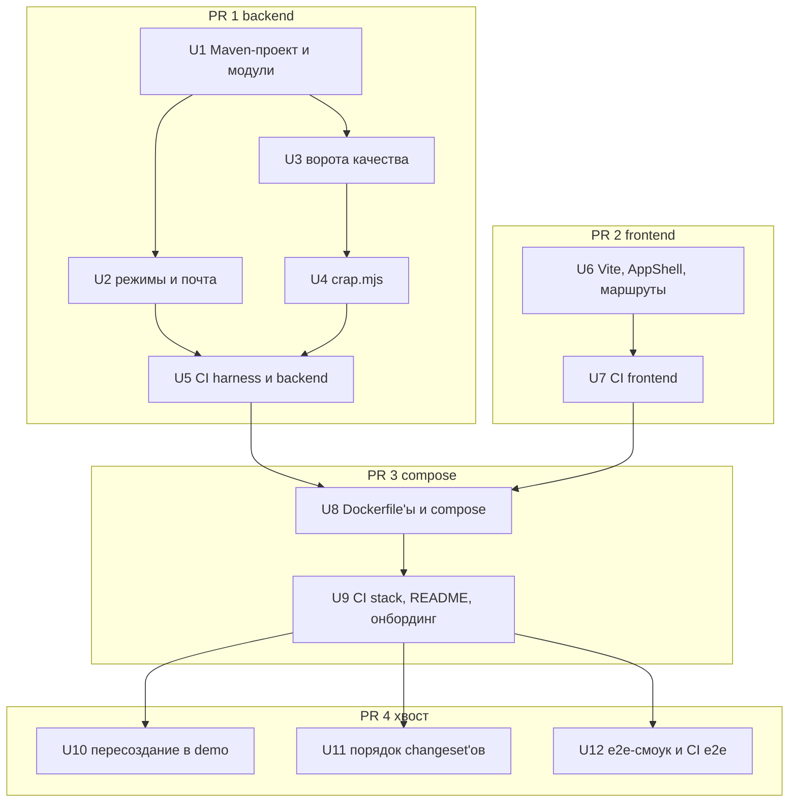
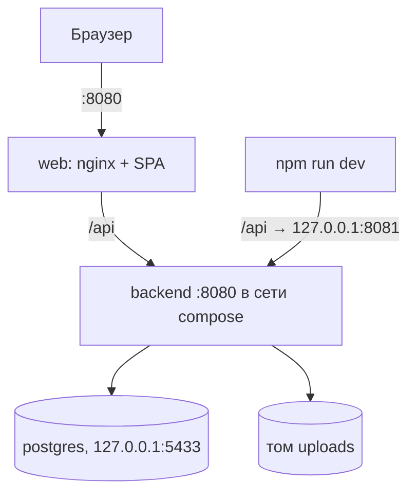

# U2 Skeleton - Plan

## Goal Capsule

- **Цель.** Юнит мастер-U2 — скелет монорепо, compose и CI — целиком, без сокращений, четырьмя PR, чтобы ревью человеком не стало узким местом. К утру 08.11 второй разработчик получает рабочий `docker compose up` и зелёный CI и начинает мастер-U21c → мастер-U5.
- **Иерархия источников.** Мастер-план `docs/spec/plans/2026-10-31-001-feat-campus-rating-mvp-plan.md` (раздел U2, Verification Contract, мастер-KTD1, KTD2, KTD6, KTD13, KTD15, KTD22) выше этого плана. Здесь R, KTD и U — локальные; ссылки на мастер-план помечены «мастер-». Юнит этого плана не переопределяет ни мастер-R, ни мастер-KTD.
- **Профиль исполнения.** Код пишет Codex по скиллу `implement-unit`; Claude ревьюит по `review-unit`, сам повторяет проверки на SHA PR и коммитит; запись журнала — скилл `agent-log`. В основном это конфигурация: первое доказательство — сборка, смоук и CI, а не модульные тесты (кроме U3, U4, U10, U11).
- **Остановись и спроси, если:**
  - версия из KTD1 не собирается и замена тянет смену мажорной версии стека;
  - смоук PIT не проходит на JUnit 6 (KTD8);
  - нужно править мастер-R или мастер-KTD, а не только команды Verification Contract мастер-плана;
  - работа выходит за `Files` юнита больше чем на смежный файл.
- **Открытый блокер.** Локально установлен JDK 21, а мастер-KTD1 требует 25. Codex и ревьюер запускают `./backend/mvnw` на этой машине, поэтому JDK 25 — предусловие U1; ставит человек.
- **Ветки.** PR 0 — `u2-skeleton` (этот план и правки спеки, KTD16), затем `u2a-backend`, `u2b-frontend`, `u2c-compose`, `u2d-tail` от свежего `main`. На каждый PR — один цикл `implement-unit` → `review-unit` → `agent-log`.

---

## Product Contract

Product Contract preservation: изменено R3 — `tools/crap.py` заменён на Node-скрипт `tools/crap.mjs` (KTD9: служебные скрипты на Node, мастер-KTD16); объём не изменился. Правки спеки, скиллов и прав, которых требуют KTD7, KTD9 и KTD16, идут отдельным PR 0 до кода (правило «спека — отдельным PR» из `AGENTS.md`), R2 описывает только PR с кодом.

### Summary

Весь мастер-U2 приходит четырьмя последовательными PR: backend, frontend, compose, затем хвост с тестами пересоздания схемы, порядка changeset'ов и e2e-смоуком. Каждый PR добавляет CI-проверку своего слоя, поэтому зелёный CI на PR уже доказывает его ворота. Первые три PR вливаются к утру 08.11, хвост — днём 08.11.

### Problem Frame

Кода приложения нет, а с 08.11 две дорожки работают параллельно, и обе зависят от скелета. Агенты пишут код быстро; медленное звено — ревью человеком: один PR на весь U2 занял бы его надолго, и всё это время у второго разработчика не было бы ни стека, ни CI. Мастер-план описывает U2 как один юнит и не говорит, в каком порядке и какими порциями он появляется.

### Key Decisions

- **Ничего из мастер-U2 не сокращается.** Агентская база справляется с объёмом; ограничение — скорость ревью, и его снимает нарезка, а не урезание. Governs R1. (session-settled: user-directed — chosen over минимального скелета к утру с доделкой позже: ограничение — ревью, а не объём работы агентов.)
- **Нарезка по слоям: backend, frontend, compose.** Каждый PR смотрится за 15–20 минут, и пока человек ревьюит один, Codex пишет следующий. Governs R2–R5. (session-settled: user-directed — chosen over одного PR ядра и над порядком «сначала рабочий стек, потом ворота качества»: маленький PR быстрее проходит ревью.)
- **Хвост — отдельный PR.** Тест пересоздания схемы в `demo`, тест порядка changeset'ов и e2e-смоук не нужны второму разработчику утром и вливаются после стека. Governs R6. (session-settled: user-directed — chosen over включения их в первые PR: их можно добавить позже без влияния на работу второй дорожки.)
- **CI растёт вместе с PR.** Каждый PR приносит проверку своего слоя, а не весь CI в последнем PR: ревьюер видит доказательство ворот на самом PR. Governs R7. (session-settled: user-approved — chosen over CI в compose-PR: иначе первые два PR проверяются только руками.)
- **Форма входа в U2 — статичная заглушка.** Она нужна e2e-смоуку как признак того, что nginx отдаёт SPA; настоящая форма и логика — мастер-U5. Governs R4.

### Requirements

**Состав**

- R1. U2 реализует всё, что перечислено в разделе U2 мастер-плана: файлы, шаги, тестовые сценарии и проверку. Распределение по PR задают R3–R6.

**Нарезка и порядок**

- R2. U2 приходит четырьмя PR в `main` в порядке backend → frontend → compose → хвост; backend и frontend не зависят друг от друга, compose идёт после обоих, хвост — после compose.
- R3. Backend-PR: Maven-проект с Wrapper, пакеты модулей мастер-KTD2, `ModularityTest`, базовый класс интеграционных тестов с Testcontainers PostgreSQL 18 и сдвигаемым `Clock`, `SmokeIT`, `MailModeConfigTest` со всеми случаями мастер-KTD22 (включая отказ старта с `required` до мастер-U15), master-changelog, JaCoCo и CPD в `verify`, профиль `quality` со смоуком PIT, `tools/crap.mjs`.
- R4. Frontend-PR: Vite и TypeScript, Mantine AppShell с боковой навигацией на десктопе и нижней на мобильном, React Router, TanStack Query, Vitest, линтер и проверка типов; маршрут `/login` со статичной заглушкой формы без логики.
- R5. Compose-PR: `docker-compose.yml` (postgres с healthcheck, backend в профиле `demo` с явным `EMAIL_VERIFICATION=off`, web с nginx на `http://localhost:8080`, том `uploads`), Dockerfile'ы, `.env.example` и `docker-compose.e2e.yml` с ускоренным штрафом.
- R6. Хвост-PR: тест повторного запуска в `demo` на технической записи, тест применения changeset'ов из двух веток в любом порядке и неприменения `context: demo` в тестах, e2e-смоук через nginx.

**CI**

- R7. Каждый PR добавляет CI-проверку своего слоя и зелёный по ней: backend — `verify`, frontend — `check` и `build`, compose — подъём стека с ожиданием готовности, хвост — e2e. После хвоста CI выполняет весь Verification Contract мастер-плана на каждом PR и на каждом push в `main`.

**Процесс и документация**

- R8. Каждый PR проходит цикл мастер-U1: реализация скиллом `implement-unit`, независимое ревью `review-unit` с повтором проверок на SHA PR, запись в `docs/agent-log.md`. U2 — первый сквозной прогон этого цикла, его итог фиксирует журнал.
- R9. Каждый PR заменяет «появятся в мастер-U2» в таблицах команд `AGENTS.md`, `backend/AGENTS.md`, `frontend/AGENTS.md` и `e2e/AGENTS.md` реальными командами своего слоя; команда e2e совпадает с Verification Contract мастер-плана (отдельный проект compose, чистый том).
- R10. Compose-PR обновляет `README.md` и `docs/onboarding.md`: запуск одной командой, адрес, режим `demo` и выключенное подтверждение email.

### Success Criteria

- К утру 08.11 в `main` влиты PR backend, frontend и compose: чистый клон → `docker compose up` → на `http://localhost:8080` открывается заглушка входа, CI зелёный.
- Днём 08.11 влит хвост, и CI гоняет e2e на каждом PR.
- Второй разработчик начинает мастер-U21c и мастер-U5 по `AGENTS.md` и онбордингу, не спрашивая, как собрать и запустить проект.

### Scope Boundaries

- Регистрация, вход, сессии и Spring Security — мастер-U5; на `/login` в U2 только заглушка.
- Тема, токены и шаблоны страниц — мастер-U21c; U2 ставит Mantine с темой по умолчанию.
- API-контракт, `GET /auth/config`, MSW и генерация типов — мастер-U3.
- Справочники, настройки, демо-сид и выбор слоя доступа к данным (JPA или JDBC) — мастер-U4.
- Очистка тома файлов в `demo` — мастер-U7.
- `docker-compose.server.yml`, `RunModeConfigTest` и стенд на сервере — мастер-U22.

### Dependencies / Assumptions

- JDK 25 на машине, где работают Codex и ревьюер, ставит человек до U1; CI и Docker-сборка от локального JDK не зависят.
- Минут GitHub Actions на private-репозитории хватает на compose и e2e на каждый PR до сдачи 12.11 — не проверено.
- `pitest-junit5-plugin` совместим с JUnit 6 из BOM Boot 4.1 — допущение мастер-плана, проверяется смоуком PIT в U3 этого плана; при несовместимости действует митигация из Risks мастер-плана.
- Пока хвост не влит, требование мастер-плана «e2e на каждый PR» не выполняется; это несколько часов утром 08.11, и PR второй дорожки в это время проверяются без e2e.

### Sources / Research

- Мастер-план: раздел U2, Verification Contract, мастер-KTD1, KTD2, KTD6, KTD13, KTD15, KTD16, KTD22, Risks and Dependencies (митигация PIT).
- Текущее состояние: в `backend/`, `frontend/`, `e2e/` только `AGENTS.md` и `CLAUDE.md`; в `.github/` только шаблон PR; таблицы команд в `AGENTS.md` и вложенных `AGENTS.md` ждут U2; `.gitignore` уже исключает `target/`, `dist/`, `node_modules/`, отчёты Playwright.
- Хук `guard` (`.claude/hooks/guard.mjs`) и `deny` в `.claude/settings.json` запрещают чтение и правку `.env*`, кроме `.env.example`.
- `.claude/settings.json` разрешает `./mvnw *` и `npm run *`, но не `./backend/mvnw` и `npm --prefix` из Verification Contract; PR 0 добавляет их.
- Codex не может писать в `.agents/` и `.codex/` (`docs/agent-process.md`), прямую запись в `.claude/skills/` блокирует хук `guard`.

---

## Planning Contract

### Key Technical Decisions

- KTD1. **Версии фиксируются точно, проверены по Maven Central, npm и Docker Hub на 07.11.2026.** Мажорные версии не повышаются в рамках U2.
  - Backend: parent `spring-boot-starter-parent` 4.1.2 (его BOM даёт JUnit Jupiter 6.0.3, Testcontainers 2.0.5, Liquibase 5.0.4, Jackson 3.1), BOM `spring-modulith-bom` 2.1.2 и `spring-ai-bom` 2.0.2, Maven Wrapper 3.3.4 с Maven 3.9.16, JaCoCo 0.8.16, `maven-pmd-plugin` 3.28.0, `pitest-maven` 1.30.2 и `pitest-junit5-plugin` 1.2.3.
  - Frontend: React 19.3, Vite 8, Mantine 9, React Router 8, TanStack Query 5, Vitest 5, ESLint 10 с `typescript-eslint` 8, TypeScript 6.0. TypeScript 7 не берём: `typescript-eslint` требует TypeScript < 6.1.
  - e2e: `@playwright/test` 1.65.
  - Node: React Router 8 требует ≥ 22.22, поэтому `engines` в `frontend/package.json` и `e2e/package.json` — `>=22.22`, образ сборки — `node:22.23-alpine`, `.nvmrc` — `22.22`; ESLint 10 требует ≥ 22.13. TypeScript 6 по умолчанию не подключает типы окружения, поэтому `tsconfig.json` явно задаёт `types` (`vite/client`, типы Vitest).
  - Образы: `postgres:18.6-alpine`, `eclipse-temurin:25-jdk` для сборки и `eclipse-temurin:25-jre-alpine` для запуска, `node:22.23-alpine`, `nginxinc/nginx-unprivileged:1.31-alpine` (nginx не от root, слушает `8080`). Тот же тег Postgres использует Testcontainers.
- KTD2. **Стартеры U2 — только нужные скелету.** `webmvc`, `actuator`, `validation`, `jdbc` (для `DataSource`), `liquibase`, `spring-modulith-starter-core`, PostgreSQL-драйвер; в тестах — `spring-boot-starter-test`, `spring-boot-starter-webmvc-test` (MockMvc), `spring-boot-testcontainers`, `testcontainers-postgresql`, `spring-modulith-starter-test`. JUnit-расширение Testcontainers (`@Testcontainers`, `@Container`) не используется (KTD14). Security не подключается до мастер-U5: стартер закрыл бы все эндпоинты и навязал бы решения U5. Слой доступа к данным выбирает мастер-U4. `spring-boot-maven-plugin` подключён явно (иначе `package` даст jar без `Main-Class`). `maven-enforcer-plugin` запрещает `com.fasterxml.jackson.core:jackson-databind` в `compile` и `runtime` (Testcontainers тянет его в `test`, там он допустим) — это ворота из Risks мастер-плана.
- KTD3. **Порты локального стека — только на `127.0.0.1`.** `web` — `127.0.0.1:8080` (backend до мастер-U5 без Security, наружу стек не открываем); `backend` — `127.0.0.1:8081` для `npm run dev`; `postgres` — `127.0.0.1:5433`, чтобы не конфликтовать с локальным Postgres. Vite dev-сервер проксирует `/api` на `http://localhost:8081`. `docker-compose.e2e.yml` заменяет порты (`!override` и `!reset`), а не складывает их: `web` — `127.0.0.1:8090` (внутри контейнера nginx слушает `8080`), backend и postgres не публикуются, поэтому e2e-стек поднимается рядом с рабочим. Серверный override (мастер-U22) публикует только `web`.
- KTD4. **Имена настроек фиксируются в U2, раньше их потребителей.** `application.yml` связывает `campus.mail.email-verification` с `EMAIL_VERIFICATION` подстановкой без значения по умолчанию: relaxed binding такое имя сам не свяжет, а значение по умолчанию открыло бы старт без явного выбора. Тесты задают свойство напрямую. Ключи штрафа заводятся в `application.yml` уже в U1 со значениями мастер-плана и явной подстановкой: `campus.penalty.default-step: ${CAMPUS_PENALTY_DEFAULT_STEP:20}`, `campus.penalty.default-interval: ${CAMPUS_PENALTY_DEFAULT_INTERVAL:1m}`, `campus.penalty.poll-period: ${CAMPUS_PENALTY_POLL_PERIOD:1s}` (это `penalty.poll-period` мастер-KTD4). `docker-compose.e2e.yml` задаёт `CAMPUS_PENALTY_DEFAULT_INTERVAL=4s` и `CAMPUS_PENALTY_POLL_PERIOD=1s`. Имена записываются в `backend/AGENTS.md` (PR 0), потому что исполнитель мастер-U4 и мастер-U8 читает его, а не этот план. Compose работает без `.env`: все значения по умолчанию заданы в compose-файле, `.env.example` только документирует переопределения.
- KTD5. **Режим почты — типизированные свойства с проверкой при старте.** `campus.mail.email-verification` — перечисление `required | off` без значения по умолчанию; отсутствие, опечатка, `required` без `spring.mail.host` и `required` до мастер-U15 останавливают старт с сообщением, называющим свойство. Запрет `required` до U15 — одна явная проверка, которую мастер-U15 удаляет. Проверка — бин в `shared.mail`, читающий `Environment` (`spring.mail.host` проверяется без стартера почты); свойства включает `@ConfigurationPropertiesScan` в `CampusRatingApplication`. Тест — `ApplicationContextRunner` с `ConfigDataApplicationContextInitializer` и активным профилем, только с конфигурацией почты и свойствами Liquibase, без автоконфигурации `DataSource`: так читаются настоящие `application*.yml`, а не свойства, подставленные в тесте.
- KTD6. **Время.** Один бин `Clock` (`Clock.systemUTC()`) в модуле `shared` с `@ConditionalOnMissingBean`; базовый класс интеграционных тестов объявляет свой бин сдвигаемых часов, и переопределения бинов не нужно. Зона Europe/Moscow и календарные правила R41 мастера живут в чистом классе `shared.domain.MoscowTime` (дата и месяц по Москве для `Instant`) — он же цель смоука PIT. Нужен мастер-U9 (месяц бюджета) и мастер-U17.
- KTD7. **Master-changelog — `includeAll` по 12 папкам мастер-KTD13** (`shared` первой — технические таблицы, реестр событий мастер-KTD11 заводит мастер-U4; затем `settings`, `directory`, `identity`, `ledger`, `checkpoint`, `activity`, `feed`, `poll`, `admin`, `notification`, `demo`) с `errorIfMissingOrEmpty: false`. Пустых папок и `.gitkeep` нет: посторонний файл в папке `includeAll` Liquibase пытается разобрать как changelog, а отсутствующую папку при `errorIfMissingOrEmpty: false` пропускает; папку создаёт первый changeset модуля. Контексты задаются всегда: без контекста при запуске Liquibase выполняет все changeset'ы, включая `context: demo`. `application.yml` — `spring.liquibase.contexts: default`, `application-demo.yml` — `default,demo` и `drop-first`; тесты и `prod` идут с `default` и демо-данных не получают. Формулировка мастер-KTD13 «тесты — без него» и строка `backend/AGENTS.md` уточняются в PR 0.
- KTD8. **Ворота качества.** `verify` гоняет Surefire (unit), Failsafe (`*IT`), JaCoCo `check` (≥ 80% строк в `**/domain/**`) и PMD CPD (100 токенов, сборка падает). JaCoCo `report` привязан к `verify` до `check`, поэтому `backend/target/site/jacoco/jacoco.xml` есть после каждого `verify`; приватный пустой конструктор утилитного класса JaCoCo отфильтровывает сам. PIT — профиль `quality`, отдельные запуски на пакет: `ledger.domain`, `checkpoint.domain`, `activity.domain` с порогом 70% и `failWhenNoMutations=false` (до мастер-U6 пакетов нет, порог включён сразу и начинает действовать с первым классом), и смоук на `shared.domain` с порогом 70%; `*IT` из PIT исключены. Общий результат не смешивает пакеты. PIT гоняет ревьюер локально; в CI его нет (мастер-Verification Contract). Если смоук PIT на JUnit 6 не проходит — стоп и вопрос (Goal Capsule).
- KTD9. **CRAP — `tools/crap.mjs` вместо `tools/crap.py`.** Мастер-KTD16 требует служебных скриптов на Node, который есть у всех; у второго разработчика Windows, и Python там не гарантирован. Скрипт читает JaCoCo XML и для каждого метода в пакетах, имя которых (в XML — через `/`, например `ru/campusrating/ledger/domain`) содержит сегмент `domain`, включая вложенные, считает `CC² × (1 − покрытие)³ + CC`: `CC` — `missed + covered` счётчика `COMPLEXITY`, покрытие — доля `covered` счётчика `INSTRUCTION`. CRAP > 10 — код 1; битый или отсутствующий отчёт — код 2. Команда в Verification Contract мастер-плана и в `references/java-tools.md` скилла `ub-mode` меняется в PR 0.
- KTD10. **Frontend-маршруты U2 и заглушка сессии.** `/login` — статичная заглушка вне AppShell; все остальные маршруты — внутри AppShell под охранником маршрута, который спрашивает сессию у заглушки `useSession()`, всегда отвечающей «нет сессии». Поэтому `/` ведёт на `/login`. В `router.tsx` есть ветка гостевых маршрутов вне AppShell: мастер-U5 добавляет туда `/register` и `/password/change` и заменяет заглушку сессии. Навигация AppShell берёт пункты из конфигурации по роли — сразу полный список из `screen-map.md` для студента, преподавателя и администратора; маршрутов разделов ещё нет, ссылки ведут на «Раздел появится» внутри AppShell. Выбор боковой или нижней панели — через `useMediaQuery` Mantine, а не CSS-брейкпоинты (`visibleFrom`), поэтому тест с подменённым в setup-файле Vitest `matchMedia` (и `ResizeObserver` для Mantine) проверяет логику; внешний вид на 360 и 1280 px ревьюер смотрит руками с временно включённой тестовой сессией.
- KTD11. **CI — один workflow `.github/workflows/ci.yml`, задание на слой.** Задания: `harness` (`node --test` и `check-agent-docs` — уже есть в репо, U5 подключает их первым), `backend`, `frontend`, `stack` (с PR 3), `e2e` (с PR 4 заменяет `stack`: его проверки переезжают в e2e, чтобы образы не собирались дважды). Триггеры — `pull_request` в `main` и `push` в `main`; `concurrency` отменяет устаревшие запуски ветки. Каждый PR добавляет своё задание. Образы в CI собираются через Buildx с кэшем `type=gha`. Если PR 1 и PR 2 идут параллельно, второй перед финальным ревью ребейзится на `main`, и ревью повторяет проверки на новом SHA.
- KTD12. **Проверка пересоздания в `demo` — интеграционный тест, а не два `docker compose up`.** Тест дважды поднимает и закрывает приложение через `SpringApplicationBuilder` (не кэшируемый `@SpringBootTest`) на своём контейнере Postgres: в `demo` техническая таблица, созданная между запусками, исчезает; в `prod` — остаётся. Это проверяет то, что делает `drop-first`, дешевле compose; ручной `docker compose up` дважды остаётся в Verification U8.
- KTD13. **Проверка порядка changeset'ов — Liquibase API на временной копии настоящего changelog.** Тест копирует `db/changelog` из ресурсов во временную папку, добавляет в папку настоящего модуля два changeset'а с метками «из двух веток» (поздняя метка вливается первой) по шагам: для каждого из двух порядков — своя чистая база, на которой `update` настоящего master-changelog прогоняется после шага 1 и снова после шага 2. Так проверяется докатка ранней метки поверх уже применённой поздней. Реальные ветки и git не нужны.
- KTD14. **Интеграционная база.** Один контейнер Postgres на JVM — статический синглтон `org.testcontainers.postgresql.PostgreSQLContainer` (в Testcontainers 2 без generic-параметра), запущенный при загрузке базового класса и отданный Spring через `@ServiceConnection`; он не останавливается между тестовыми классами и контекстами. Базовый класс задаёт `campus.mail.email-verification=off`. U10 поднимает свой контейнер, чтобы `drop-first` не стирал схему другим тестам.
- KTD15. **Сеть и здоровье стека.** nginx: `location /api/` проксирует на `http://backend:8080` без завершающего `/`, префикс `/api` сохраняется (контроллеры мастер-U3 — под `/api/v1`); `/actuator` наружу не проксируется. Healthcheck'и: postgres — `pg_isready -h 127.0.0.1 -U <user> -d <db>` (без `-h` проверка через сокет зеленеет ещё во время `initdb`), backend — `wget -qO- http://127.0.0.1:8080/actuator/health`, web — `wget -qO- http://127.0.0.1:8080/` (в alpine-образах есть busybox `wget`, `curl` нет; `localhost` уходит на IPv6). Том Postgres 18 монтируется в `/var/lib/postgresql` (в образе 18 путь данных изменился). Каталог загрузок создаётся и отдаётся непривилегированному пользователю в `backend/Dockerfile` до `USER`, иначе именованный том `uploads` принадлежит root. `mvnw` хранится в git с режимом `100755`. `.dockerignore` в `backend/` и `frontend/` исключает `target/`, `node_modules/`, `dist/` и `.env*` (хостовые `node_modules` с нативными бинарями Vite 8 сломали бы Alpine-сборку).
- KTD16. **PR 0 — спека, скиллы и права до кода, руками Claude.** Codex не пишет в `.agents/`, а правка спеки идёт отдельным PR (`AGENTS.md`). PR 0 из ветки `u2-skeleton` содержит этот план и:
  - мастер-KTD13 и `backend/AGENTS.md` — контексты Liquibase по KTD7;
  - мастер-план (Verification Contract, Files мастер-U2) и `.agents/skills/ub-mode/references/java-tools.md` с `node tools/sync-skills.mjs` — `tools/crap.mjs` по KTD9;
  - `backend/AGENTS.md` — имена настроек штрафа (KTD4) и правило модулей Modulith (KTD17);
  - `.claude/settings.json` — `allow` для `./backend/mvnw *`, `backend/mvnw.cmd *`, `npm --prefix frontend run *`, `npm --prefix e2e test*` в Bash и PowerShell;
  - `frontend/AGENTS.md` — `npm run api:gen` помечен «появится в мастер-U3»;
  - `docs/onboarding.md` — Node ≥ 22.22 и правило «на Windows весь стек разработки — внутри WSL2».
- KTD17. **Границы модулей Modulith.** Каждый из 14 пакетов мастер-KTD2 — `package-info.java` с `@ApplicationModule` (без аннотации `javac` не создаёт класс, и Modulith увидел бы ноль модулей). `shared` — `@ApplicationModule(type = OPEN)`: его используют все. В остальных модулях публичный API — корень пакета модуля; Modulith по умолчанию закрывает вложенные пакеты, поэтому `api` и `domain`, которые нужны соседям, модуль открывает `@NamedInterface` в своём юните. `ModularityTest` также запрещает классам `ru.campusrating..` импорт `com.fasterxml.jackson.databind..` (правило ArchUnit).

### High-Level Technical Design

Порядок PR, юнитов и заданий CI:



PR 1 и PR 2 независимы и могут идти параллельно (Codex пишет один, пока человек ревьюит другой). Задания CI по мере слияния: после PR 1 — `harness`, `backend`; после PR 2 — плюс `frontend`; после PR 3 — плюс `stack`; после PR 4 — плюс `e2e`.

Локальный стек (порты по KTD3):



### Output Structure

```text
.env.example
docker-compose.yml
docker-compose.e2e.yml
.github/workflows/ci.yml
backend/
  Dockerfile, .dockerignore
  mvnw, mvnw.cmd, .mvn/wrapper/maven-wrapper.properties
  pom.xml
  src/main/java/ru/campusrating/
    CampusRatingApplication.java
    <module>/package-info.java          # 14 модулей мастер-KTD2, KTD17
    shared/ClockConfig.java
    shared/domain/MoscowTime.java
    shared/mail/MailModeProperties.java
  src/main/resources/
    application.yml, application-demo.yml, application-prod.yml
    db/changelog/db.changelog-master.yaml   # папки модулей появятся с первыми changeset'ами
  src/test/java/ru/campusrating/
    ModularityTest.java, SmokeIT.java, MailModeConfigTest.java
    DemoRecreateIT.java, ChangelogOrderIT.java
    support/PostgresIntegrationTest.java, support/MutableClock.java
    shared/domain/MoscowTimeTest.java
frontend/
  Dockerfile, .dockerignore, nginx.conf
  package.json, package-lock.json, vite.config.ts, tsconfig.json, eslint.config.js, index.html
  src/main.tsx
  src/app/AppShell.tsx, src/app/router.tsx, src/app/navigation.ts, src/app/session.ts
  src/features/auth/LoginPlaceholder.tsx
  src/app/*.test.tsx, src/test/setup.ts
e2e/
  package.json, package-lock.json, playwright.config.ts
  tests/smoke.spec.ts
tools/crap.mjs
tools/test/crap.test.mjs, tools/test/fixtures/jacoco-*.xml
```

Дерево — ожидаемая форма; авторитетны `Files` юнитов.

### Assumptions

Подтверждение объёма перед записью плана пропущено по просьбе человека; ставки агента, которые человек ещё не видел:

- `includeAll` Liquibase 5 пропускает отсутствующую папку при `errorIfMissingOrEmpty: false` (KTD7) — проверяет `SmokeIT`.
- Codex в sandbox `workspace-write` запускается с `-c sandbox_workspace_write.network_access=true`: без сети он не скачает Maven Wrapper, зависимости и `npm ci`. Docker ему недоступен, поэтому `*IT`, Testcontainers, сборку образов и compose гоняет Claude на ревью; Codex прогоняет то, что работает без Docker.
- Порты `8081` и `5433` на машинах обоих разработчиков свободны.

### Risks and Dependencies

| Риск | Митигация |
|---|---|
| PIT на JUnit 6 не стартует | Смоук в U3 первым делом; при отказе — стоп и вопрос, затем митигация мастер-плана (JUnit 5 platform в профиле или порог как отчёт) |
| Агент пишет под Boot 3 (Jackson 2, `@MockBean`, монолитный `spring-boot-starter-web`) | `backend/AGENTS.md`; ревьюер сверяет импорты и стартеры с KTD2 |
| `openapi-typescript` 7 объявляет peer TypeScript `^5` | Касается мастер-U3; при установке в U3 проверить совместимость с TypeScript 6 или взять версию с поддержкой 6 |
| e2e нестабилен на холодном старте стека | `up --wait` по healthcheck всех сервисов, ожидания Playwright без пауз |
| Сборка образа backend долгая в CI | Buildx с кэшем `type=gha` (KTD11); с PR 4 образы собирает только задание `e2e` |

---

## Implementation Units

| U | Юнит | Ключевые файлы | Зависит от |
|---|---|---|---|
| U0 | PR 0: план, спека, скилл, права | этот план, мастер-план, `backend/AGENTS.md`, `java-tools.md`, `.claude/settings.json` | — |
| U1 | Maven-проект, модули, интеграционная база | `backend/pom.xml`, `backend/src/...` | U0 |
| U2 | Режимы запуска и почта | `application-*.yml`, `shared/mail/`, `MailModeConfigTest` | U1 |
| U3 | Ворота качества и смоук PIT | `backend/pom.xml`, `shared/domain/MoscowTime` | U1 |
| U4 | `tools/crap.mjs` | `tools/crap.mjs`, `tools/test/crap.test.mjs` | U3 |
| U5 | CI `harness` и `backend`, команды backend | `.github/workflows/ci.yml`, `AGENTS.md`, `backend/AGENTS.md` | U2, U4 |
| U6 | Frontend-скелет | `frontend/...`, `.gitignore` | U0 |
| U7 | CI `frontend`, команды frontend | `ci.yml`, `AGENTS.md`, `frontend/AGENTS.md` | U6 |
| U8 | Dockerfile'ы и compose | `docker-compose*.yml`, `*/Dockerfile`, `frontend/nginx.conf`, `.env.example` | U5, U7 |
| U9 | CI `stack`, README и онбординг | `ci.yml`, `README.md`, `docs/onboarding.md` | U8 |
| U10 | Пересоздание схемы в `demo` | `DemoRecreateIT.java` | U9 |
| U11 | Порядок changeset'ов | `ChangelogOrderIT.java` | U9 |
| U12 | e2e-смоук и CI `e2e` | `e2e/...`, `ci.yml`, `e2e/AGENTS.md` | U9 |

PR 0 = U0, PR 1 = U1–U5, PR 2 = U6–U7, PR 3 = U8–U9, PR 4 = U10–U12.

### U0. PR 0: план, спека, скилл, права

- **Goal.** До первой строки кода спека, скилл `ub-mode`, правила агентов и права Claude согласованы с этим планом.
- **Requirements.** R8, R9; KTD4, KTD7, KTD9, KTD16, KTD17.
- **Dependencies.** нет. Исполнитель — Claude, не Codex (KTD16).
- **Files:** `docs/spec/plans/2026-11-07-001-feat-u2-skeleton-plan.md`, `docs/spec/plans/2026-10-31-001-feat-campus-rating-mvp-plan.md`, `backend/AGENTS.md`, `frontend/AGENTS.md`, `docs/onboarding.md`, `.agents/skills/ub-mode/references/java-tools.md`, `.claude/skills/ub-mode/references/java-tools.md` (через `node tools/sync-skills.mjs`), `.claude/settings.json`, `docs/agent-log.md`.
- **Approach.** Состав правок — KTD16.
- **Test expectation: none -- документация и права; доказательство — `node tools/check-agent-docs.mjs` и `node --test "tools/test/*.test.mjs"`.**
- **Verification.** Обе команды зелёные; `rg -n 'crap\.py'` по `docs/` и `.agents/` находит только журнал; после слияния ревьюер запускает `./backend/mvnw` и `npm --prefix` без запроса прав.

### U1. Maven-проект, модули, интеграционная база

- **Goal.** Пустое приложение Boot 4 собирается, поднимается на Postgres из Testcontainers и отвечает на health; границы модулей проверяются тестом.
- **Requirements.** R1, R3; мастер-KTD1, KTD2, KTD6, KTD13, KTD15; KTD1, KTD2, KTD4, KTD6, KTD7, KTD14, KTD17.
- **Dependencies.** U0; JDK 25 на машине.
- **Files:**
  - `backend/pom.xml`, `backend/mvnw`, `backend/mvnw.cmd`, `backend/.mvn/wrapper/maven-wrapper.properties`;
  - `backend/src/main/java/ru/campusrating/CampusRatingApplication.java`, `backend/src/main/java/ru/campusrating/<module>/package-info.java` для 14 модулей мастер-KTD2, `backend/src/main/java/ru/campusrating/shared/ClockConfig.java`;
  - `backend/src/main/resources/application.yml`, `backend/src/main/resources/db/changelog/db.changelog-master.yaml`;
  - `backend/src/test/java/ru/campusrating/ModularityTest.java`, `backend/src/test/java/ru/campusrating/SmokeIT.java`, `backend/src/test/java/ru/campusrating/support/PostgresIntegrationTest.java`, `backend/src/test/java/ru/campusrating/support/MutableClock.java`.
- **Approach:**
  1. `pom.xml` по KTD1 и KTD2; Java 25; Surefire для unit, Failsafe для `*IT`; `spring-boot-maven-plugin` и `maven-enforcer-plugin`.
  2. Пакеты модулей по KTD17, без пустых классов-заглушек; `@ConfigurationPropertiesScan` в `CampusRatingApplication`.
  3. `PostgresIntegrationTest` по KTD14, сдвигаемые часы по KTD6.
  4. `application.yml`: контексты Liquibase по KTD7, ключи штрафа по KTD4. Master-changelog по KTD7.
- **Patterns to follow.** `backend/AGENTS.md` (Boot 4, модули), `.agents/skills/review-unit/references/spring-boot-4-checklist.md`.
- **Test scenarios:**
  - `ModularityTest`: Modulith видит ровно 14 модулей с идентификаторами из мастер-KTD2, `shared` — открытый, `verify()` зелёный.
  - `ModularityTest`: класс `ru.campusrating..`, импортирующий `com.fasterxml.jackson.databind.ObjectMapper`, нарушает правило (проверить временной правкой на ревью).
  - `ModularityTest` падает, если класс в `ledger` импортирует класс из `checkpoint.internal` (проверить временной правкой на ревью, в diff её нет).
  - `SmokeIT`: контекст поднимается на Testcontainers PostgreSQL 18, `/actuator/health` — `UP`.
  - `SmokeIT`: Liquibase отработал на пустом master-changelog с контекстом `default`, таблица `databasechangelog` создана.
  - `SmokeIT`: `GET /api/v1/does-not-exist` — 404 с JSON-телом ошибки Boot, а не HTML.
  - Сдвиг `MutableClock` на час виден бину `Clock` из контекста.
- **Verification.** `./backend/mvnw -f backend/pom.xml verify` зелёный; enforcer падает, если временно добавить `jackson-databind` в `compile`; `spring-boot-starter-web` в зависимостях нет; `java -jar backend/target/*.jar` стартует (jar исполняемый).

### U2. Режимы запуска и почта

- **Goal.** Профили `demo` и `prod` и режим подтверждения email ведут себя по мастер-KTD22.
- **Requirements.** R3; мастер-R47, R48, мастер-KTD22; KTD4, KTD5, KTD7.
- **Dependencies.** U1.
- **Files:** `backend/src/main/resources/application.yml`, `backend/src/main/resources/application-demo.yml`, `backend/src/main/resources/application-prod.yml`, `backend/src/main/java/ru/campusrating/shared/mail/MailModeProperties.java`, `backend/src/main/java/ru/campusrating/shared/mail/MailModeValidator.java`, `backend/src/test/java/ru/campusrating/MailModeConfigTest.java`, `backend/src/test/java/ru/campusrating/support/PostgresIntegrationTest.java` (свойство `off`, KTD14).
- **Approach.** Профили и контексты по KTD7, проверка режима почты по KTD5. После U2 `SmokeIT` из U1 должен остаться зелёным — ревьюер гоняет его на Docker.
- **Execution note.** Сначала `MailModeConfigTest` со всеми случаями, затем свойства.
- **Test scenarios:**
  - Без `campus.mail.email-verification` контекст не поднимается, сообщение называет свойство.
  - Значение `maybe` — отказ старта.
  - `required` без `spring.mail.host` — отказ старта.
  - `required` с `spring.mail.host` — отказ старта: подтверждение не реализовано до мастер-U15.
  - `off` в профиле `demo` — контекст поднимается.
  - `off` в профиле `prod` — контекст поднимается.
  - Профиль `demo` из настоящих YAML даёт контексты Liquibase `default,demo` и `drop-first: true`; `prod` — `default` и `drop-first: false`.
  - `EMAIL_VERIFICATION=off` в окружении без свойства — контекст поднимается в режиме `off` (проверка подстановки KTD4).
- **Verification.** Все сценарии зелёные без Docker.

### U3. Ворота качества и смоук PIT

- **Goal.** `verify` ломается на падении покрытия и дублировании, профиль `quality` гоняет PIT на JUnit 6.
- **Requirements.** R3; мастер-R41, мастер-KTD6, KTD15; KTD6, KTD8.
- **Dependencies.** U1.
- **Files:** `backend/pom.xml`, `backend/src/main/java/ru/campusrating/shared/domain/MoscowTime.java`, `backend/src/test/java/ru/campusrating/shared/domain/MoscowTimeTest.java`.
- **Approach.** Плагины и пороги по KTD8. `MoscowTime` — чистая функция по KTD6.
- **Execution note.** Начать со смоука PIT: если он не стартует на JUnit 6, остановиться до остальной работы.
- **Test scenarios:**
  - `MoscowTime`: `2026-10-31T20:59:59Z` — октябрь, `2026-10-31T21:00:00Z` — ноябрь (граница бюджета мастер-U9).
  - `MoscowTime`: `2026-08-31T21:00:00Z` — 1 сентября по Москве.
  - `./backend/mvnw -f backend/pom.xml -Pquality verify` — PIT стартует на JUnit 6, отчёт смоука содержит мутанты `MoscowTime`, все убиты, `*IT` не запускались; запуски `ledger`, `checkpoint`, `activity` проходят без мутантов.
  - Удаление теста `MoscowTimeTest` роняет JaCoCo `check` (проверка на ревью).
  - Скопированный 100-токенный блок роняет CPD (проверка на ревью).
- **Verification.** `verify` и `-Pquality verify` зелёные; отчёт JaCoCo лежит в `backend/target/site/jacoco/jacoco.xml`.

### U4. `tools/crap.mjs`

- **Goal.** CRAP ≤ 10 по `*.domain` проверяется одной Node-командой на любой ОС.
- **Requirements.** R3; мастер-KTD15, KTD16; KTD9.
- **Dependencies.** U3.
- **Files:** `tools/crap.mjs`, `tools/test/crap.test.mjs`, `tools/test/fixtures/jacoco-clean.xml`, `tools/test/fixtures/jacoco-crappy.xml`, `tools/test/fixtures/jacoco-broken.xml`. Команды в мастер-плане и скилле правит U0.
- **Approach.** Без зависимостей, как остальные скрипты `tools/` (KTD4 плана U1). Контракт — KTD9; вывод — таблица методов с CRAP > 10. Фикстуры — фрагменты настоящего формата JaCoCo (пакеты через `/`).
- **Patterns to follow.** `tools/check-agent-docs.mjs`, `tools/test/check-agent-docs.test.mjs`.
- **Execution note.** Test-first по фикстурам.
- **Test scenarios:**
  - Метод с CC 1 и покрытием 100% — CRAP 1, код 0.
  - Метод с CC 5 без покрытия — CRAP 30, код 1, метод назван в выводе.
  - Метод с CC 5 и покрытием 100% — CRAP 5, проходит.
  - Метод с CC 4 и покрытием 50% — CRAP 6.
  - Метод с CRAP ровно 10 проходит, с CRAP 10,1 — код 1.
  - Метод во вложенном пакете `ru/campusrating/ledger/domain/rules` проверяется; пакет `ru/campusrating/domainless` — нет.
  - Сложный непокрытый метод вне `domain` — не влияет на код возврата.
  - Отсутствующий файл и битый XML — понятное сообщение и код 2, а не трасса.
  - Отчёт без методов `domain` — сообщение «нечего проверять» и код 0.
- **Verification.** `node --test "tools/test/*.test.mjs"` зелёный; `node tools/crap.mjs backend/target/site/jacoco/jacoco.xml` на настоящем отчёте U3 — код 0 и `MoscowTime` в списке проверенных.

### U5. CI `harness` и `backend`, команды backend

- **Goal.** PR 1 приходит с зелёным CI, а агенты знают команды backend.
- **Requirements.** R7, R8, R9; KTD11.
- **Dependencies.** U2, U4.
- **Files:** `.github/workflows/ci.yml`, `AGENTS.md`, `backend/AGENTS.md`.
- **Approach.** Задание `harness` — Node 22, `node --test` и `check-agent-docs`. Задание `backend` — Temurin 25 с кэшем Maven, `verify`, затем `crap.mjs` по отчёту; `-Pquality` в CI не гоняется (KTD8). Таблицы команд по R9.
- **Test expectation: none -- конфигурация CI и документация; доказательство — зелёный запуск на PR.**
- **Verification.** На PR 1 задания `harness` и `backend` зелёные; намеренно сломанный тест на временной ветке делает `backend` красным.

### U6. Frontend-скелет

- **Goal.** SPA собирается, проходит линтер, типы и Vitest; `/` ведёт на заглушку входа, AppShell адаптивен.
- **Requirements.** R1, R4; мастер-R40; KTD1, KTD3, KTD10.
- **Dependencies.** нет.
- **Files:**
  - `frontend/package.json`, `frontend/package-lock.json`, `frontend/vite.config.ts`, `frontend/tsconfig.json`, `frontend/eslint.config.js`, `frontend/index.html`;
  - `frontend/src/main.tsx`, `frontend/src/app/AppShell.tsx`, `frontend/src/app/router.tsx`, `frontend/src/app/navigation.ts`, `frontend/src/app/session.ts`, `frontend/src/features/auth/LoginPlaceholder.tsx`;
  - `frontend/src/app/AppShell.test.tsx`, `frontend/src/app/router.test.tsx`, `frontend/src/test/setup.ts`;
  - `.gitignore` — `*.tsbuildinfo`, `.eslintcache`, `blob-report/`.
- **Approach:**
  1. Скрипты `check` (ESLint, `tsc --noEmit`, `vitest run`), `build`, `dev`; прокси `/api` по KTD3; `engines` и `types` по KTD1.
  2. `MantineProvider` с темой по умолчанию, `QueryClientProvider`, роутер по KTD10.
  3. AppShell: боковая панель от брейкпоинта `sm`, нижняя панель ниже, выбор по KTD10; пункты — из `navigation.ts`; setup-файл Vitest подменяет `matchMedia` и `ResizeObserver`.
  4. Заглушка входа: поля «Email» и «Пароль» с подписями и кнопка «Войти», без отправки.
- **Patterns to follow.** `frontend/AGENTS.md`, `docs/spec/ux/screen-map.md` (навигация).
- **Test scenarios:**
  - `/` без сессии ведёт на `/login`.
  - `/login` показывает поля с подписями «Email» и «Пароль» (`getByLabel`: у поля пароля нет роли `textbox`) и кнопку «Войти» (`getByRole`).
  - Неизвестный маршрут без сессии тоже ведёт на `/login`.
  - AppShell с тестовой сессией студента и `matchMedia`, отвечающим «десктоп», рендерит боковую панель с пятью пунктами студента из `screen-map.md` и не рендерит нижнюю.
  - Тот же AppShell при «мобильном» `matchMedia` рендерит нижнюю панель и не рендерит боковую; у ссылок есть доступные имена.
  - Сессия преподавателя даёт пункты преподавателя, администратора — пункты администратора.
- **Verification.** `npm --prefix frontend run check` и `npm --prefix frontend run build` зелёные; `npm --prefix frontend run dev` открывает заглушку на 360 и 1280 px без горизонтальной прокрутки; ревьюер с временно включённой тестовой сессией видит боковую панель на 1280 и нижнюю на 360 px.

### U7. CI `frontend`, команды frontend

- **Goal.** PR 2 приходит с зелёным CI, агенты знают команды frontend.
- **Requirements.** R7, R8, R9; KTD11.
- **Dependencies.** U6.
- **Files:** `.github/workflows/ci.yml`, `AGENTS.md`, `frontend/AGENTS.md`.
- **Approach.** Задание `frontend` — Node из `.nvmrc` с кэшем npm, `npm ci`, `check`, `build`. Если PR 1 ещё не влит, PR 2 создаёт `ci.yml` с заданиями `harness` и `frontend`; параллельные PR — по KTD11.
- **Test expectation: none -- конфигурация CI и документация; доказательство — зелёный запуск на PR.**
- **Verification.** На PR 2 задание `frontend` зелёное.

### U8. Dockerfile'ы и compose

- **Goal.** Чистый клон → `docker compose up` → заглушка входа на `http://localhost:8080`.
- **Requirements.** R5; мастер-R39, R47, R48, мастер-KTD12, KTD22; KTD1, KTD3, KTD4, KTD15.
- **Dependencies.** U5, U7.
- **Files:** `backend/Dockerfile`, `backend/.dockerignore`, `frontend/Dockerfile`, `frontend/.dockerignore`, `frontend/nginx.conf`, `docker-compose.yml`, `docker-compose.e2e.yml`, `.env.example`.
- **Approach:**
  1. `backend/Dockerfile` — многостадийный: сборка `mvnw package -DskipTests` на `25-jdk`, запуск на `25-jre-alpine` от непривилегированного пользователя, каталог загрузок по KTD15.
  2. `frontend/Dockerfile` — `npm ci` и `build` на `node:22.23-alpine`, раздача на `nginxinc/nginx-unprivileged:1.31-alpine`; `nginx.conf` — порт `8080`, SPA-fallback на `index.html` и прокси по KTD15.
  3. Healthcheck'и и `.dockerignore` по KTD15.
  4. `docker-compose.yml` — `postgres` (том по KTD15), `backend` (`SPRING_PROFILES_ACTIVE=demo`, `EMAIL_VERIFICATION=off`, том `uploads`, `depends_on: service_healthy`), `web` (`depends_on` backend healthy); порты по KTD3.
  5. `docker-compose.e2e.yml` — переменные штрафа по KTD4 и порты по KTD3; `.env.example` — переменные стека без значений секретов.
- **Execution note.** Конфигурация: доказательство — подъём стека, а не модульные тесты.
- **Test expectation: none -- конфигурация; поведение проверяют U9 (стек в CI), U10 и U12.**
- **Verification:**
  - `docker compose up --build --wait` из чистого клона без `.env` поднимает все три сервиса healthy, `docker compose ps` показывает `healthy` у каждого;
  - файл, записанный backend в каталог загрузок, создаётся без ошибки прав;
  - `http://localhost:8080/login` отдаёт заглушку, `http://localhost:8080/tasks` — тоже SPA (fallback);
  - `http://localhost:8080/api/v1/does-not-exist` — JSON 404 от backend; `http://localhost:8080/actuator/health` — HTML SPA, actuator наружу не виден;
  - `docker compose config` показывает явный `EMAIL_VERIFICATION=off` и порты только на `127.0.0.1`;
  - таблица, созданная через `psql` в работающем стеке, исчезает после `docker compose restart backend` (`drop-first`), том Postgres при этом сохранён;
  - e2e-стек (`-p campus-e2e` с override) поднимается, пока работает основной.

### U9. CI `stack`, README и онбординг

- **Goal.** PR 3 приходит с зелёным подъёмом стека в CI, новичок запускает проект по README.
- **Requirements.** R7, R8, R9, R10; KTD11.
- **Dependencies.** U8.
- **Files:** `.github/workflows/ci.yml`, `AGENTS.md`, `README.md`, `docs/onboarding.md`.
- **Approach.** Задание `stack` — `docker compose up -d --build --wait`, запросы `/` (200, HTML SPA), `/api/v1/does-not-exist` (404, JSON) и `/actuator/health` (HTML SPA), `down -v`. README: запуск, адрес, режим `demo`, выключенное подтверждение email, порты для разработки (KTD3); демо-аккаунты появятся в мастер-U5. В `docs/onboarding.md` убрать «стек появляется вместе с U2» (Node и WSL2 правит U0). Строка «весь стек» в таблице команд `AGENTS.md`.
- **Test expectation: none -- CI и документация.**
- **Verification.** На PR 3 задание `stack` зелёное; ревьюер проходит README из чистого клона.

### U10. Пересоздание схемы в `demo`

- **Goal.** Доказано, что повторный запуск в `demo` стирает данные поверх сида, а в `prod` — нет.
- **Requirements.** R6; мастер-R47, мастер-KTD22; KTD12.
- **Dependencies.** U9.
- **Files:** `backend/src/test/java/ru/campusrating/DemoRecreateIT.java`.
- **Approach.** По KTD12, на своём контейнере (KTD14), с `campus.mail.email-verification=off`.
- **Test scenarios:**
  - `demo`: старт → создать таблицу `u2_probe` со строкой → второй старт на том же контейнере → таблицы нет.
  - `prod`: те же шаги → таблица и строка на месте.
- **Verification.** `verify` зелёный, тест виден в отчёте Failsafe.

### U11. Порядок changeset'ов

- **Goal.** Доказано, что changeset'ы из двух веток применяются в любом порядке слияния, а `context: demo` не применяется в тестах.
- **Requirements.** R6; мастер-KTD13; KTD13.
- **Dependencies.** U9.
- **Files:** `backend/src/test/java/ru/campusrating/ChangelogOrderIT.java`, `backend/src/test/resources/changelog-order/` (два changeset'а и changeset с `context: demo`).
- **Approach.** По KTD13. Changeset'ы — formatted SQL с id `<автор>:<метка>` по мастер-KTD13.
- **Test scenarios:**
  - Порядок «сначала поздняя метка, потом ранняя»: после второго шага обе таблицы созданы, в `databasechangelog` по одной записи на changeset, ошибок нет.
  - Обратный порядок даёт ту же схему.
  - Повторный `update` без новых файлов ничего не применяет.
  - Changeset с `context: demo` при контексте `default` не применяется; при `default,demo` — применяется.
  - Настоящий master-changelog подключает папку модуля: changeset, положенный в неё, применяется (иначе тест на временном master был бы пуст).
- **Verification.** `verify` зелёный.

### U12. e2e-смоук и CI `e2e`

- **Goal.** Playwright открывает приложение через nginx и видит заглушку входа; CI гоняет e2e на каждом PR.
- **Requirements.** R6, R7, R9; мастер-R40, мастер-R42; KTD10, KTD11.
- **Dependencies.** U9.
- **Files:** `e2e/package.json`, `e2e/package-lock.json`, `e2e/playwright.config.ts`, `e2e/tests/smoke.spec.ts`, `.github/workflows/ci.yml`, `e2e/AGENTS.md`, `AGENTS.md`.
- **Approach.** `baseURL` — из `E2E_BASE_URL`, по умолчанию `http://localhost:8090` (порт e2e-стека, KTD3); проекты на 360×800 и 1280×800; Playwright стеком не управляет. Задание `e2e` — команда стека и e2e из Verification Contract мастер-плана (проект `campus-e2e`, `down -v` до и после), установка Chromium, артефакт отчёта при падении. Команда в `e2e/AGENTS.md` выравнивается по Verification Contract. Проверки задания `stack` (API — JSON от backend, actuator наружу не виден) переезжают в `smoke.spec.ts` через `request`, задание `stack` удаляется (KTD11).
- **Patterns to follow.** `e2e/AGENTS.md` (локаторы по ролям, без пауз).
- **Test scenarios:**
  - Открыть `/` → URL `/login`, видны «Email», «Пароль» и кнопка «Войти» — на 360 и 1280 px.
  - На 360 px после появления кнопки «Войти» у страницы нет горизонтальной прокрутки.
  - `GET /api/v1/does-not-exist` — 404 с `application/json`; `GET /actuator/health` — HTML SPA, не JSON со статусом `UP`.
- **Verification.** На PR 4 задание `e2e` зелёное; локально команда из `e2e/AGENTS.md` проходит на чистом томе.

---

## Verification Contract

| Ворота | Команда | Когда |
|---|---|---|
| Обвязка | `node --test "tools/test/*.test.mjs"`, `node tools/check-agent-docs.mjs` | с PR 0, в CI с PR 1 |
| Backend | `./backend/mvnw -f backend/pom.xml verify`, `node tools/crap.mjs backend/target/site/jacoco/jacoco.xml` | с PR 1, CI |
| Мутации | `./backend/mvnw -f backend/pom.xml -Pquality verify` | PR 1 (смоук PIT) и PR 4, локально ревьюером |
| Frontend | `npm --prefix frontend run check`, `npm --prefix frontend run build` | с PR 2, CI |
| Стек | `docker compose up -d --build --wait`, запросы задания `stack` (U9), `docker compose down -v` | PR 3, CI до PR 4 |
| Стек и e2e | `docker compose -p campus-e2e -f docker-compose.yml -f docker-compose.e2e.yml down -v`, то же с `up -d --build --wait`, `npm --prefix e2e test` | с PR 4, CI |

Ревьюер повторяет ворота своего PR на SHA PR сам, не по отчёту исполнителя (`REVIEWING.md`).

---

## Definition of Done

**Каждый PR:**
- Test scenarios его юнитов реализованы, ворота из таблицы выше зелёные: в CI — все, кроме PIT; PIT ревьюер гоняет локально (KTD8).
- Ревью `review-unit` с решением `approve`, замечания закрыты; автор PR может объяснить каждую строку diff.
- Запись в `docs/agent-log.md`.
- Таблицы команд своего слоя в `AGENTS.md` обновлены (R9).
- Нет мёртвого и экспериментального кода от отброшенных подходов, нет пустых классов-заглушек, нет `.env`.

**U2 целиком:**
- PR 0 и четыре PR с кодом влиты в `main`; CI на `main` зелёный по всем заданиям KTD11.
- Чистый клон → `docker compose up` → `http://localhost:8080` показывает заглушку входа.
- Команда CRAP в мастер-плане и в скилле `ub-mode` указывает на `tools/crap.mjs` (U0).
