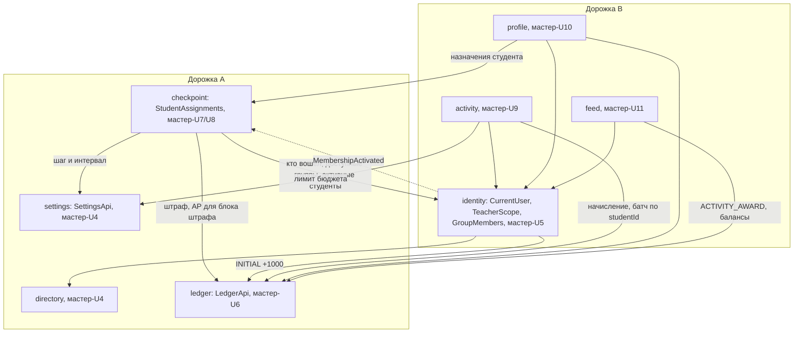
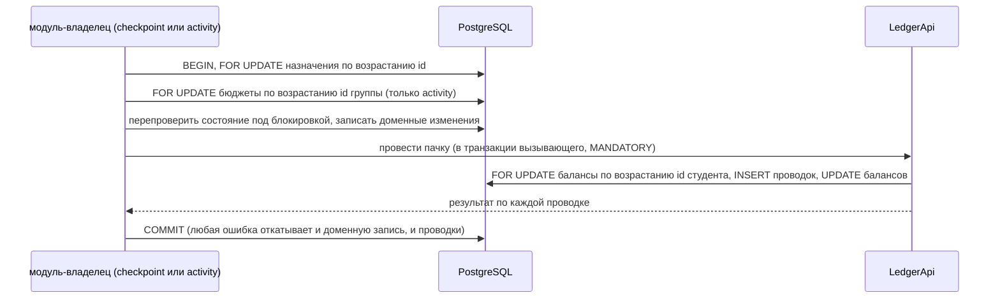

# U3 API Contract - Plan

## Goal Capsule

- **Цель.** Контракт API модулей 1–4 и сигнатуры швов между дорожками готовы к ревью второго разработчика утром 08.11: после него backend и frontend обеих дорожек пишутся против контракта и тестовых двойников без вопросов друг к другу.
- **Иерархия источников.** Мастер-план `docs/spec/plans/2026-10-31-001-feat-campus-rating-mvp-plan.md` (раздел U3, R1–R23, R31, R47–R50, KTD3, KTD5, KTD7, KTD8, KTD9, KTD11, KTD12, KTD17, KTD18, KTD23, тестовые сценарии мастер-U5–U11, Sequencing and Team Lanes), `docs/spec/glossary.md`, `docs/spec/ux/screen-map.md`, ADR003, ADR004, ADR007. Здесь R, KTD и U — локальные, ссылки на мастер-план помечены «мастер-». Контракт не меняет продуктовое поведение: неоднозначный R мастера — вопрос в PR, а не решение в YAML.
- **Профиль исполнения.** U1–U6 — документы, их пишет Claude: решения дизайнерские, а не механические. U7 — код после слияния мастер-U2, его пишет Codex, ревьюит Claude. Ревью контракта — второй разработчик (мастер-U3 Verification).
- **Остановись и спроси, если:**
  - операция требует поведения, которого нет в R мастер-плана;
  - шов требует изменить мастер-KTD3, KTD5, KTD23 или направление зависимостей модулей мастер-плана;
  - U7 не может стартовать, потому что мастер-U2 ещё не влит;
  - закреплённый инструмент сравнения не проходит пробные сравнения KTD14.
- **Ветка.** `u3-contract` от `main`. U1–U6 — один PR (U3a); U7 — отдельный PR (U3b) после слияния мастер-U2. Файлы скелета мастер-U2 (`backend/`, `frontend/`, `e2e/`, `.github/`) до его слияния не трогаются.

---

## Product Contract

### Summary

Один файл `docs/spec/api/openapi.yaml` описывает все операции модулей 1–4, вход, регистрацию, сессию, CSRF и смену пароля, единый формат ошибок и курсорную пагинацию, с примерами для каждого успешного ответа. Рядом `docs/spec/api/module-seams.md` фиксирует сигнатуры и гарантии швов между модулями разных дорожек. Генерация типов, клиент, MSW-моки и тест совместимости с backend появляются вторым PR после скелета.

### Problem Frame

С 08.11 дорожки A и B работают параллельно: A — справочники, настройки, журнал проводок, точки и штрафы, B — пользователи, доступ, активности, профиль и ленты. Экраны B читают данные модулей A (баланс, задачи, история), модули A проверяют личность, доступ и состав групп через модули B, а бюджет B читает лимит из настроек A. Без общего контракта и сигнатур швов каждая сторона придумает свои поля, коды ошибок и правила, и вечерняя стыковка 09.11 превратится в переделку. Мастер-план фиксирует только список ресурсов и три кода ошибок.

### Requirements

**Контракт**

- R1. `docs/spec/api/openapi.yaml` (OpenAPI 3.1) покрывает операции, нужные мастер-R1–R23, вход и выход, сессию и CSRF, регистрацию студента и преподавателя с допуском (мастер-R2), публичные настройки стенда для пометок формы регистрации (мастер-R47, R48), обязательную смену пароля (мастер-R49 в части смены, мастер-R50) и сверку журнала для администратора (мастер-U6).
- R2. Каждая операция называет роли и правило принадлежности ресурса (мастер-R3), включая отказ преподавателю, который не автор ресурса, и студенту чужой группы.
- R3. Ошибки — `application/problem+json` с полем `code` из закрытого перечня; ошибки бюджета, записи, участия и массового приёма несут данные, нужные экрану без второго запроса (мастер-R14, R19, R20).
- R4. Ленты и история — курсорная пагинация (мастер-KTD18) в одном формате.
- R5. Каждый успешный ответ и ключевые ошибки имеют пример на данных, согласованных с демо-сидом и каркасами; примеры проходят проверку схем.
- R6. Контракт проходит линтер с правилами проекта, и линтер падает на нарушении каждого правила.

**Швы**

- R7. `docs/spec/api/module-seams.md` описывает каждый шов между модулями разных дорожек: операции, входы, выходы, ошибки, транзакционные гарантии, владельца и порядок работы потребителя до готовности реализации.
- R8. Матрица сценариев мастер-U5–U11 показывает для каждого мастер-R1–R23, R31, R47–R50 операцию контракта, шов, событие или фоновое поведение и юнит-владельца проверки.

**После слияния мастер-U2**

- R9. Frontend генерирует типы из контракта, имеет типизированный клиент с CSRF, multipart и разбором `Problem` и MSW-моки на примерах контракта, работающие в браузере и в Vitest.
- R10. Backend проверяет вывод springdoc на совместимость с контрактом по реализованным операциям; CI запускает линтер и проверку «сгенерированные типы совпадают с контрактом».

### Scope Boundaries

- Администрирование, кроме сверки журнала (справочники на запись, импорт, семестры, настройки, старосты, выдачи доступа, временный пароль, допуск заявок, строка «Пароль выставлен» в профиле), — мастер-U13, расширяет контракт сам.
- Подтверждение email и членства (`/confirm/:token`, заявки членства) — мастер-U15; в контракте только коды ошибок входа, которые U15 начнёт отдавать.
- Опросы, персональная лента, аналитика, уведомления, ИИ — мастер-U16–U19.
- Реализация контроллеров и швов — мастер-U4–U11.

#### Deferred to Follow-Up Work

- U7 этого плана (PR U3b) — после слияния мастер-U2.

### Sources / Research

- Мастер-план: раздел U3 (список ресурсов, коды `BUDGET_EXCEEDED`, `NOT_ENROLLED`, `INVALID_STATE`), тестовые сценарии мастер-U5–U11 как источник полей и ошибок, диаграмма зависимостей модулей (`ledger` зависит только от `settings`), Sequencing and Team Lanes (четыре шва).
- `docs/spec/ux/screen-map.md`: маршруты экранов, пять состояний блока штрафа, ошибка бюджета «нужно, остаток, не хватает», итог массового приёма.
- Глоссарий: имена схем и перечислений.
- Spring Security: SPA-интеграция CSRF (отложенная загрузка токена, обновление после входа и выхода), `docs.spring.io/spring-security/reference/servlet/exploits/csrf.html`.
- Версии на 07.11.2026: `@redocly/cli` 2.76 (Node ≥ 22.12), `openapi-typescript` 7.13 (peer TypeScript `^5`), `openapi-fetch` 0.17, `msw` 3.0.4, `openapi-diff-core` 2.1.7 (известны проблемы сравнения типов 3.1, issue OpenAPITools/openapi-diff#745), springdoc 3.2.

---

## Planning Contract

### Key Technical Decisions

- KTD1. **OpenAPI 3.1, один файл, пути под `/api/v1` прямо в `paths`.** Полный путь в `paths` совпадает с путём контроллера и выводом springdoc без нормализации; `servers` — `/`. Действие над ресурсом — подпуть через `/` (`/assignments/{id}/return`), без `:`: в путях MSW двоеточие начинает параметр, а Spring примет `5:return` за id; закреплено правилом линтера `paths-kebab-case`. Имена схем и перечислений — из глоссария на английском, описания — по-русски. Идентификаторы — `integer`, `format: int64`; баллы — `integer`; время — `date-time` в UTC; длительность — целые секунды (`intervalSeconds`). Отсутствующее значение — `type: [<тип>, "null"]` (в 3.1 нет `nullable`). Перечисления, которых нет в глоссарии литералами, задаются в контракте и вносятся в глоссарий (U6): `AssignmentStatus` (`IN_PROGRESS`, `SUBMITTED`, `OVERDUE`, `ACCEPTED`), `ActivityType` (`ACADEMIC`, `SOCIAL`), `ParticipationLevel` (25, 50, 75, 100), `GroupMembershipState` (`PENDING`, `ACTIVE`).
- KTD2. **Ошибки.** Базовая схема `Problem` — поля RFC 7807 и `code`. Варианты с обязательными данными — отдельные схемы через `allOf` с `code` как `const`, и операция ссылается на нужный вариант в своём ответе:
  - `ValidationProblem` (`400`, `VALIDATION_FAILED`) — `fieldErrors[]` (`field`, `code`, `message`);
  - `BudgetProblem` (`422`, `BUDGET_EXCEEDED`) — `budgets[]` (`groupId`, `groupName`, `needed`, `remaining`, `shortfall`);
  - `StudentsProblem` (`422` или `409`) для `NOT_ENROLLED`, `STUDENT_NOT_ELIGIBLE`, `ALREADY_CONFIRMED` — `studentIds[]`.

  Перечень кодов и статусов: `UNAUTHENTICATED` 401, `INVALID_CREDENTIALS` 401, `FORBIDDEN` 403, `GROUP_NOT_ACCESSIBLE` 403, `PASSWORD_CHANGE_REQUIRED` 403, `EMAIL_NOT_VERIFIED` 403, `CSRF_INVALID` 403, `NOT_FOUND` 404, `INVALID_STATE` 409, `EMAIL_TAKEN` 409, `EMAIL_RESERVED_FOR_TEACHER` 409, `ALREADY_CONFIRMED` 409, `VALIDATION_FAILED` 400, `PASSWORD_REUSED` 400, `FILE_TOO_LARGE` 413, `FILE_TYPE_NOT_ALLOWED` 415, `BUDGET_EXCEEDED` 422, `NOT_ENROLLED` 422, `STUDENT_NOT_ELIGIBLE` 422, `MEMBERSHIP_NOT_ACTIVE` 422, `ENROLLMENT_CLOSED` 422, `INTERNAL_ERROR` 500 (добавлен в мастер-U4: непредвиденная ошибка). Новый код — только правкой контракта. `EMAIL_NOT_VERIFIED` начинает отдавать мастер-U15.
- KTD3. **Курсорная пагинация.** Параметры `cursor` (непрозрачная строка) и `limit` (по умолчанию 20, максимум 100); ответ `{ items, nextCursor }`, `nextCursor: null` — конец. Курсор кодирует ключ сортировки и фильтр списка; курсор от другого фильтра или битый — `400 VALIDATION_FAILED` по полю `cursor`. Ключ — `(createdAt desc, id desc)` для истории и ленты наград (мастер-KTD18), `(время подтверждения desc, id desc)` для начислений преподавателя, `(ФИО, id)` для назначений точки. Активные задачи студента, рейтинг группы, точки и активности преподавателя, участники активности отдаются целиком: их мало, а порядок «сначала просроченные» курсором `(createdAt, id)` не описать. Завершённые задачи — курсор по `(acceptedAt desc, id desc)`.
- KTD4. **Сессия и CSRF.** Сессия — cookie (мастер-KTD8, ADR003). CSRF — схема Spring Security для SPA: cookie `XSRF-TOKEN` (не HttpOnly), заголовок `X-XSRF-TOKEN` на `POST`, `PUT`, `PATCH`, `DELETE`. Spring Security откладывает выдачу токена и меняет его при входе и выходе, поэтому публичный `GET /api/v1/auth/csrf` (`204`) гарантированно выставляет свежий cookie: фронт вызывает его при старте и после входа, выхода и смены пароля. Вход — обычный контроллер с JSON-телом, а не `formLogin`: его видит springdoc, и ответы описываются как у любой операции. Регистрация не создаёт сессию: ответ говорит, что дальше — вход или подтверждение email. Пока у пользователя `mustChangePassword`, любая операция, кроме смены пароля, `GET /auth/me`, `GET /auth/csrf` и выхода, отвечает `403 PASSWORD_CHANGE_REQUIRED` (мастер-R49).
- KTD5. **Перечисление учётных записей.** Вход отвечает одинаковым `401 INVALID_CREDENTIALS` на неизвестный email и неверный пароль; `EMAIL_NOT_VERIFIED` — только после верного пароля. Регистрация студента проверяет список преподавателей (`EMAIL_RESERVED_FOR_TEACHER`) раньше занятости email, чтобы ответ не выдавал, зарегистрировался ли уже преподаватель из списка. Различимость `EMAIL_TAKEN` при регистрации следует мастер-U5 («повторный email отклоняется с понятной ошибкой поля»); это принятая цена.
- KTD6. **Сессия описывает допуск и членство.** `GET /auth/me` отдаёт `id`, `role`, `fullName`, `email`, `mustChangePassword`, для преподавателя — `teacherApproved` (логическое; запись `TeacherApproval` есть или нет) и кафедру, для студента — группу и `GroupMembershipState`. По этим полям фронт показывает плашки «Заявка ждёт подтверждения администратора» и «Членство ждёт подтверждения» (мастер-R2, R32) без отдельных запросов.
- KTD7. **Справочники для регистрации публичны.** Чтение факультетов, групп факультета и кафедр факультета не требует входа: форма регистрации — публичная страница (мастер-R3). Публичные операции имеют `security: []` и `x-public: true`. Запись справочников — мастер-U13.
- KTD8. **Статус и штраф считает сервер.** Назначение отдаёт хранимое `state`, вычисленный `status` (мастер-KTD7) и блок `penalty`: `charged`, `cap`, `step`, `intervalSeconds`, `phase` и `nextAt`, `nextAmount`. Значения по фазам (карта экранов):

  | `phase` | Когда | `nextAt` | `nextAmount` |
  |---|---|---|---|
  | `BEFORE_DEADLINE` | `OPEN`, время ≤ дедлайна | дедлайн: слот 0 списывается сразу после него (мастер-AE1) | `min(step, cap)` |
  | `RUNNING` | `OPEN`, после дедлайна, потолок не достигнут, АР > 0 | начало ближайшего необработанного слота (текущего, если планировщик его не прошёл) | по мастер-R11 на текущем АР |
  | `ZERO_BALANCE` | как `RUNNING`, но АР = 0 | начало следующего слота | `0` |
  | `CAP_REACHED` | списано = стоимость | `null` | `null` |
  | `STOPPED` | `SUBMITTED` или `ACCEPTED` | `null` | `null` |

  Фронт не повторяет формулу мастер-R11, а только ведёт обратный отсчёт до `nextAt`. Для `ZERO_BALANCE` пополнение АР внутри уже обработанного слота штраф за этот слот не даёт (мастер-AE4), `nextAt` всё равно указывает на следующий слот. АР для расчёта `checkpoint` читает через `LedgerApi`.
- KTD9. **Представление зависит от смотрящего, а не только от владельца.** Профиль — `oneOf` по `role` владельца с `discriminator.mapping` и `required: [role]` в каждой ветке. Задачи в профиле студента — три схемы по полю `view`: `PublicProfileTask` (название, дедлайн, статус, списанный штраф) для чужого профиля; `OwnProfileTask` — плюс `assignmentId` для перехода в задачу; `AdminProfileTask` — плюс `assignmentId` для экрана «Материалы сдачи». Ссылка, файл и комментарий возврата в профиле не отдаются никогда: их видно только в чтении назначения с проверкой прав (мастер-R3, R5). Экран `/admin/submissions/:id` адресуется `assignmentId`.
- KTD10. **Подтверждение участия: предпросмотр и повтор.** `POST /activities/{id}/participation/preview` с тем же телом, что подтверждение, возвращает суммы по студентам и бюджет по группам без записи (экран мастер-U9 «итог и бюджет по группам до отправки»). И предпросмотр, и подтверждение: студент, уже подтверждённый с тем же уровнем, идёт в `alreadyConfirmed[]` и не расходует бюджет; другой уровень у любого студента — весь запрос `409 ALREADY_CONFIRMED` с `studentIds[]`; студент вне целевых групп или с `PENDING`-членством — `422 STUDENT_NOT_ELIGIBLE`; незаписанный на `SOCIAL` — `422 NOT_ENROLLED`.
- KTD11. **Массовый приём.** `assignmentIds[]` дедуплицируется; id не из этой точки — весь запрос `400 VALIDATION_FAILED` до изменений (автор точки и так видит её назначения, раскрывать нечего). Ответ — `200` с `accepted[]` и `skipped[]` (id и код причины, `INVALID_STATE`): частичный успех — штатный итог мастер-R14.
- KTD12. **Роли и правила доступа в контракте.** У каждой операции `x-roles` — массив из `AUTHENTICATED`, `STUDENT`, `TEACHER`, `ADMIN` — или, у публичной, `x-public: true` (отдельное поле: смешанный `[PUBLIC, STUDENT]` выпадал бы из правил линтера), и строка описания «Доступ: …» с правилом принадлежности. Разделение проверок (мастер-KTD23, ADR007): создание точки, активности и чтение рейтинга группы — по доступным группам; приём, возврат, подтверждение участия и чтение своих назначений и участников — по авторству ресурса, даже если группа уже недоступна; бюджет — доступные группы плюс группы своих активностей. Каждая непубличная операция перечисляет `401` и `403`.
- KTD13. **Линтер — Redocly CLI 2.76** с набором `recommended` и правилами проекта в `docs/spec/api/redocly.yaml`, все правила проекта с `severity: error`, включая проверку примеров (`no-invalid-media-type-examples`, по умолчанию `warn`). Правила проекта — configurable rules: у операции есть `operationId`, `x-status` и ровно одно из `x-roles` (допустимые значения, массив) или `x-public: true`; непубличная задаёт явный непустой `security` с сессией и ответы `401` и `403`; публичная — `security` без сессии; изменяющая — CSRF, чтение — без него; у успешного ответа есть пример. Полный список и негативные прогоны — `docs/spec/api/README.md`. До U7 запускается через `npx --yes @redocly/cli@2.76.0`, без `package.json`.
- KTD14. **Совместимость backend с контрактом (U7).** У каждой операции контракта — `x-status: planned | implemented`; юнит, реализующий операцию, переводит её в `implemented` своим PR. `ContractCompatibilityIT` берёт `/v3/api-docs` поднятого приложения и требует:
  1. каждая операция springdoc есть в контракте (метод и полный путь);
  2. каждая `implemented`-операция контракта есть в springdoc;
  3. для пересечения — совместимость параметров, тел запросов и схем ответов `2xx` по `oasdiff` 1.37.0 (`breaking --format json --fail-on WARN`).

  springdoc описывает multipart плоским объектом из `@RequestPart`, а контракт — `oneOf` с запретом второй части; сравнение multipart-тела `submitAssignment` в U7 решается явно (исключение из сравнения тела или `@Schema` на контроллере), а не молча. До выбора инструмента U7 гоняет пробные сравнения на смену типа поля, `null`, `oneOf`, `required` и multipart; если закреплённый инструмент их не ловит — стоп и вопрос, сравнение только по `operationId` равноценной заменой не считается.
- KTD15. **Швы — документ с сигнатурами, код пишут владельцы.** `module-seams.md` задаёт сигнатуры на уровне Java-типов, транзакционные гарантии и правила вызова. Интерфейсы создают владельцы в своих юнитах; до готовности потребитель в своих тестах использует тестовый двойник по сигнатуре, в `main` заглушек нет. Направления зависимостей — по диаграмме мастер-плана: `ledger` не зависит от `identity`, `checkpoint`, `activity`, поэтому всё, что журнал показывает в истории, он получает при проводке снимком (название источника, ФИО автора).
- KTD16. **Клиент и моки (U7).** `openapi-typescript` 7.13 генерирует `frontend/src/api/schema.d.ts`; он объявляет peer TypeScript `^5`, а фронт на TypeScript 6 — установка с `overrides` на TypeScript проекта, запасной путь — изолированный `npx` с TypeScript 5.9 в скрипте `api:gen`. Клиент — `openapi-fetch` 0.17 с промежуточным слоем: CSRF-заголовок на изменяющих методах, разбор `Problem` в ошибку с `code`; сдача — `bodySerializer` с `FormData` без ручного `Content-Type`. `api:gen` также генерирует `frontend/src/mocks/examples.generated.ts` — разыменованные примеры ответов: браузерный MSW не читает YAML. MSW подключается в `main.tsx` по флагу до рендера, worker — `frontend/public/mockServiceWorker.js` от `msw init`.

### High-Level Technical Design

Швы между модулями и их владельцы (направления — по диаграмме мастер-плана):



Сплошная стрелка — вызов шва, пунктир — событие (мастер-KTD11). `CheckpointCreated` — событие внутри дорожки A (мастер-U7), в `module-seams.md` описано как встречная сторона `MembershipActivated`.

Протокол транзакции начисления (мастер-KTD5), который `LedgerApi` закрепляет для всех вызывающих:



Карта ресурсов контракта по модулям:

| Модуль | Ресурсы | Мастер-R | Владелец реализации |
|---|---|---|---|
| identity | `/auth/csrf`, `/auth/login`, `/auth/logout`, `/auth/me`, `/auth/config`, `/auth/register/student`, `/auth/register/teacher`, `/auth/password`, `/me/accessible-groups` | R1–R3, R8, R31, R47–R50 | мастер-U5 (B) |
| directory | `/directory/faculties`, `/directory/faculties/{id}/groups`, `/directory/faculties/{id}/departments` | R1, R2, R4 | мастер-U4 (A) |
| checkpoint | `/checkpoints`, `/checkpoints/defaults`, `/checkpoints/{id}`, `/checkpoints/{id}/assignments`, `/checkpoints/{id}/assignments/accept`, `/me/assignments`, `/assignments/{id}`, `/assignments/{id}/submission`, `/assignments/{id}/submission/file`, `/assignments/{id}/return` | R7, R10–R12, R14–R16, R24 (чтение) | мастер-U7 (A) |
| activity | `/activities`, `/activities/{id}`, `/activities/{id}/enrollment`, `/activities/{id}/participants`, `/activities/{id}/participation`, `/activities/{id}/participation/preview`, `/budgets`, `/me/awards`, `/me/awards/summary` | R17–R21 | мастер-U9 (B) |
| ledger | `/ledger/{userId}/entries`, `/admin/ledger/reconciliation` | R6, мастер-U6 | мастер-U6 (A) |
| profile | `/users/{id}/profile` | R5 | мастер-U10 (B) |
| feed | `/feed/awards`, `/groups/{id}/ratings` | R22, R23 | мастер-U11 (B) |

Все пути — под `/api/v1`. Точные параметры и схемы фиксируют U2–U5; таблица — карта, а не замена контракта.

### Output Structure

```text
docs/spec/api/
  openapi.yaml        # U1–U5
  redocly.yaml        # U1
  module-seams.md     # U6
  README.md           # U6: как читать и расширять контракт, матрица сценариев
frontend/             # U7, после мастер-U2
  public/mockServiceWorker.js
  src/api/schema.d.ts, client.ts, client.test.ts
  src/mocks/examples.generated.ts, handlers.ts, browser.ts, server.ts, handlers.test.ts
backend/src/test/java/ru/campusrating/ContractCompatibilityIT.java   # U7
```

### Assumptions

Решения агента, которые второй разработчик проверяет на ревью контракта:

- Пароль — от 8 символов и не больше 72 байт в UTF-8 (предел BCrypt); других правил сложности нет.
- Регистрация не создаёт сессию (KTD4): после неё фронт ведёт на вход.
- Рейтинг группы и активные задачи студента отдаются целиком, без пагинации (KTD3).
- Запись на активность — `PUT` (идемпотентно), отмена — `DELETE` того же ресурса.
- Журнал хранит снимок названия источника и ФИО автора на момент проводки (KTD15): переименование точки или смена ФИО не меняют прошлую историю.

### Risks and Dependencies

| Риск | Митигация |
|---|---|
| Контракт понят исполнителем B иначе, ревью 08.11 затягивается | Матрица сценариев и примеры на демо-данных (U6); вопросы — в PR, правки до начала мастер-U5 |
| `openapi-typescript` 7.13 не работает с TypeScript 6 | KTD16: `overrides`, запасной изолированный запуск |
| Регрессия сравнения схем 3.1 | KTD14: закреплённые негативные пробы в каждом verify, иначе стоп |
| Ресурсы позднее разрастаются (U13–U19) и ломают имена | Правило KTD2 «новый код — правкой контракта», пространства путей по модулям, `x-status` |
| Единый `ProblemDetail` (KTD2, мастер-U3) меняет ответ на неизвестный путь `/api/…`: `application/problem+json` с `instance` вместо `path` | `SmokeIT#missingApiReturnsJsonError` мастер-U2 ждёт `application/json` и `path`; юнит, включающий `ProblemDetail` в backend, правит его в том же PR (e2e-смоук мастер-U2 проверяет только JSON и `status`) |
| Шов нарушает направление зависимостей модулей мастер-плана | KTD15: проверка каждой сигнатуры по диаграмме; `ModularityTest` мастер-U2 ловит нарушение в коде |

---

## Implementation Units

### U1. Основа контракта и линтер

- **Goal.** Каркас `openapi.yaml` с общими компонентами и линтер, который ловит нарушение каждого правила проекта.
- **Requirements.** R2, R3, R4, R6; KTD1, KTD2, KTD3, KTD4, KTD12, KTD13.
- **Dependencies.** нет.
- **Files:** `docs/spec/api/openapi.yaml`, `docs/spec/api/redocly.yaml`.
- **Approach:**
  1. `info`, `servers: [/]`, схема безопасности cookie сессии и заголовок CSRF по KTD4, глобальная `security` — сессия.
  2. Компоненты: `Problem` и варианты по KTD2, ответы `Unauthenticated`, `Forbidden`, `NotFound`, `Validation`; параметры `cursor`, `limit`; шаблон страницы по KTD3; `UserRef` (id, ФИО), `StudyGroupRef` (id, название, факультет); перечисления по KTD1.
  3. `redocly.yaml` — правила KTD13.
- **Test scenarios:**
  - Линтер на каркасе проходит.
  - Временная операция без `x-roles` — линтер падает с ненулевым кодом.
  - Временная операция с `x-roles: [STUDENT, GUEST]` — падает (недопустимое значение).
  - Временная непубличная операция без ответа `403` — падает.
  - Временная операция с `x-public: true` без `security` — падает; со смешанным `x-roles: [PUBLIC, STUDENT]` — падает.
  - Временный пример с полем не того типа — падает (проверка примеров — `error`).
- **Verification.** Линтер зелёный; каждый негативный прогон давал ненулевой код возврата, временные правки удалены.

### U2. Вход, сессия, регистрация, справочники

- **Goal.** Всё, что нужно мастер-U5 и форме регистрации, описано вместе с допуском преподавателя и CSRF-циклом.
- **Requirements.** R1, R2, R3, R5; мастер-R1–R3, R8, R31, R47–R50; KTD4, KTD5, KTD6, KTD7.
- **Dependencies.** U1.
- **Files:** `docs/spec/api/openapi.yaml`.
- **Approach.** Операции по строкам identity и directory таблицы HTD. Регистрация студента — ФИО, email, пароль, факультет, группа; преподавателя — ФИО, email, пароль, кафедра; ответ — `201` с `nextStep` (`LOGIN` или `CONFIRM_EMAIL`). `GET /auth/config` — `demo`, `emailVerification`. `GET /me/accessible-groups` — доступные группы преподавателя (пусто без допуска) для форм точек и активностей. Пароль — по Assumptions.
- **Test scenarios:**
  - Пример полного цикла в описании операции: `GET /auth/csrf` → регистрация → `GET /auth/csrf` → вход → изменяющий запрос → выход → `GET /auth/csrf` → вход.
  - Регистрация студента в группу не того факультета — `VALIDATION_FAILED` с `fieldErrors` по `groupId`.
  - Регистрация студентом email из списка преподавателей — `EMAIL_RESERVED_FOR_TEACHER`, даже если преподаватель с этим email уже зарегистрирован.
  - Регистрация преподавателя при `off` — `201`, `nextStep: LOGIN`; `GET /auth/me` этого пользователя — `teacherApproved: false`.
  - Вход с неизвестным email и вход с неверным паролем — одинаковый `401 INVALID_CREDENTIALS`.
  - `GET /auth/me` с `mustChangePassword: true`; любая операция, кроме перечисленных в KTD4, описывает `403 PASSWORD_CHANGE_REQUIRED`.
  - Пароль на 73 байта (кириллица, 37 символов) — `VALIDATION_FAILED`; на 72 байта — проходит; смена на тот же — `PASSWORD_REUSED`.
  - Справочники описаны с `security: []` и без ответа `401`.
- **Verification.** Линтер зелёный; каждый тестовый сценарий мастер-U5 про API находит в контракте операцию и код ответа.

### U3. Контрольные точки, назначения, сдача

- **Goal.** Полный цикл точки, списки преподавателя и студента и блок штрафа описаны для мастер-U7 и экранов задач.
- **Requirements.** R1, R2, R3, R5; мастер-R7, R10–R12, R14–R16, R24 (чтение материалов), R47; KTD3, KTD8, KTD9, KTD11, KTD12.
- **Dependencies.** U1.
- **Files:** `docs/spec/api/openapi.yaml`.
- **Approach:**
  1. `GET /checkpoints` — точки текущего преподавателя со счётчиками `submittedCount` и `totalCount` (экраны «Мои точки» и «Главная»). Создание — название, описание, `groupIds`, дедлайн, стоимость; ответ показывает зафиксированные шаг и интервал. `GET /checkpoints/defaults` — текущие шаг, интервал и минимальный интервал (2 × poll-period, мастер-KTD4).
  2. `GET /me/assignments?view=active|completed` по KTD3: активные целиком, сначала `OVERDUE`, затем по дедлайну; завершённые — курсор. Без `ACTIVE`-членства — пустой список и `membershipState` в ответе для текста экрана.
  3. Назначение — `state`, `status`, `penalty` по KTD8, комментарий возврата, сдача (ссылка или имя файла). Сдача — `multipart/form-data`: ровно одна из частей `link` или `file` (мастер-KTD12: 10 МБ; pdf, docx, zip, png, jpg).
  4. Массовый приём по KTD11; возврат — обязательный комментарий.
  5. Список назначений точки — фильтр по статусу, курсор, ФИО студента.
- **Test scenarios:**
  - Пример назначения в каждой из пяти фаз KTD8 на числах мастер-AE1 и AE4.
  - Пример массового приёма трёх назначений, одно в `OPEN`: два в `accepted`, одно в `skipped` с `INVALID_STATE`; запрос с id чужой точки — `400` до изменений.
  - Создание точки для недоступной группы — `403 GROUP_NOT_ACCESSIBLE`.
  - Чужой преподаватель на `/checkpoints/{id}/assignments`, `…/assignments/accept`, `/assignments/{id}/return` и чтение сдачи — `403 FORBIDDEN`, даже если группа ему доступна.
  - Автор точки после потери доступа к группе принимает и возвращает работы (описание доступа по KTD12).
  - Сдача из `SUBMITTED` — `409 INVALID_STATE`; файл 11 МБ — `413 FILE_TOO_LARGE`; `.exe` — `415 FILE_TYPE_NOT_ALLOWED`; ни ссылки, ни файла или оба сразу — `400`.
  - Скачивание файла сдачи другим студентом — `403`; администратором — `200`; приём и возврат для администратора — `403`.
- **Verification.** Линтер зелёный; тестовые сценарии мастер-U7 про API находят операции и коды.

### U4. Активности, участие, бюджет

- **Goal.** Цикл активности с записью, предпросмотром, подтверждением и бюджетом описан для мастер-U9.
- **Requirements.** R1, R2, R3, R5; мастер-R17–R21, R32; KTD2, KTD3, KTD10, KTD12.
- **Dependencies.** U1.
- **Files:** `docs/spec/api/openapi.yaml`.
- **Approach:**
  1. `GET /activities` и `GET /activities/{id}`: студенту — только активности его группы, с `enrolled` и `myAward` (уровень и сумма, если подтверждён); преподавателю — созданные им. Студенту чужой группы — `403 FORBIDDEN`.
  2. Запись — `PUT`, отмена — `DELETE` `/activities/{id}/enrollment`; только `SOCIAL`, только до времени начала (`ENROLLMENT_CLOSED`), только с `ACTIVE`-членством (`MEMBERSHIP_NOT_ACTIVE`).
  3. Участники для подтверждения: у `SOCIAL` — записавшиеся, у `ACADEMIC` — студенты целевых групп с `ACTIVE`-членством; у каждого — подтверждённый уровень, если есть.
  4. Предпросмотр и подтверждение по KTD10; успех подтверждения — начисления по студентам, `alreadyConfirmed[]` и итог.
  5. `GET /budgets?month=` — по KTD12 за месяц по Москве: лимит, расход, остаток. `GET /me/awards` — курсорная история начислений преподавателя; `GET /me/awards/summary?month=` — сумма и число начислений за месяц по группам и валютам, совпадающие с расходом бюджета.
- **Test scenarios:**
  - Covers AE8 мастера. Пример `422 BUDGET_EXCEEDED`: ИВТ-21, нужно 100, остаток 50, не хватает 50.
  - Covers AE9 мастера. Пример предпросмотра: максимум 75, уровень 50 → 38.
  - Covers AE10 мастера. Пример `422 NOT_ENROLLED` с `studentIds` для `SOCIAL`; то же подтверждение для `ACADEMIC` — `200`.
  - Повторное подтверждение с тем же уровнем — `200`, студент в `alreadyConfirmed`, расход бюджета не меняется; с другим уровнем — `409 ALREADY_CONFIRMED`.
  - Студент с `PENDING`-членством в подтверждении — `422 STUDENT_NOT_ELIGIBLE`; в записи — `422 MEMBERSHIP_NOT_ACTIVE`.
  - Подтверждение до времени начала — `409 INVALID_STATE`; запись после начала — `422 ENROLLMENT_CLOSED`; максимум 1 при создании — `400`.
  - Чужой преподаватель на `/participants` и `/participation*` — `403 FORBIDDEN`.
- **Verification.** Линтер зелёный; тестовые сценарии мастер-U9 про API находят операции и коды.

### U5. Профиль, история, лента наград, рейтинги, сверка журнала

- **Goal.** Чтение для мастер-U6, мастер-U10 и мастер-U11 описано, включая представления профиля по смотрящему.
- **Requirements.** R1, R2, R4, R5; мастер-R5, R6, R22, R23; KTD3, KTD9, KTD15.
- **Dependencies.** U1.
- **Files:** `docs/spec/api/openapi.yaml`.
- **Approach.** Профиль по KTD9: студент (ФИО, факультет, группа, балансы АР, БУА, БОА, активные и завершённые задачи), преподаватель (ФИО, кафедра, факультет), администратор (ФИО, роль). Запись истории — дата, валюта, знаковая сумма, вид, источник (`type`, `id`, `title` из снимка), автор (`UserRef` из снимка) или `null` для системы (мастер-R6). Лента наград — только `ACTIVITY_AWARD`. Рейтинг — сортировка `AR`, `BUA`, `BOA`, при равенстве — по ФИО. Сверка журнала — пары (студент, валюта), где снимок не равен сумме журнала; пустой список — инвариант держится.
- **Test scenarios:**
  - Пример строки истории по образцу мастер-R6: `+50 БОА`, «Помощь в организации конференции», автор — преподаватель.
  - Пример штрафа в истории — источник точка, автор `null`.
  - Пример чужого профиля студента — задачи `PublicProfileTask` без `assignmentId`; своего — `OwnProfileTask`; администратора — `AdminProfileTask`; ни в одном нет ссылки, файла и комментария возврата.
  - Профиль без сессии — `401`.
  - Рейтинг недоступной группы — `403 GROUP_NOT_ACCESSIBLE`.
  - Сверка журнала не администратором — `403`.
- **Verification.** Линтер зелёный; тестовые сценарии мастер-U6, U10 и U11 про API находят операции и коды.

### U6. Швы, матрица сценариев, глоссарий

- **Goal.** Обе дорожки знают сигнатуры, гарантии и владельцев швов, а покрытие требований проверяется по сценариям.
- **Requirements.** R7, R8; мастер-KTD3, KTD5, KTD11, KTD23; KTD1, KTD12, KTD15.
- **Dependencies.** U2–U5.
- **Files:** `docs/spec/api/module-seams.md`, `docs/spec/api/README.md`, `docs/spec/README.md` (строка о `api/`), `docs/spec/glossary.md` (литералы перечислений KTD1).
- **Approach.** Каждый шов — владелец, юнит, операции, гарантии, тестовый двойник (KTD15):
  1. `LedgerApi` (ledger, мастер-U6, A). Запись — «провести пачку»: элементы (студент, валюта, вид, номинальная сумма, источник с `type`, `id` и снимком `title`, автор с id и снимком ФИО или `null`, ключ идемпотентности); результат по каждому — «проведено», «уже было» (та же проводка) или «ноль, не записано». Вызывается только в транзакции вызывающего (`MANDATORY`), без собственного commit, последним шагом протокола HTD; балансы блокирует сам по возрастанию id студента. Чтение: балансы одного и многих студентов, страница истории, страница наград для ленты, сверка инварианта.
  2. `CurrentUser` (identity, мастер-U5, B): id, роль, ФИО, флаг смены пароля, допуск, членство; отказ `UNAUTHENTICATED` без сессии.
  3. `TeacherScope` (identity, мастер-U5, B): доступные группы преподавателя и проверка одной или нескольких групп с отказом `GROUP_NOT_ACCESSIBLE`; без допуска — пусто. Где применяется, а где — авторство, — по KTD12.
  4. `GroupMembers` (identity, мастер-U5, B): `ACTIVE`-студенты групп (id, ФИО, группа, время активации), членство одного студента, ФИО пользователей по id (`UserRef`). Нужен мастер-U7 (назначения и встречная сверка), U9 (участники, группировка бюджета), U10, U11.
  5. `SettingsApi` (settings, мастер-U4, A): шаг и интервал штрафа, poll-period, N семестра, лимит бюджета; чтение при каждом использовании (мастер-KTD10). Нужен мастер-U7, U8, U9.
  6. `StudentAssignments` (checkpoint, мастер-U7, A): активные и завершённые задачи студента в представлениях KTD9 для профиля (мастер-U10).
  7. События: `MembershipActivated` (студент, группа, время активации) — публикует identity в транзакции активации, слушает checkpoint после commit (мастер-KTD11); встречная сверка `CheckpointCreated` внутри дорожки A читает `GroupMembers`; обе стороны идемпотентны по уникальной паре (точка, студент) (мастер-U7).
  8. `README.md`: как читать контракт, порядок расширения (контракт → `x-status` → генерация → код), матрица сценариев по R8 с колонками «мастер-R», «сценарий мастер-U», «операция», «шов, событие или фоновое поведение», «владелец проверки».
- **Test expectation: none -- документация; проверка — сверка каждой сигнатуры с диаграммой зависимостей мастер-плана и ревью второго разработчика.**
- **Verification.** Каждый R1–R23, R31, R47–R50 мастера есть в матрице со своим сценарием и владельцем; ни одна сигнатура не требует зависимости модулей против диаграммы мастер-плана; второй разработчик подтверждает в PR, что по контракту и швам может начать мастер-U5 и мастер-U9 без вопросов.

### U7. Типы, клиент, моки и совместимость (PR U3b, после мастер-U2)

- **Goal.** Контракт подключён к коду: фронт типизирован и работает против моков, backend проверяется на совместимость, CI ловит расхождения.
- **Requirements.** R9, R10; KTD13, KTD14, KTD16.
- **Dependencies.** U1–U6; слияние мастер-U2.
- **Files:** `frontend/package.json`, `frontend/package-lock.json`, `frontend/src/main.tsx`, `frontend/public/mockServiceWorker.js`, `frontend/src/api/schema.d.ts`, `frontend/src/api/client.ts`, `frontend/src/api/client.test.ts`, `frontend/src/mocks/examples.generated.ts`, `frontend/src/mocks/handlers.ts`, `frontend/src/mocks/browser.ts`, `frontend/src/mocks/server.ts`, `frontend/src/mocks/handlers.test.ts`, `tools/install-oasdiff.mjs`, `frontend/scripts/generate-api.mjs`, `backend/pom.xml`, `backend/src/test/java/ru/campusrating/ContractCompatibilityIT.java`, `.github/workflows/ci.yml`, `frontend/AGENTS.md`, `docs/spec/api/openapi.yaml` (только `x-status`).
- **Approach:**
  1. Скрипт `api:gen` по KTD16: типы и модуль примеров; оба файла генерируемые, руками не правятся.
  2. `client.ts` по KTD16.
  3. MSW: обработчики отвечают примерами; списки с курсором отдают две страницы (`page1` с `nextCursor`, `page2` с `null`); изменяющие операции отвечают примером состояния после действия.
  4. `ContractCompatibilityIT` по KTD14, сначала пробные сравнения инструмента.
  5. CI: в задание `frontend` — линтер контракта и `api:gen` с проверкой пустого `git diff`; в `backend` — `ContractCompatibilityIT` в составе `verify`.
- **Patterns to follow.** `frontend/AGENTS.md`, задания CI и скрипты `frontend/package.json` из скелета мастер-U2.
- **Execution note.** Начать с пробных сравнений `oasdiff` 1.37.0: от них зависит, как устроен `ContractCompatibilityIT`.
- **Test scenarios:**
  - `client.ts`: `POST`, `PUT`, `PATCH`, `DELETE` добавляют `X-XSRF-TOKEN` из cookie, `GET` — нет.
  - `client.ts`: сдача отправляет `multipart/form-data` с частью `file`, без ручного `Content-Type`, с CSRF-заголовком.
  - `client.ts`: ответ `application/problem+json` с `code: BUDGET_EXCEEDED` разбирается в ошибку с `budgets[]`.
  - MSW в Vitest: `GET /api/v1/feed/awards` отдаёт две страницы без дублей и с `nextCursor: null` на второй.
  - MSW в браузере (`npm run dev` с флагом): экран получает пример профиля, запрос перехвачен worker'ом.
  - Правка `openapi.yaml` без `api:gen` — CI падает на `git diff`.
  - `ContractCompatibilityIT`: временный контроллер с операцией вне контракта — падает; `implemented`-операция без контроллера — падает; переименованное поле DTO у реализованной операции — падает (мастер-U3).
- **Verification.** `npm --prefix frontend run api:gen` даёт пустой diff, `npm --prefix frontend run check` и `./backend/mvnw -f backend/pom.xml verify` зелёные, в CI зелёные задания `frontend` и `backend`.

---

## Verification Contract

| Ворота | Команда | Когда |
|---|---|---|
| Линтер контракта | `npx --yes @redocly/cli@2.76.0 lint --config docs/spec/api/redocly.yaml docs/spec/api/openapi.yaml` | U1–U6, затем в CI (U7) |
| Обвязка | `node tools/check-agent-docs.mjs`, `node --test "tools/test/*.test.mjs"` | каждый PR |
| Контракт ↔ типы | `npm --prefix frontend run api:gen` и пустой `git diff` | U7 и каждая правка `openapi.yaml` после него |
| Frontend | `npm --prefix frontend run check` | U7 |
| Backend | `./backend/mvnw -f backend/pom.xml verify` (с `ContractCompatibilityIT`) | U7 |

---

## Definition of Done

**PR U3a (U1–U6):**
- Линтер зелёный, негативные прогоны U1 падали; матрица покрывает мастер-R1–R23, R31, R47–R50.
- Второй разработчик в PR подтвердил, что начинает мастер-U5 и мастер-U9 по контракту и швам; его замечания закрыты правками или ответами.
- Запись в `docs/agent-log.md` — в этом PR после агентского ревью (`AGENTS.md`, шаг 5); итог ревью второго разработчика дописывается в неё до слияния.

**PR U3b (U7):**
- Ворота U7 зелёные локально и в CI.
- Нет ручных правок генерируемых файлов, временных контроллеров и правок из негативных проверок.

## Согласованная замена KTD14 (09.11)

Команда согласовала oasdiff 1.37.0 после провала исходной пробы openapi-diff-core 2.1.7: три несовместимые мутации OpenAPI 3.1 давали NO_CHANGES. oasdiff прошёл 9/9 проб, включая совместимые контрпримеры. Продуктовые требования и набор сравниваемых операций не меняются.

Установка: вспомогательный tools/install-oasdiff.mjs скачивает закреплённый release для Windows/Linux amd64, сверяет закреплённый SHA-256 и устанавливает бинарник в backend/target/tools. CI backend вызывает установку до verify; локально та же команда. Отсутствие или сбой инструмента делает проверку красной. Схемы передаются локальными JSON-файлами; внешние ссылки отключены. Негативные пробы остаются в ContractCompatibilityIT. Multipart сравнивается полностью: контроллер submitAssignment обязан явно описать oneOf из контракта; исключения для request body не вводятся.
