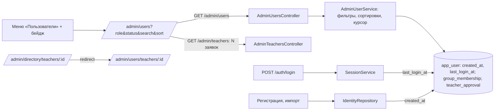

# Собрать людей в одной таблице «Пользователи» - Plan

**Target repo:** campus-rating

## Goal Capsule

- **Objective:** администратор находит и обслуживает любого человека — студента, преподавателя (включая заявки на допуск), администратора — в одной таблице «Пользователи»; в «Справочниках» остаются только факультеты, группы и кафедры.
- **Authority:** Requirements → Acceptance Examples → Key Decisions → планы U13 (`2026-11-12-006`, `2026-11-11-004`) → Sources.
- **Open blockers:** нет.

---

## Product Contract

### Problem Frame

- **Кто:** администратор.
- **Сейчас:** «Справочники» (`/admin/directory`) содержат ссылку «Преподаватели» с вкладками «Заявки / Все преподаватели» и карточкой допуска `/admin/directory/teachers/:id`; бейдж числа заявок — на пункте меню «Справочники». Отдельно «Пользователи» (`/admin/users`) — все роли с фильтром «Роль» и временным паролем, без статуса допуска. Время создания и последнего входа нигде не хранится.
- **Зачем:** замечание владельца: «преподаватели не в общем списке, при этом есть отдельно пользователи, при этом нет учеников».
- **Риски данных:** миграция добавляет пользователям время создания и время последнего входа; существующим пользователям время создания — момент выполнения миграции. Других изменений данных нет.

**Термины.** *Заявка преподавателя* — преподаватель без допуска (как сейчас в `TeacherBadge`). *Допущен* — преподаватель с допуском. *Членство* — `group_membership` студента: у каждого студента ровно одно (как сейчас: регистрация и импорт создают его вместе с пользователем); `ACTIVE` — «подтверждено», `PENDING` — «ждёт подтверждения». *Неуспешный вход* — отказ входа по любой причине; время не меняет. *Карточка преподавателя* — экран допуска и выдач (сейчас `TeacherPage`). *Вход* — успешный `POST /api/v1/auth/login`, в том числе с временным паролем.

### Requirements

**Меню и «Справочники»**

- R1. Меню администратора: «Справочники», «Пользователи», «Импорт», «Семестры», «Настройки», «Бюджеты» (как сейчас). Бейдж числа заявок преподавателей переносится с «Справочников» на «Пользователи» (источник: пользователь, интервью).
- R2. На «Справочниках» нет ссылки «Преподаватели» и ничего о людях; вкладки факультетов, групп, кафедр и ссылки «Аналитика» у групп (U17) остаются (источник: пользователь, интервью).

**Таблица «Пользователи» (`/admin/users`)**

- R3. Одна таблица всех пользователей. Колонки: «ФИО», «Email», «Роль», «Группа / кафедра» (у студента — группа членства при любом состоянии, у преподавателя — «<кафедра> · <факультет>», у администратора — «—»), «Статус», «Создан», «Последний вход», «Пароль выставлен», «Действия». Время — `ДД.ММ.ГГГГ ЧЧ:ММ` по Москве; нет значения — «—» (источник: пользователь, интервью).
- R4. «Статус»: студент — «Членство подтверждено» или «Ждёт подтверждения»; преподаватель — «Допущен» или «Заявка»; администратор — «—» (источник: пользователь, интервью).
- R5. Поиск — как сейчас (подстрока ФИО или email без учёта регистра, от 2 символов после обрезки пробелов; короче — не применяется). Поиск и фильтры R6 применяются вместе; при «Роль» = «Все» поиск идёт по всем ролям (источник: пользователь, интервью; план `006`/R2).
- R6. Фильтр «Роль»: «Все», «Студенты», «Преподаватели», «Администраторы». Фильтр «Статус»: «Все», «Заявка», «Допущен», «Ждёт подтверждения», «Членство подтверждено»; статус, не относящийся к выбранной роли, даёт пустой результат «Никого не нашли». По умолчанию оба «Все» (источник: пользователь, интервью).
- R7. Над таблицей кнопка «Заявки преподавателей (N)», N — число всех заявок в системе, без учёта поиска и фильтров (то же число, что в бейдже меню). Нажатие ставит «Роль» = «Преподаватели», «Статус» = «Заявка» и очищает поиск. При N = 0 кнопки и бейджа нет (источник: пользователь, интервью; сброс поиска — предложение).
- R8. Сортировка переключателем: «ФИО» (по умолчанию; ФИО по возрастанию, затем id), «Создан» (новые сверху), «Последний вход» (сначала «—», затем от давнего к недавнему). При равных значениях «Создан» и «Последний вход» — ФИО по возрастанию, затем id. По 50 строк, «Загрузить ещё»; смена поиска, фильтров или сортировки показывает первую страницу (источник: пользователь, интервью; план `006`/R3).
- R9. ФИО — ссылка: у преподавателя — карточка допуска `/admin/users/teachers/:id`, у студента и администратора — профиль `/users/:id`. В карточке преподавателя — ссылка «Профиль» на `/users/:id` (источник: пользователь, интервью; ссылка «Профиль» — предложение).
- R10. «Действия»: «Временный пароль» у студента и преподавателя (как сейчас, план `006`), у администратора пусто (источник: план `006`/R4).

**Адреса**

- R11. Карточка преподавателя — `/admin/users/teachers/:id`, содержимое без изменений (допуск, выдачи), кроме ссылки «Профиль» из R9. Старые адреса перенаправляют: `/admin/directory/teachers` → `/admin/users?role=TEACHER&status=PENDING`, `/admin/directory/teachers/:id` → `/admin/users/teachers/:id` (источник: пользователь, интервью).
- R12. Фильтры, поиск и сортировка — в адресе: `role` = `STUDENT` | `TEACHER` | `ADMIN` (нет — «Все»), `status` = `PENDING` (заявка) | `APPROVED` (допущен) | `MEMBERSHIP_PENDING` | `MEMBERSHIP_ACTIVE` (нет — «Все»), `search`, `sort` = `name` | `created` | `lastLogin` (нет — `name`). Открытие ссылки и обновление страницы восстанавливают фильтры, поиск и сортировку; загруженные «Загрузить ещё» строки не восстанавливаются — показывается первая страница (источник: предложение).

**Время создания и последнего входа**

- R13. «Создан» — момент вставки записи пользователя: при регистрации, импорте и вставке сидом; повторный запуск сида существующие записи не меняет. Пользователям, существующим до миграции, — одно значение для всех: время транзакции миграции (источник: пользователь, интервью).
- R14. «Последний вход» обновляется при каждом входе (термин «Вход», в том числе с временным паролем); неуспешный вход его не меняет; до первого входа после миграции — «—» (источник: пользователь, интервью).

**Не меняется**

- R15. «Импорт» → «Список преподавателей» (допуск по email) остаётся в «Импорте» без изменений, включая удаление записей (источник: пользователь, интервью).

### Key Decisions

- **Одна таблица с фильтрами вместо вкладок по ролям** (session-settled: user-directed — chosen over «вкладки Студенты / Преподаватели / Администраторы»: общий поиск по email без переходов). Governs R3–R8.
- **Заявки — фильтром в «Пользователях»** (session-settled: user-approved — chosen over «отдельный пункт меню»). Governs R1, R6, R7.
- **Перенос адресов с перенаправлением** (session-settled: user-approved — chosen over «оставить старые адреса»). Governs R11.
- **«Создан» существующих — момент миграции** (session-settled: user-directed — chosen over «по проводке регистрации у студентов» и «“—” всем»). Governs R13.

### Acceptance Examples

Стенд demo после миграции; время транзакции миграции — 12.11.2026 18:00 по Москве, демо-сид вставлен в той же сессии в 18:00. Каждый AE начинается с этого состояния. Петров и Волков — «Кафедра программной инженерии · Факультет информационных технологий»; Петров допущен, Волков — заявка.

- AE1. **Covers R1, R2.** Тогда: меню «Справочники, Пользователи, Импорт, Семестры, Настройки, Бюджеты»; бейдж «1» на «Пользователи», на «Справочниках» бейджа нет. На «Справочниках» вкладки «Факультеты», «Учебные группы», «Кафедры», у групп — «Аналитика», ссылки «Преподаватели» нет.
- AE2. **Covers R3, R4, R10, R13.** Тогда строки:
  - «Смирнова Анна Олеговна · smirnova@student.campus.test · Студент · ИВТ-21 · Членство подтверждено · 12.11.2026 18:00 · — · — · Временный пароль»;
  - «Орлов … · Студент · ИВТ-21 · Ждёт подтверждения»;
  - «Петров Павел Петрович · petrov@campus.test · Преподаватель · Кафедра программной инженерии · Факультет информационных технологий · Допущен · 12.11.2026 18:00 · — · — · Временный пароль»;
  - «Волков Максим Игоревич · … · Заявка · … · Временный пароль»;
  - «Администратор Демо · admin@campus.test · Администратор · — · — · 12.11.2026 18:00 · — · — ·» (без действий).
  Когда: Смирнове выставлен временный пароль 13.11 10:00. Тогда: «Пароль выставлен» — 13.11.2026 10:00.
- AE3. **Covers R5, R6.** Когда: открыть `/admin/users`. Тогда: «Роль» и «Статус» — «Все». Когда: поиск «PETROV@» при «Все». Тогда: одна строка Петрова. Когда: поиск «смир». Тогда: Смирнова. Когда: поиск «с» (1 символ). Тогда: поиск не применяется. Когда: поиск очищен, «Роль» = «Студенты», «Статус» = «Заявка». Тогда: «Никого не нашли». Когда: «Статус» = «Ждёт подтверждения». Тогда: Орлов. Когда: поиск «смир», «Роль» = «Преподаватели». Тогда: «Никого не нашли».
- AE4. **Covers R7.** Дано: поиск «смир». Когда: «Заявки преподавателей (1)». Тогда: поиск пуст, фильтры «Преподаватели» + «Заявка», строка Волкова. Когда: Волков допущен. Тогда: кнопки и бейджа нет.
- AE5. **Covers R8, R14.** Дано: Смирнова вошла 13.11 10:15, Петров — 13.11 09:00 и 13.11 11:00; неуспешный вход Волкова 13.11 12:00; студент «Тест Новый» зарегистрирован 13.11 11:30. Когда: «Последний вход». Тогда: сначала все без входа по ФИО (Администратор Демо, Волков, … Орлов …, Тест Новый), затем Смирнова (10:15), затем Петров (11:00); у Волкова «—». Когда: «Создан». Тогда: «Тест Новый» (13.11.2026 11:30) первым, затем остальные с 12.11.2026 18:00 по ФИО.
- AE6. **Covers R8.** Дано: 120 студентов «Тест 001»…«Тест 120». Когда: поиск «тест». Тогда: 50 строк, «Загрузить ещё» → 100 → 120, кнопки нет. Когда: после двух нажатий смена сортировки, фильтра или поиска. Тогда: снова первые 50.
- AE7. **Covers R9, R11.** Когда: клик по «Волков Максим Игоревич». Тогда: `/admin/users/teachers/2002` — допуск и выдачи как раньше и ссылка «Профиль» → `/users/2002`. Клик по «Смирнова …» и «Администратор Демо» — `/users/<id>`. Когда: открыть `/admin/directory/teachers/2002`. Тогда: `/admin/users/teachers/2002`. Когда: `/admin/directory/teachers`. Тогда: `/admin/users?role=TEACHER&status=PENDING`.
- AE8. **Covers R12.** Когда: открыть в новой вкладке `/admin/users?role=TEACHER&status=APPROVED&search=пет&sort=created`. Тогда: «Преподаватели», «Допущен», поиск «пет», сортировка «Создан», строка Петрова. Когда: «Загрузить ещё» и обновление страницы. Тогда: фильтры те же, первая страница.
- AE9. **Covers R13, R14.** Когда: импорт студента `ivanov@student.campus.test` 13.11 11:00. Тогда: «Создан» — 13.11.2026 11:00. Когда: Иванов входит по временному паролю 13.11 11:20. Тогда: «Последний вход» — 13.11.2026 11:20. Когда: повторный запуск демо-сида. Тогда: «Создан» у демо-пользователей не меняется.
- AE10. **Covers R10, R15.** Тогда: у Смирновой и Петрова «Временный пароль» открывает диалог подтверждения (план `006`); у администратора действий нет. «Импорт» → «Список преподавателей»: записи и удаление записи без регистрации — как раньше.

### Scope Boundaries

Не входит:
- Подтверждение членства студента администратором, изменение данных пользователя, блокировка и удаление.
- Изменение содержимого карточки преподавателя (допуск, выдачи).
- Перенос «Списка преподавателей» из «Импорта».

### Sources

- Планы U13: `docs/spec/plans/2026-11-12-006-feat-u13-users-temporary-passwords-plan.md` (R1–R4), `docs/spec/plans/2026-11-11-004-feat-u13-teachers-frontend-plan.md` (заявки, карточка).
- Код: `frontend/src/app/navigation.ts`, `frontend/src/features/admin/users/AdminUsersPage.tsx`, `frontend/src/features/admin/teachers/*` (`TeacherBadge`, `TeacherListPage`, `TeacherPage`), `frontend/src/features/admin/directory/DirectoryPage.tsx`, `GET /api/v1/admin/users`, таблица `app_user`.

---

## Planning Contract

**Product Contract preservation:** Product Contract unchanged.

### Key Technical Decisions

- KTD1. **Расширить существующий `GET /api/v1/admin/users`, нового эндпоинта нет.** Параметры: `search`, `role` (есть), `status` (`PENDING` | `APPROVED` | `MEMBERSHIP_PENDING` | `MEMBERSHIP_ACTIVE`), `sort` (`name` | `created` | `lastLogin`), `cursor`. В строке добавляются `status` (тот же enum), `createdAt`, `lastLoginAt` (nullable). Курсор кодирует ключ сортировки + ФИО + id и фильтры; чужой курсор — `VALIDATION_FAILED`, как сейчас. Governs R3–R8.
- KTD2. **Миграция `app_user`.** `created_at timestamptz NOT NULL DEFAULT now()` — существующие строки получают время транзакции миграции одним значением (R13); `last_login_at timestamptz NULL`. Индексы под сортировки: `(created_at DESC, full_name, id)`, `(last_login_at NULLS FIRST, full_name, id)`.
- KTD3. **Время — по часам приложения в одной точке вставки.** `IdentityRepository` (регистрация и импорт) пишет `created_at` из `Clock`; сид не меняется и получает `DEFAULT now()`. `last_login_at` пишет `SessionService.login` после успешной аутентификации, из `Clock`, в той же транзакции входа; неуспешный вход не доходит до записи (R14).
- KTD4. **Бейдж заявок — существующий источник.** `TeacherBadge` уже считает заявки по `GET /api/v1/admin/teachers`; бейдж и кнопка «Заявки преподавателей (N)» используют тот же запрос (R7: N без учёта фильтров). Бейдж переносится на пункт «Пользователи» в `AppShell`.
- KTD5. **Маршруты.** Карточка — `/admin/users/teachers/:id` (`TeacherPage`); `/admin/directory/teachers` и `/admin/directory/teachers/:id` — перенаправления (`redirect` в `router.tsx`, как у `groups/:id/ratings`). `TeacherListPage` удаляется: вкладки «Заявки / Все» заменены фильтрами (R6, R7).
- KTD6. **Состояние таблицы — в адресе** (`useSearchParams`), значения R12; смена параметра сбрасывает бесконечный запрос к первой странице (ключ запроса включает все параметры).

### High-Level Technical Design

---

## Implementation Units

### U1. Миграция и запись времён

- **Goal:** `created_at`, `last_login_at` и их запись.
- **Requirements:** R13, R14; KTD2, KTD3.
- **Dependencies:** нет.
- **Files:** `backend/src/main/resources/db/changelog/identity/<ts>-user-times.sql`, `backend/src/main/java/ru/campusrating/identity/internal/IdentityRepository.java`, `backend/src/main/java/ru/campusrating/identity/internal/SessionService.java`, `backend/src/test/java/ru/campusrating/admin/UserTimesIT.java`.
- **Test scenarios:**
  - Covers AE9. Импорт студента при часах 13.11 11:00 — `created_at` 13.11 11:00.
  - Регистрация студента и преподавателя — `created_at` равен часам приложения.
  - Covers AE9. Вход по временному паролю — `last_login_at` обновлён.
  - Повторный вход — значение обновляется на новое время.
  - Covers AE5. Неуспешный вход (неверный пароль, неподтверждённый email в `required`) — `last_login_at` не меняется.
  - Существующие до миграции строки — одно общее значение `created_at` (проверка: у всех сидовых пользователей одинаковое время).
- **Verification:** `UserTimesIT` зелёный; `DemoStoryIT` зелёный.

### U2. API списка пользователей

- **Goal:** фильтр статуса, сортировки, новые поля.
- **Requirements:** R3–R8, R10; KTD1.
- **Dependencies:** U1.
- **Files:** `docs/spec/api/openapi.yaml`, `frontend/src/api/schema.d.ts`, `frontend/src/mocks/examples.generated.ts`, `backend/src/main/java/ru/campusrating/identity/api/AdminUsersController.java`, `backend/src/main/java/ru/campusrating/identity/internal/AdminUserService.java`, `backend/src/test/java/ru/campusrating/admin/AdminUsersListIT.java`.
- **Approach:** статус в SQL: преподаватель — наличие `teacher_approval`; студент — `group_membership.state`; администратор — `null`. Поиск и фильтры — `AND` (R5). Сортировка `lastLogin` — `NULLS FIRST`, затем ФИО и id. После правки контракта — `redocly lint`.
- **Patterns to follow:** текущий `AdminUserService.list` (keyset-курсор, 50 строк).
- **Test scenarios:**
  - Covers AE2. Поля строки: роль, группа/кафедра, `status` для студента (`MEMBERSHIP_ACTIVE`/`MEMBERSHIP_PENDING`), преподавателя (`APPROVED`/`PENDING`), администратора (`null`), `createdAt`, `lastLoginAt`.
  - Covers AE3. `search=PETROV@` — Петров; `role=STUDENT&status=PENDING` — пусто; `status=MEMBERSHIP_PENDING` — Орлов; `search=смир&role=TEACHER` — пусто; поиск из 1 символа не применяется.
  - Covers AE5. `sort=lastLogin` — сначала без входа по ФИО, затем по возрастанию времени; `sort=created` — новые сверху, равные — по ФИО и id.
  - Covers AE6. 120 студентов: страницы 50/50/20 без дублей при каждой сортировке; курсор с другими параметрами — `VALIDATION_FAILED`.
  - Не администратор — `403`.
- **Verification:** `AdminUsersListIT`, `U13AdminUsersIT`, `ContractCompatibilityIT` зелёные; `redocly lint` без ошибок.

### U3. Таблица «Пользователи» на фронтенде

- **Goal:** новая таблица, фильтры, кнопка заявок, сортировка, состояние в адресе.
- **Requirements:** R3–R10, R12; KTD4, KTD6.
- **Dependencies:** U2.
- **Files:** `frontend/src/features/admin/users/AdminUsersPage.tsx`, `frontend/src/features/admin/users/contracts.ts`, `frontend/src/mocks/` (обработчики пользователей), `frontend/src/features/admin/users/users.acceptance.test.tsx`.
- **Approach:** колонки и тексты статуса — R3, R4; ссылка ФИО — по роли (R9); «Временный пароль» — существующий `SetPasswordDialog`; кнопка заявок — число из `useTeachers` (KTD4), нажатие — `role=TEACHER&status=PENDING` без `search`.
- **Patterns to follow:** текущий `AdminUsersPage.tsx`, `TeacherTableLayout`, `features/analytics/GroupAnalytics.tsx` (параметры в адресе).
- **Test scenarios:**
  - Covers AE2. Тексты статуса для всех ролей и «—» у администратора; время по Москве.
  - Covers AE3. Значения фильтров по умолчанию «Все»; комбинации из AE3.
  - Covers AE4. Кнопка «Заявки преподавателей (1)» ставит фильтры и очищает поиск; при N = 0 кнопки нет.
  - Covers AE7. Ссылки ФИО: преподаватель — `/admin/users/teachers/<id>`, остальные — `/users/<id>`.
  - Covers AE8. Открытие адреса с параметрами восстанавливает фильтры, поиск и сортировку.
  - Covers AE10. У администратора нет действий.
- **Verification:** `npm --prefix frontend run check` зелёный.

### U4. Меню, «Справочники», маршруты и карточка

- **Goal:** бейдж на «Пользователях», чистые «Справочники», перенос карточки, перенаправления, ссылка «Профиль».
- **Requirements:** R1, R2, R9, R11, R15; KTD4, KTD5.
- **Dependencies:** U3.
- **Files:** `frontend/src/app/AppShell.tsx`, `frontend/src/app/router.tsx`, `frontend/src/features/admin/directory/DirectoryPage.tsx`, `frontend/src/features/admin/teachers/TeacherPage.tsx`, `frontend/src/features/admin/teachers/TeacherShared.tsx`, удалить `frontend/src/features/admin/teachers/TeacherListPage.tsx`, тесты: `frontend/src/app/AppShell.test.tsx`, `frontend/src/features/admin/teachers/teachers.acceptance.test.tsx`, `frontend/src/test/teachersAcceptance.tsx`, `frontend/src/features/admin/directory/directory.acceptance.test.tsx`, `e2e/tests/admin.spec.ts`.
- **Approach:** обновление ожиданий старых тестов (адреса карточки, место бейджа, отсутствие ссылки «Преподаватели») — следствие R1, R2, R11; проверки допуска и выдач не ослабляются.
- **Test scenarios:**
  - Covers AE1. Меню из шести пунктов; бейдж «1» на «Пользователи»; на «Справочниках» нет «Преподаватели», у групп есть «Аналитика».
  - Covers AE7. `/admin/directory/teachers/2002` → `/admin/users/teachers/2002`; `/admin/directory/teachers` → `/admin/users?role=TEACHER&status=PENDING`; в карточке ссылка «Профиль» → `/users/2002`; допуск и выдачи работают как раньше.
  - e2e (1280 и 360): администратор нажимает «Заявки преподавателей (1)», открывает карточку Волкова, допускает его — бейдж и кнопка исчезают.
- **Verification:** `check`, `build`, e2e зелёные.

---

## Verification Contract

- Приёмочные тесты по AE1–AE10 пишет отдельная сессия до реализации; red фиксируется запуском.
- `./backend/mvnw -f backend/pom.xml -Pquality verify`, `npm --prefix frontend run check` и `build`, `redocly lint` контракта, e2e — зелёные.

## Definition of Done

- AE1–AE10 покрыты тестами и проходят; CI зелёный; запись в `docs/agent-log.md`.
