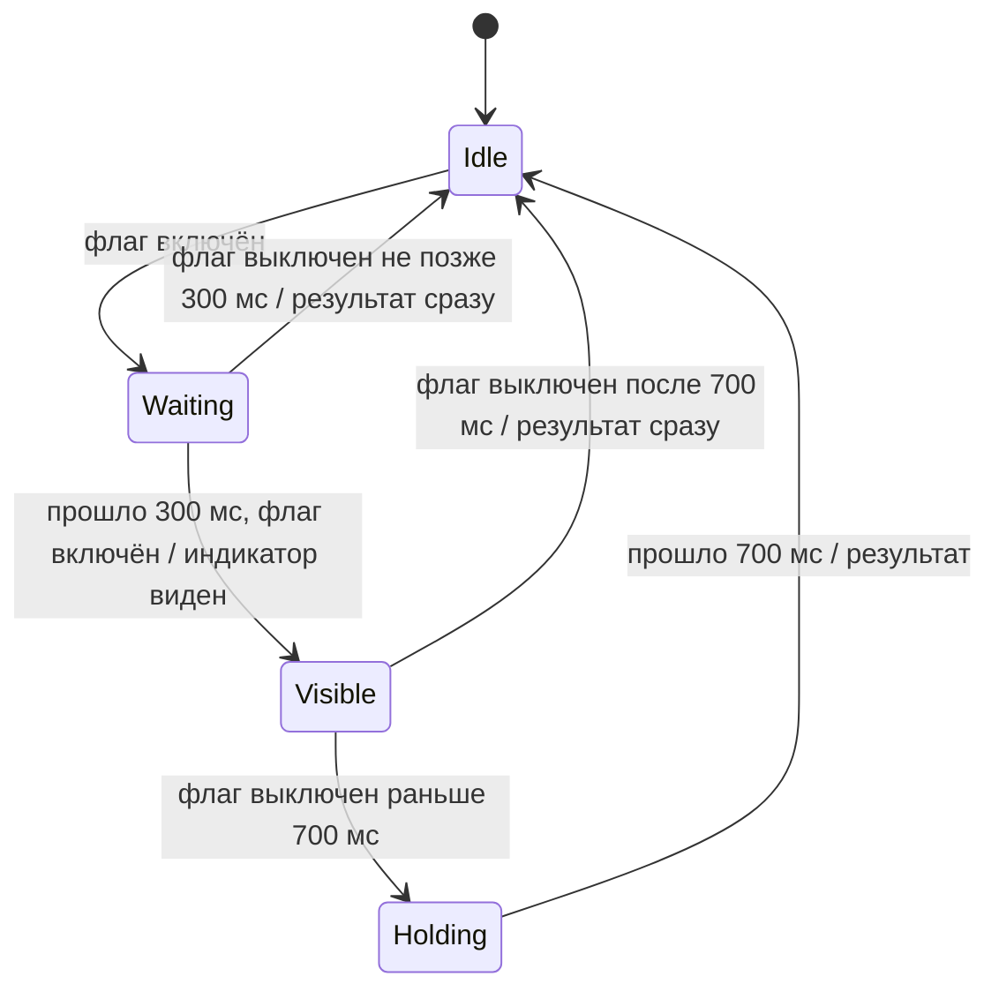
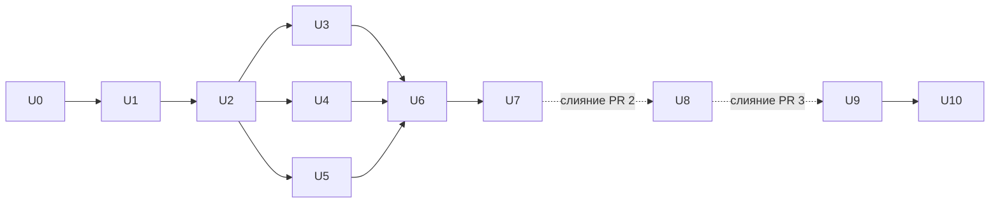

# U24 — ФИО тремя полями, повтор пароля, тайминг лоадеров - Plan

## Goal Capsule

- **Цель.** ФИО хранится и вводится тремя полями (отчество необязательно); каждый новый пароль вводится дважды; индикаторы загрузки не появляются на операциях до 300 мс и держатся не меньше 400 мс.
- **Иерархия источников.** Этот план (Product Contract → Key Decisions → Planning Contract) → мастер-план (R1, R2, R40) → план U7 `2026-11-12-001-fix-u7-ui-review-plan.md` (R41: вид лоадеров) → контракт после U1.
- **Поставка — четыре PR по очереди.** PR 1 `spec-u24-name-fields-loaders` — U0 (этот план и правки спеки). PR 2 `u24-name-fields` — U1–U7. PR 3 `u24-password-repeat` — U8. PR 4 `u24-loaders` — U9–U10. PR 3 и PR 4 правят те же формы, что PR 2, поэтому каждый начинается от `main` после слияния предыдущего.
- **Профиль исполнения.** В каждом PR с кодом приёмочные тесты пишет отдельная сессия `write-tests` до реализации; исполнитель (`implement-unit`) их не меняет и не коммитит. Ревью PR — не автором, по `REVIEWING.md`.
- **Остановись и спроси, если:** нужно трогать исторические снимки ФИО (R7), менять контракт сверх U1, порядок папок Liquibase сверх KTD1, или правило 300/400 мс не ложится на какое-то место из R28 без смены вида.

---

## Product Contract

### Summary

Фамилия, имя и отчество становятся отдельными полями в базе, в форме регистрации, в импорте студентов и в таблице «Пользователи». Везде, где ФИО только показывается, остаётся одна строка «Фамилия Имя Отчество». Формы с новым паролем получают поле повтора. Лоадеры и спиннеры показываются только на операциях дольше 300 мс и держатся на экране не меньше 400 мс.

### Problem Frame

- **Кто:** студенты и преподаватели при регистрации; все пользователи, которые задают или меняют пароль; администратор при импорте студентов и в таблице «Пользователи»; все пользователи при любой загрузке.
- **Сейчас:** ФИО вводится одной строкой «ФИО» до 200 символов и хранится одним полем. Новый пароль вводится один раз. Лоадер появляется на любую загрузку, даже на 50 мс, и на ненагруженном сервисе мигает — это выглядит как баг.
- **Зачем:** одно поле на всё ФИО — плохой паттерн ввода; без повтора опечатку в пароле не заметить; мигающий лоадер выглядит как сбой.
- **Риски данных:** миграция схемы пользователей с разбором существующих ФИО. В проде реальных пользователей нет, есть только тестовые и демо-данные. Серверный стенд обновляется без сброса базы (`CAMPUS_DEMO_RESET=false`), поэтому миграция применяется к его данным; там только демо-данные из сидов, самостоятельно никто не регистрировался. Исторические снимки ФИО (в назначениях задач, событиях ленты, авторах проводок) не мигрируются.

### Requirements

**Хранение ФИО**
- R1. У пользователя три поля: фамилия (обязательна), имя (обязательно), отчество (необязательно). Прежняя колонка `app_user.full_name` после переноса данных удаляется (источник: пользователь, интервью: «и в базе, и в форме»).
- R2. Полное ФИО для показа — «Фамилия Имя Отчество» через один пробел; без отчества — «Фамилия Имя», без пробела в конце (источник: пользователь, интервью).
- R3. Ограничения каждого поля после обрезки пробелов по краям: фамилия и имя — от 1 до 100 символов, отчество — от 0 до 100 символов. Допустимы любые символы, пробел и дефис внутри значения разрешены («Римский-Корсаков», «де Голль»). Пустое отчество или отчество из одних пробелов хранится как отсутствие отчества (`null` в API). Поля ввода длину не ограничивают: 101 символ ввести можно, ошибка — при отправке (источник: пользователь, интервью).

**Миграция существующих данных**
- R4. Существующее ФИО делится по пробельным символам: первое слово — фамилия, второе — имя, все остальные слова через один пробел — отчество (источник: пользователь, интервью).
- R5. ФИО из одного слова переносится и в фамилию, и в имя: «Тест» → фамилия «Тест», имя «Тест», отчество пусто (источник: пользователь, интервью).
- R6. Миграция проверяется автотестами на демо-данных из сидов и на случаях: одно слово, четыре слова, лишние пробелы внутри и по краям. Проверки: число пользователей до и после совпадает; у каждого фамилия и имя непустые; у каждого пользователя с двумя и более словами новое полное ФИО (R2) равно прежнему после обрезки пробелов по краям и замены каждой последовательности пробельных символов одним пробелом. Копия базы стенда не снимается: на стенд миграция накатывается обычным обновлением (источник: пользователь, интервью).
- R6a. Если после разбора фамилия, имя или отчество длиннее 100 символов, миграция останавливается с ошибкой, данные не меняются (источник: пользователь, интервью). Так же — если прежнее ФИО пустое или из одних пробелов (источник: следствие R3; в базе таких нет: поле обязательно, регистрация и импорт отклоняют пустое).
- R6b. Уже применённые changeset'ы, в том числе демо-сиды, не меняются: демо-пользователи попадают в базу в старом формате и делятся новой миграцией, как любые другие (источник: правило репозитория — применённые changeset'ы не править).
- R7. Исторические снимки ФИО — в назначениях задач, событиях ленты и авторах проводок — остаются строками как есть и не пересчитываются. Снимки, созданные после задачи, записывают полное ФИО по R2 (источник: код, как сейчас; пользователь, интервью).

**Первый администратор**
- R8. Администратор, которого система создаёт при первом запуске, получает фамилию «Администратор» и имя «Системы» → «Администратор Системы». Правило действует только при создании; уже существующие администраторы переносятся по R4–R5 (источник: пользователь, интервью).

**Регистрация (студент и преподаватель)**
- R9. Вместо поля «ФИО» — три поля в порядке Фамилия, Имя, Отчество, затем остальные поля формы в прежнем порядке (источник: пользователь, интервью).

| Поле | Подпись | Подсказка под полем | Ошибка |
| --- | --- | --- | --- |
| Фамилия | «Фамилия» | — | «Укажите фамилию, не больше 100 символов» |
| Имя | «Имя» | — | «Укажите имя, не больше 100 символов» |
| Отчество | «Отчество» | «Если есть» | «Не больше 100 символов» |

- R10. Ошибки полей ФИО показываются при отправке и пропадают, когда пользователь меняет это поле, — как у полей «Email» и «Пароль» сейчас. Сервер проверяет те же ограничения (R3) и при нарушении возвращает ошибку поля, которую форма показывает под соответствующим полем (источник: код, как сейчас).
- R11. Запрос регистрации передаёт `lastName`, `firstName`, `middleName` вместо `fullName`; `middleName` можно не передавать или передать пустой строкой. Ошибки проверки сервер возвращает на поля с теми же именами (источник: пользователь, интервью).

**API**
- R12. Во всех ответах API, где сейчас есть `fullName`, оно остаётся и вычисляется по R2. Поля `lastName`, `firstName`, `middleName` (отчество — `null`, если его нет) появляются в ответах только в строках списка «Пользователи» администратора (источник: пользователь, интервью).

**Импорт студентов (CSV и XLSX)**
- R13. Заголовок файла — ровно `email,last_name,first_name,middle_name,faculty_code,group_code`. Колонка `middle_name` в заголовке обязательна, значение в строке может быть пустым (источник: пользователь, интервью).
- R14. Файл с любым другим заголовком, в том числе со старым `email,full_name,faculty_code,group_code`, отклоняется целиком с общей ошибкой «Не удалось прочитать файл: проверьте формат и заголовок». Отдельного сообщения про старый формат нет (источник: пользователь, интервью; текст — код, как сейчас).
- R15. Ошибки строки (вместо прежних «пустое значение full_name» и «неверное ФИО») (источник: пользователь, интервью):

| Условие | Текст ошибки строки |
| --- | --- |
| пустая фамилия | «пустое значение last_name» |
| пустое имя | «пустое значение first_name» |
| фамилия длиннее 100 символов | «неверная фамилия» |
| имя длиннее 100 символов | «неверное имя» |
| отчество длиннее 100 символов | «неверное отчество» |

- R16. Если студент с email из строки уже есть: строка получает «уже есть», только когда фамилия, имя и отчество совпадают без учёта регистра (пустое отчество совпадает с пустым) и студент состоит в группе из строки. Иначе — «email занят». Остальные проверки строки не меняются (источник: пользователь, интервью; остальное — код, как сейчас).

**Таблица «Пользователи» администратора**
- R17. На ширине от 48em вместо колонки «ФИО» — три колонки «Фамилия», «Имя», «Отчество», у каждой — сортировка по стрелке в заголовке. Ссылка на профиль пользователя — на фамилии. Пустое отчество показывается как «—» (источник: пользователь, интервью; «—» — код, как сейчас для пустых ячеек).
- R18. На ширине меньше 48em строка таблицы показывается карточкой, как сейчас; в карточке одна строка «ФИО» с полным ФИО (R2), ссылкой на профиль. В списке «Сортировка» вместо пункта «ФИО» — три пункта «Фамилия», «Имя», «Отчество» (источник: пользователь, интервью).
- R19. Сортировка по фамилии упорядочивает дальше по имени, отчеству и id; по имени — дальше по фамилии, отчеству и id; по отчеству — дальше по фамилии, имени и id. Дополнительные ключи всегда по возрастанию, при любом направлении основного, как сейчас. Пустое отчество при сортировке по отчеству идёт после заполненных в обоих направлениях; как дополнительный ключ (при сортировке по фамилии или имени) — перед заполненным, как в прежней сортировке по строке ФИО: «Иванов Иван» выше «Иванов Иван Иванович». По умолчанию — по фамилии по возрастанию (источник: пользователь, интервью; положение пустых — как сейчас для пустых значений сортировки).
- R20. Поиск, как сейчас: от 2 символов, без учёта регистра, подстрока в полном ФИО (R2) или в email (источник: код, как сейчас).

**Повтор пароля**
- R21. Поле повтора стоит сразу под полем нового пароля в формах (источник: пользователь, интервью):

| Форма | Поле нового пароля | Подпись поля повтора |
| --- | --- | --- |
| Регистрация студента и преподавателя (`/register`) | «Пароль» | «Повторите пароль» |
| Смена пароля, в том числе смена временного (`ChangePasswordPage`) | «Новый пароль» | «Повторите новый пароль» |
| Установка пароля по ссылке (`SetPasswordPage`) | «Новый пароль» | «Повторите пароль» |

- R22. При отправке, если значения полей не совпадают посимвольно, форма не отправляется, под полем повтора — «Пароли не совпадают». Ошибка пропадает при любом изменении поля повтора, даже если значения ещё не совпали, и снова проверяется при следующей отправке. Изменение поля нового пароля ошибку не убирает (источник: пользователь, интервью).
- R23. Повтор проверяется только в браузере: на сервер он не передаётся, контракт API для паролей не меняется (источник: пользователь, интервью).
- R24. Поле повтора имеет собственный переключатель «показать пароль» такого же вида, как у поля нового пароля, и `autocomplete="new-password"` (источник: код, как сейчас у поля нового пароля).

**Индикаторы загрузки**
- R25. Время проверяется автотестами с управляемым временем: операция, завершённая ровно на 300 мс, индикатора не даёт; незавершённая на 300 мс — даёт; ручная проверка в браузере с замедлением сети — только качественная. «Операция» — промежуток, в который индикатор показывается сейчас (флаг загрузки включён); отсчёт времени — с момента включения флага. Индикатор загрузки не появляется, если операция завершилась за 300 мс или быстрее; результат (данные, ошибка, переход) показывается сразу по завершении (источник: пользователь, интервью).
- R26. Если операция не завершилась к 300 мс, индикатор появляется на 300-й мс и остаётся на экране не меньше 400 мс. Результат показывается, когда операция завершилась и индикатор провисел 400 мс — что наступит позже. Пример: ответ на 320 мс → индикатор с 300 до 700 мс, результат на 700 мс (источник: пользователь, интервью).
- R27. Повторные нажатия кнопки действия игнорируются сразу с первого нажатия и до показа результата. Внешне кнопка в первые 300 мс не меняется; неактивный вид и спиннер появляются вместе по R25 и R26 (источник: пользователь, интервью).
- R28. R25–R27 действуют для всех индикаторов загрузки во фронтенде, в том числе появившихся до выкладки задачи. На 13.11.2026 это (источник: пользователь, интервью; список — код):
  - лоадер `BrandLoader` в блоках и на страницах (`AsyncContent`);
  - полноэкранный лоадер сессии (`RouteLoading`);
  - спиннеры кнопок со свойством `loading` (30 файлов на 13.11.2026);
  - кнопки «Загрузить ещё»;
  - текстовые статусы «Загрузка факультетов…», «Загрузка справочника…», «Загрузка настроек стенда…», «Обновление сессии…».
- R29. Пока индикатор не появился (первые 300 мс операции), на экране остаётся то, что было видно до её начала: при смене сортировки, фильтра или поиска — прежняя таблица, при первой загрузке блока — пустое место. Когда индикатор появился, он заменяет содержимое там же, где сейчас (источник: следствие цели «не мигает»).

### Key Decisions

- **Отдельные поля только во вводе и в таблице администратора** (session-settled: user-approved — chosen over отдельные поля также в ответе «текущий пользователь» и профиле: больше их нигде не показывают). Governs R11, R12, R17.
- **Импорт — только новый формат** (session-settled: user-directed — chosen over отдельное сообщение для старого формата и chosen over приём старого формата с разбором по пробелам: два формата — лишняя сложность, а данных в старом формате нет). Governs R13, R14.
- **Имя всегда обязательно** (session-settled: user-approved — chosen over «Администратор Администратор» и необязательное имя для роли ADMIN: правило без исключений). Governs R3, R8.
- **На телефоне ФИО одной строкой** (session-settled: user-approved — chosen over три строки в карточке: карточка короче, сортировка по всем трём полям остаётся через список). Governs R17, R18.
- **Кнопка в первые 300 мс выглядит как обычно** (session-settled: user-approved — chosen over сразу серая кнопка: серая вспышка на быстрой операции — то же мигание). Governs R27.
- **Миграция без копии стенда** (session-settled: user-directed — chosen over проверка на дампе стенда: на стенде только сидовые данные). Governs R6, R6a.
- **Минимальный показ индикатора задерживает результат** (session-settled: user-approved — chosen over мгновенный показ результата: иначе остаётся мигание длиной в десятки мс). Governs R26, R27.
- **Правило 300/400 мс везде** (session-settled: user-approved — chosen over только `BrandLoader` и спиннеры кнопок: текстовые статусы мигают так же). Governs R28.

### Acceptance Examples

- AE1. **Covers R2, R9, R11, R12.** Дано: форма регистрации студента. Когда: ввести «Иванова» / «Мария» / пусто, остальные поля верно, отправить. Тогда: пользователь создан; в шапке и в «Пользователях» на телефоне — «Иванова Мария».
- AE2. **Covers R2.** Дано: регистрация с «Петров» / «Павел» / «Петрович». Когда: открыть профиль. Тогда: ФИО «Петров Павел Петрович».
- AE3. **Covers R3, R9, R10.** Дано: форма регистрации. Когда: оставить фамилию пустой, в имя ввести 101 символ, отправить. Тогда: запрос не отправлен; под «Фамилия» — «Укажите фамилию, не больше 100 символов», под «Имя» — «Укажите имя, не больше 100 символов».
- AE4. **Covers R3.** Дано: форма регистрации. Когда: ввести «  Римский-Корсаков » / «Николай» / « », отправить. Тогда: пользователь создан с фамилией «Римский-Корсаков», без отчества; ФИО «Римский-Корсаков Николай».
- AE5. **Covers R10.** Дано: запрос регистрации в обход формы с фамилией из 101 символа. Когда: отправить. Тогда: ответ — ошибка проверки с ошибкой поля фамилии; пользователь не создан.
- AE6. **Covers R4.** Дано: в базе до миграции пользователь «Смирнова Анна Олеговна». Когда: применить миграцию. Тогда: фамилия «Смирнова», имя «Анна», отчество «Олеговна».
- AE7. **Covers R4.** Дано: до миграции «Оглы Мамед Али Оглы». Когда: применить миграцию. Тогда: фамилия «Оглы», имя «Мамед», отчество «Али Оглы».
- AE8. **Covers R5.** Дано: до миграции «Тест». Когда: применить миграцию. Тогда: фамилия «Тест», имя «Тест», отчество пусто; ФИО «Тест Тест».
- AE9. **Covers R6.** Дано: чистая база, накатаны все changeset'ы с демо-сидами (все демо-ФИО из двух-трёх слов). Когда: применить миграцию. Тогда: число пользователей до и после одинаковое; ни у кого нет пустых фамилии или имени; у каждого демо-пользователя новое ФИО совпадает с прежним, например «Администратор Демо» → фамилия «Администратор», имя «Демо».
- AE9a. **Covers R6.** Дано: до миграции «  Иванов   Иван  Иванович ». Когда: применить миграцию. Тогда: фамилия «Иванов», имя «Иван», отчество «Иванович»; ФИО «Иванов Иван Иванович».
- AE9b. **Covers R6a.** Дано: до миграции ФИО «<фамилия из 101 буквы> Иван». Когда: применить миграцию. Тогда: миграция остановлена с ошибкой, данные пользователей не изменились.
- AE10. **Covers R7.** Дано: назначение задачи со снимком «Смирнова Анна Олеговна». Когда: применить миграцию и открыть задачу. Тогда: ФИО в задаче «Смирнова Анна Олеговна», запись снимка не изменилась.
- AE11. **Covers R8.** Дано: пустая база без администратора. Когда: запустить систему, войти первым администратором. Тогда: в шапке «Администратор Системы»; в «Пользователях» фамилия «Администратор», имя «Системы», отчество «—».
- AE12. **Covers R13.** Дано: CSV с заголовком `email,last_name,first_name,middle_name,faculty_code,group_code` и строкой `new@student.campus.test,Орлова,Вера,,ФИТ,ИВТ-21`. Когда: импортировать. Тогда: создан студент «Орлова Вера» без отчества в группе ИВТ-21.
- AE13. **Covers R13, R14.** Дано: CSV с заголовком `email,last_name,first_name,faculty_code,group_code` (без `middle_name`). Когда: импортировать. Тогда: файл отклонён с «Не удалось прочитать файл: проверьте формат и заголовок», никто не создан.
- AE14. **Covers R14.** Дано: CSV со старым заголовком `email,full_name,faculty_code,group_code`. Когда: импортировать. Тогда: файл отклонён с «Не удалось прочитать файл: проверьте формат и заголовок».
- AE15. **Covers R15.** Дано: CSV нового формата со строками: пустая фамилия; пустое имя; фамилия из 101 символа; имя из 101 символа; отчество из 101 символа. Когда: импортировать. Тогда: ошибки строк по порядку — «пустое значение last_name», «пустое значение first_name», «неверная фамилия», «неверное имя», «неверное отчество».
- AE16. **Covers R16.** Дано: студент `ivanov@student.campus.test` «Иванов Иван Иванович» в группе ИВТ-21 факультета ФИТ. Когда: импортировать строку `ivanov@student.campus.test,ИВАНОВ,иван,иванович,ФИТ,ИВТ-21`. Тогда: строка «уже есть», данные студента не изменились.
- AE17. **Covers R16.** Дано: тот же студент. Когда: импортировать строку с тем же email, «Иванов» / «Иван» / пусто, ИВТ-21. Тогда: строка «email занят».
- AE18. **Covers R16.** Дано: в базе студент «Иванов Иван» с email `ivanov@student.campus.test`, факультет ФИТ и группа ИВТ-21 существуют. Когда: импортировать строку `ivanov2@student.campus.test,Иванов,Иван,,ФИТ,ИВТ-21`. Тогда: создан новый студент; тёзка не мешает.
- AE19. **Covers R17, R19.** Дано: десктоп, в списке «Иванова Мария» и «Иванова Анна Олеговна». Когда: нажать стрелку у «Фамилия» (по возрастанию). Тогда: «Иванова Анна Олеговна» выше «Иванова Мария».
- AE20. **Covers R17, R19.** Дано: десктоп, пользователи «Петров Павел Петрович» и «Иванова Мария» (без отчества). Когда: сортировка по «Отчество» по возрастанию, затем по убыванию. Тогда: «Иванова Мария» последняя в обоих случаях; её ячейка «Отчество» — «—».
- AE21. **Covers R17.** Дано: десктоп, ширина 1280 px. Когда: открыть «Пользователи». Тогда: колонки «Фамилия», «Имя», «Отчество» вместо «ФИО»; клик по фамилии открывает профиль.
- AE22. **Covers R18.** Дано: ширина 360 px. Когда: открыть «Пользователи». Тогда: в карточке одна строка «ФИО» со ссылкой; в списке «Сортировка» есть «Фамилия», «Имя», «Отчество» и нет «ФИО»; выбор «Имя» сортирует по имени.
- AE23. **Covers R19.** Дано: администратор открывает «Пользователи» без параметров. Когда: страница загрузилась. Тогда: список отсортирован по фамилии по возрастанию.
- AE24. **Covers R20.** Дано: пользователь «Иванова Мария». Когда: искать «ова мар», затем «МАРИЯ». Тогда: оба раза он в результатах.
- AE25. **Covers R21, R22.** Дано: форма регистрации. Когда: «Пароль» — `Secret123`, «Повторите пароль» — `Secret124`, отправить. Тогда: запрос не отправлен, под повтором — «Пароли не совпадают».
- AE26. **Covers R22.** Дано: после AE25. Когда: исправить повтор на `Secret123`. Тогда: ошибка пропала сразу; отправка создаёт пользователя.
- AE27. **Covers R21, R22.** Дано: вход с временным паролем, открыта смена пароля. Когда: новый пароль и повтор различаются, отправить. Тогда: пароль не сменён, под «Повторите новый пароль» — «Пароли не совпадают».
- AE28. **Covers R21, R22.** Дано: страница установки пароля по ссылке. Когда: пароли различаются, отправить. Тогда: пароль не установлен, «Пароли не совпадают».
- AE29. **Covers R23.** Дано: форма смены пароля, значения совпадают. Когда: отправить. Тогда: тело запроса на сервер — то же, что до задачи, без поля повтора.
- AE30. **Covers R24.** Дано: форма регистрации. Когда: нажать «показать пароль» у поля повтора. Тогда: значение повтора видно; поле нового пароля остаётся в прежнем состоянии.
- AE31. **Covers R25.** Дано: страница, данные которой отвечают за 100 мс. Когда: открыть страницу. Тогда: лоадер ни разу не появился, данные показаны через 100 мс.
- AE32. **Covers R26.** Дано: ответ за 2 с. Когда: открыть страницу. Тогда: лоадер появился на 300 мс, данные показаны на 2 с, лоадер исчез вместе с их появлением.
- AE33. **Covers R26.** Дано: ответ за 320 мс. Когда: открыть страницу. Тогда: лоадер виден с 300 по 700 мс, данные — на 700 мс.
- AE34. **Covers R26.** Дано: запрос завершается ошибкой через 500 мс. Когда: открыть страницу. Тогда: лоадер с 300 по 700 мс, затем текст ошибки.
- AE35. **Covers R27.** Дано: вход отвечает за 100 мс. Когда: дважды быстро нажать «Войти». Тогда: отправлен один запрос; кнопка не меняла вид и спиннер не появлялся; через 100 мс переход.
- AE36. **Covers R27.** Дано: вход отвечает за 1 с. Когда: нажать «Войти». Тогда: до 300 мс кнопка выглядит как обычно, но повторное нажатие не шлёт запрос; с 300 мс до 1 с — неактивный вид и спиннер; затем переход.
- AE37. **Covers R28.** Дано: справочник факультетов на регистрации отвечает за 100 мс. Когда: открыть `/register`. Тогда: «Загрузка факультетов…» не появлялся.
- AE38. **Covers R28.** Дано: полноэкранная загрузка сессии за 100 мс. Когда: обновить страницу. Тогда: полноэкранный лоадер не появлялся.
- AE39. **Covers R28, R29.** Дано: открыт список с «Загрузить ещё», следующая страница отвечает за 1 с. Когда: нажать «Загрузить ещё». Тогда: уже загруженные строки остаются на месте; повторные нажатия игнорируются сразу, неактивный вид и спиннер с 300 мс, новые строки на 1 с.
- AE39a. **Covers R29.** Дано: десктоп, «Пользователи» показаны, сортировка по фамилии; запрос сортировки отвечает за 100 мс. Когда: нажать стрелку у «Имя». Тогда: прежняя таблица видна до прихода ответа, пустой вспышки и лоадера нет, через 100 мс — таблица в новом порядке.
- AE19a. **Covers R19.** Дано: «Иванов Иван Иванович» и «Иванов Иван». Когда: сортировка по фамилии по возрастанию. Тогда: «Иванов Иван» выше.
- AE40. **Covers R7, R12.** Дано: база с демо-данными после миграции. Когда: открыть ленту наград, задачи преподавателя, рейтинг группы, профиль студента. Тогда: везде ФИО одной строкой, как до задачи.
- AE41. **Covers R11, R12.** Дано: зарегистрирован «Иванова Мария» без отчества. Когда: администратор запрашивает список «Пользователи»; сама студентка запрашивает текущего пользователя. Тогда: в строке списка `lastName` «Иванова», `firstName` «Мария», `middleName` `null`, `fullName` «Иванова Мария»; в ответе текущего пользователя только `fullName` «Иванова Мария».
- AE42. **Covers R28.** Дано: справочник групп, настройки стенда и обновление сессии отвечают за 1 с. Когда: выбрать факультет на `/register`, открыть `/register`, сменить пароль. Тогда: «Загрузка справочника…», «Загрузка настроек стенда…», «Обновление сессии…» появляются на 300 мс и держатся до ответа.
- AE43. **Covers R3, R9.** Дано: форма регистрации. Когда: ввести «де Голль» / «Шарль» / 101 символ в отчество, отправить. Тогда: под «Отчество» — «Не больше 100 символов»; после исправления отчества на пустое пользователь создан с фамилией «де Голль».

### Success Criteria

- Новых пользователей регистрируют тремя полями; ФИО существующих пользователей из двух и более слов в интерфейсе выглядит как раньше.
- Опечатка в новом пароле ловится до отправки.
- На стенде при обычной работе лоадеры и спиннеры не мигают; заметные индикаторы появляются только на операциях дольше 300 мс.
- Серверный стенд обновлён без сброса базы; демо-пользователи входят и видят свои ФИО.

### Scope Boundaries

- Не входит: редактирование ФИО в профиле или администратором.
- Не входит: пересчёт исторических снимков ФИО (R7).
- Не входит: серверная проверка повтора пароля.
- Не входит: выставление временного пароля преподавателем или администратором — пароль генерирует сервер, ввода нет.
- Не входит: форма входа (там не новый пароль).
- Не входит: приём импорта в старом формате.
- Индикаторы фонового обновления данных, которые сейчас не показываются, не появляются.

### Dependencies / Assumptions

- Списки, отсортированные сейчас по ФИО (студенты группы, заявки и т. п.), сортируются по фамилии, имени, отчеству — некритично: порядок совпадает с прежним для всех ФИО, кроме вырожденных случаев сравнения пробела с буквой.
- Порог ширины 48em для таблицы и карточек «Пользователи» — существующий, не меняется — некритично: это текущее поведение.

### Sources

- Требования поставлены интервью с заказчиком 13.11.2026; решения — в Key Decisions.
- `docs/spec/plans/2026-10-31-001-feat-campus-rating-mvp-plan.md` — R1, R2 (регистрация, ФИО), R40 (русский интерфейс от 360 px).
- `docs/spec/plans/2026-11-12-001-fix-u7-ui-review-plan.md` — R41 (лоадер сессии 96 px и `AsyncContent` 48 px); этот план добавляет к нему тайминг.
- `backend/src/main/resources/db/changelog/identity/202611090900-base-users.sql` — `app_user.full_name`.
- `backend/src/main/java/ru/campusrating/identity/internal/RegistrationService.java:84` — первый администратор.
- `backend/src/main/java/ru/campusrating/identity/internal/ImportFileReader.java:29,79` — заголовок импорта и общая ошибка.
- `backend/src/main/java/ru/campusrating/identity/internal/AdminImportService.java:55–69` — проверки строк и совпадение с существующим студентом.
- `backend/src/main/java/ru/campusrating/identity/internal/AdminUserService.java:45–89` — поиск и сортировка «Пользователей».
- `frontend/src/features/auth/RegisterPage.tsx`, `ChangePasswordPage.tsx`, `SetPasswordPage.tsx` — формы с паролем.
- `frontend/src/features/admin/users/AdminUsersPage.tsx`, `users.css` — таблица и карточки «Пользователи».
- `frontend/src/app/layouts/PageLayouts.tsx`, `frontend/src/app/routeElements.tsx`, `frontend/src/theme/Brand.tsx` — лоадеры.
- `frontend/src/features/auth/RequestMembership.tsx` — текстовые статусы загрузки.

---

## Planning Contract

Product Contract preservation: restructured, no scope change — источник R41 исправлен (вид лоадеров задан планом U7, а не мастер-планом); R/AE и решения не менялись.

### Key Technical Decisions

- KTD1. **Миграция ФИО — в новой папке `db/changelog/late/`, которую master подключает последней, после `demo`.** Демо-сиды лежат в последней папке `demo` и пишут в `full_name`; применённые changeset'ы не меняются (R6b). Changeset в `identity/` на чистой базе выполнился бы до сидов, и сиды упали бы на удалённой колонке. Changeset в `late/` — без контекста, выполняется и в `default`, и в `demo`. Будущие демо-сиды с пользователями кладутся в `late/` после этой миграции — урок в `backend/AGENTS.md`.
- KTD2. **Ограничения длины и непустоты — в схеме.** Порядок в одном changeset: добавить колонки, заполнить их разбором `full_name`, затем `NOT NULL` и `CHECK` (фамилия и имя — от 1 до 100 символов без пробелов по краям; отчество — `NULL` или от 1 до 100), пересоздать индексы, удалить `full_name`. Нарушение R6a роняет changeset, и DDL PostgreSQL откатывается целиком — отдельная проверочная логика не нужна.
- KTD3. **Полное ФИО собирается в `identity` одной функцией по R2.** Записи `UserAccount`, `UserRef`, `UserCard`, `StudentMember`, `AuthenticatedUser` сохраняют `fullName`; соседние модули не меняются. В SQL поиска и сортировки используются колонки или то же выражение сборки, без хранимой копии.
- KTD4. **Индексы `app_user_created_idx` и `app_user_last_login_idx`** пересоздаются на `(…, last_name, first_name, middle_name, id)` вместо `full_name`.
- KTD5. **Сортировка «Пользователей».** В `UserSort` вместо `name` — `lastName`, `firstName`, `middleName`; по умолчанию `lastName`. Дополнительные ключи — по R19, всегда по возрастанию, затем `id`. Пустое отчество: основной ключ — `nulls last` в обе стороны, дополнительный — `nulls first`. Фронт заменяет неизвестное значение `sort` из URL (старое `name`) на значение по умолчанию.
- KTD6. **Контракт.**
  - `StudentRegistration` и `TeacherRegistration`: `lastName` и `firstName` обязательны, `middleName` необязателен; схемы длины — максимум 100 вместо `FullName`.
  - `AdminUser`: добавить `lastName`, `firstName`, `middleName` (может быть `null`).
  - Параметр `sort` у `listAdminUsers` — новое перечисление.
  - Ошибки полей — с именами `lastName`, `firstName`, `middleName`.
  - Остальные схемы с `fullName` не меняются (R12).
- KTD7. **Тайминг индикатора — одна функция и один хук во фронте.** Константы 300 и 400 мс заданы в одном месте. Хук по флагу активности отдаёт «индикатор виден» и «результат можно показать». Логику переходов проверяет модульный тест с управляемым временем.
- KTD8. **`AsyncContent` хранит содержимое последнего готового состояния (R29).** Первые 300 мс операции он показывает это содержимое или пустое место, затем лоадер. Когда данные пришли, лоадер держится до конца 400 мс. Экраны на `AsyncContent`, `ListLayout` и `TeacherTableLayout` получают поведение без собственных правок. Экраны, которые выбирают ветку результата сами, до `AsyncContent` (ошибка профиля, ошибка сессии в `routeElements`), переводятся на тот же хук: ни одна ветка результата не показывается раньше конца минимального показа. Найти их — `rg -n "isError" frontend/src/features frontend/src/app`.
- KTD9. **Мутации и кнопки.**
  - Общая обёртка над `useMutation` продлевает завершение `mutationFn` до конца минимального показа, если спиннер успел появиться. Поэтому `onSuccess`, переход и ошибка приходят после 400 мс, а `isPending` покрывает всё окно.
  - Общая кнопка действия первые 300 мс отменяет повторные клики через `preventDefault`, и форма не отправляется ни по клику, ни по Enter. Потом кнопка получает `loading`.
  - Бесконечные списки (`fetchNextPage`: лента, награды, история профиля, бюджеты, задачи, «Пользователи») получают общий помощник: отображаемые страницы, ошибка и `hasNextPage` обновляются после окончания минимального показа — и для кнопки «Загрузить ещё», и для автоматической подгрузки по прокрутке.
  - Входу, регистрации и смене пароля задержки обёртки мало: `useAuthAction` публикует сессию в кэш до завершения мутации, и `GuestGate` уходит со страницы сразу. Публикация сессии ждёт окончания минимального показа; защита поколений и очистка приватного кэша сохраняются.

### High-Level Technical Design

Тайминг одного индикатора (R25–R27). Время отсчитывается от включения флага загрузки.

Пока длится `Waiting`, `AsyncContent` показывает прежнее содержимое, а кнопка выглядит как обычно, но глотает клики. В состояниях `Visible` и `Holding` показываются лоадер или спиннер и неактивный вид.

### Sequencing

---

## Implementation Units

### U0. Спека (PR 1)

- **Goal.** Положить этот план и согласовать спеку с новыми правилами до кода.
- **Requirements.** R1–R29 (как источник).
- **Files.**
  - `docs/spec/plans/2026-11-13-001-feat-u24-name-fields-loaders-plan.md`;
  - `docs/spec/plans/2026-10-31-001-feat-campus-rating-mvp-plan.md`: R1, R2 — фамилия, имя, отчество вместо ФИО; правило импорта «существующий email и другое ФИО» и заголовок файла студентов; ссылка на U24;
  - `docs/spec/ux/screen-map.md`: строка «Регистрация»;
  - `docs/spec/test-plan.md`: шаги сценария регистрации — три поля и повтор пароля;
  - `docs/spec/plans/2026-11-12-005-feat-u13-import-plan.md` (R1) и `2026-11-10-001-feat-u5-auth-frontend-plan.md` (ограничения полей) — пометка «заменено планом U24»;
  - `docs/agent-log.md`.
- **Approach.** Перед правкой — `rg -n "ФИО|full_name|fullName" docs/ .agents/ AGENTS.md`: правило меняется во всех местах, исторические отчёты ревью не трогаются.
- **Test expectation.** none — только документы.
- **Verification.** `node tools/check-agent-docs.mjs` и `node --test "tools/test/*.test.mjs"` зелёные; номер плана свободен в `origin/main` и в открытых PR.

### U1. Контракт и генерация (PR 2, первый коммит)

- **Goal.** Контракт по KTD6, типы и примеры для MSW.
- **Requirements.** R11, R12, R19; KTD6.
- **Dependencies.** U0.
- **Files.** `docs/spec/api/openapi.yaml`, `frontend/src/api/schema.d.ts`, `frontend/src/api/problemCodes.generated.ts`, `frontend/src/mocks/examples.generated.ts` (генерация).
- **Approach.** Примеры регистрации и строк `AdminUser` — с тремя полями, один пример без отчества. Схему `FullName` удалить, если ссылок на неё не осталось.
- **Test scenarios.** `ContractCompatibilityIT` и линтер контракта зелёные после U2–U5.
- **Verification.** `npx --no-install --prefix frontend redocly lint --config docs/spec/api/redocly.yaml docs/spec/api/openapi.yaml`; `npm --prefix frontend run api:gen` без ручных правок.

### U2. Хранение и миграция

- **Goal.** Три колонки вместо `full_name`; `identity` собирает `fullName` по R2.
- **Requirements.** R1–R7, R6a, R6b; KTD1–KTD4.
- **Dependencies.** U1.
- **Files.**
  - `backend/src/main/resources/db/changelog/db.changelog-master.yaml`: папка `late` последней;
  - `backend/src/main/resources/db/changelog/late/<ts>-user-name-parts.sql`;
  - `identity/internal/{UserAccount,IdentityRepository,MembershipRepository,AdminTeacherRepository,AdminUserService}.java`;
  - тестовые фикстуры, которые пишут `app_user.full_name` напрямую (около 27 файлов в `backend/src/test/java/ru/campusrating/**`) — переход на три колонки через общий помощник в `support/`;
  - тест `backend/src/test/java/ru/campusrating/identity/UserNameMigrationIT.java`;
  - `backend/src/test/java/ru/campusrating/ChangelogOrderIT.java`: он применяет `default`, затем `default,demo` на той же базе, а после KTD1 демо-сид встретит удалённую колонку — проверки порядка веток и фильтра демо разводятся на независимые базы, сами проверки сохраняются;
  - HTTP-фикстуры регистрации с `fullName` в теле запроса: `identity/IdentityAcceptanceSupport.java`, `support/AdminHttpTestSupport.java`, `identity/VerificationIT.java`, `identity/DemoIdentityLifecycleIT.java` и остальные из `rg -l fullName backend/src/test` (тела запросов меняются вместе с U3, ожидания результатов — нет);
  - `backend/AGENTS.md`: урок про `late/`.
- **Approach.**
  1. Разбор в SQL: схлопнуть пробельные символы, обрезать края, разбить по пробелу. Первое слово — фамилия; второе — имя, а если его нет, то первое слово (R5); остальные слова через пробел — отчество.
  2. Ограничения и порядок шагов — по KTD2.
  3. Списки студентов группы, заявок и преподавателей сортируются по `last_name, first_name, middle_name nulls first, id`.
- **Execution note.** Начать с падающего `UserNameMigrationIT`.
- **Patterns to follow.** `ChangelogOrderIT` — отдельная база и прогон Liquibase по копии changelog с выбранными контекстами.
- **Test scenarios.**
  - Covers AE6, AE7, AE8, AE9a. База накатана без `late/`, в неё вставлены «Смирнова Анна Олеговна», «Оглы Мамед Али Оглы», «Тест», «  Иванов   Иван  Иванович ». После `late/` — ожидаемые части каждого.
  - Covers AE9b. Строка с фамилией из 101 буквы: `update` падает, колонка `full_name` на месте, данные прежние.
  - Строка из одних пробелов: `update` падает (R6a).
  - Covers AE9. Чистая база с контекстами `default,demo`: пользователей столько же, сколько вставили сиды, ни у кого нет пустых частей, `fullName` каждого демо-пользователя совпадает с ФИО в сиде.
  - Covers AE10. Снимок `assignment.student_full_name` не изменился.
  - Повторный прогон Liquibase ничего не меняет.
  - `DemoRecreateIT`, `DemoStoryIT`, `DemoIdentityLifecycleIT`, `ChangelogOrderIT` зелёные; у фикстур меняются только тела запросов и вставки, ожидания прежние.
  - Новый снимок после миграции: студенту «Римский-Корсаков Николай» без отчества создаётся назначение → `student_full_name` «Римский-Корсаков Николай», без лишних пробелов (R7).
- **Verification.** `./backend/mvnw -f backend/pom.xml verify` зелёный.

### U3. Регистрация, первый администратор, текущий пользователь

- **Goal.** API регистрации принимает три поля; первый администратор — «Администратор Системы».
- **Requirements.** R3, R8, R10, R11, R12.
- **Dependencies.** U2.
- **Files.**
  - `identity/api/{AuthController,AuthDtos}.java`;
  - `identity/internal/{RegistrationService,BootstrapAdmin}.java`;
  - тесты `backend/src/test/java/ru/campusrating/identity/{RegistrationIT,BootstrapAdminIT}.java`.
- **Approach.** Обрезка пробелов и пустое или пробельное отчество → `null` — на входе (`RegistrationService.create`). Ошибки проверки — на поля `lastName`, `firstName`, `middleName`, по образцу нынешнего `Passwords.invalid("fullName", …)`.
- **Test scenarios.**
  - Covers AE1, AE41. Регистрация студента «Иванова / Мария / без отчества» → `/auth/me` отдаёт `fullName` «Иванова Мария» и не отдаёт отдельных полей.
  - Covers AE4. «  Римский-Корсаков » / «Николай» / « » → фамилия обрезана, отчество `null`.
  - Отчество не передано, `""`, `"   "` → одинаково `null`.
  - Covers AE5. Фамилия из 101 символа → 400 с ошибкой поля `lastName`, пользователь не создан. То же для `firstName` и `middleName`.
  - Пустые фамилия или имя → 400 по полю.
  - Регистрация преподавателя — те же правила.
  - Covers AE2. «Петров / Павел / Петрович» → профиль `/users/{id}` отдаёт ФИО «Петров Павел Петрович».
  - Covers AE11. Пустая база → первый администратор с фамилией «Администратор» и именем «Системы».
- **Verification.** `verify` зелёный.

### U4. Импорт студентов

- **Goal.** Новый заголовок, ошибки строк по полям, совпадение по трём полям.
- **Requirements.** R13–R16.
- **Dependencies.** U2.
- **Files.**
  - `identity/internal/{ImportFileReader,AdminImportService,RegistrationService}.java`;
  - примеры `docs/spec/import/students.example.csv` и `students.example.xlsx` — новый заголовок;
  - тесты `backend/src/test/java/ru/campusrating/admin/{AdminImportValidationIT,U13AdminImportIT}.java`.
- **Approach.** Проверки строки идут в прежнем порядке. Новые проверки ФИО стоят на месте прежних, в порядке R15. Значения обрезаются так же, как сейчас.
- **Test scenarios.**
  - Covers AE12. CSV с новым заголовком и пустым `middle_name` → студент создан без отчества.
  - Тот же сценарий в XLSX.
  - Covers AE13, AE14. Заголовок без `middle_name` и старый заголовок с `full_name` → общая ошибка, никто не создан.
  - Covers AE15. Пять строк с ошибками ФИО → пять текстов из R15.
  - Covers AE16. Совпадение без учёта регистра → «уже есть».
  - Covers AE17. Отличие только в отчестве → «email занят».
  - Совпадение ФИО, но другая группа → «email занят».
  - Covers AE18. Тёзка с другим email → создан.
- **Verification.** `verify` зелёный.

### U5. Список «Пользователи» (backend)

- **Goal.** Три поля в строке, сортировка по каждому, поиск по полному ФИО.
- **Requirements.** R12, R17, R19, R20; KTD5.
- **Dependencies.** U2.
- **Files.**
  - `identity/api/AdminUsersController.java`, `identity/internal/AdminUserService.java`;
  - тесты `backend/src/test/java/ru/campusrating/admin/{AdminUsersSortIT,AdminUsersListIT}.java`.
- **Test scenarios.**
  - Covers AE19, AE19a. Сортировка по фамилии: «Иванова Анна Олеговна» выше «Иванова Мария»; «Иванов Иван» выше «Иванов Иван Иванович».
  - Covers AE20. По отчеству: пустое отчество последним и при `asc`, и при `desc`.
  - По имени по убыванию: дополнительные ключи по возрастанию.
  - Covers AE23. Без параметров — по фамилии по возрастанию.
  - Covers AE24. Поиск «ова мар» и «МАРИЯ» находит «Иванову Марию»; поиск из 1 символа не фильтрует.
  - Covers AE41. Строка содержит `lastName`, `firstName`, `middleName` и `fullName`.
  - `sort=name` → 400.
  - Курсор второй страницы работает для каждого нового ключа.
- **Verification.** `verify` зелёный.

### U6. Фронт: регистрация, «Пользователи», импорт

- **Goal.** Три поля в форме регистрации, три колонки на десктопе и одна строка ФИО на телефоне, новая подсказка заголовка импорта.
- **Requirements.** R3, R9, R10, R17, R18; KTD5.
- **Dependencies.** U3, U4, U5.
- **Files.**
  - `frontend/src/features/auth/{RegisterPage,contracts}.tsx|ts`;
  - `frontend/src/features/admin/users/{AdminUsersPage.tsx,contracts.ts,users.css}`;
  - `frontend/src/features/admin/import/AdminImportPage.tsx`;
  - MSW-обработчики регистрации и списка и их тест `frontend/src/mocks/auth.test.ts`;
  - тесты `frontend/src/features/auth/auth.acceptance.test.tsx`, `frontend/src/features/admin/admin.acceptance.test.tsx`.
- **Approach.**
  - Для карточки на телефоне — отдельная колонка «ФИО», скрытая на десктопе, а три колонки скрыты на телефоне. Порог 48em прежний.
  - Пункты сортировки «Фамилия», «Имя», «Отчество».
  - Поля без `maxLength`.
- **Test scenarios.**
  - Covers AE1. Отправка «Иванова / Мария / пусто» уходит в API с `lastName` и `firstName` и без отчества.
  - Covers AE3. Пустая фамилия и имя из 101 символа → два текста ошибок, запрос не отправлен.
  - Covers AE43. Отчество из 101 символа → «Не больше 100 символов».
  - Ошибка поля пропадает при правке этого поля.
  - Серверная ошибка `lastName` показывается под «Фамилия».
  - Подсказка «Если есть» под «Отчество».
  - Covers AE21. 1280 px: три заголовка с сортировкой, ссылка на фамилии ведёт в профиль, пустое отчество показывается «—».
  - Covers AE22. 360 px: одна строка «ФИО», в списке сортировки нет пункта «ФИО».
  - URL с `sort=name` открывает сортировку по фамилии.
  - Страница импорта показывает новый заголовок.
- **Verification.** `npm --prefix frontend run check` и `build`; скриншоты регистрации и «Пользователей» на 360 и 1280 px.

### U7. e2e и демо

- **Goal.** e2e проходят с новой формой; демо-стенд поднимается с нуля.
- **Requirements.** R6, R9, AE40.
- **Dependencies.** U6.
- **Files.** `e2e/tests/base/{registration.spec.ts,support.ts}` и спеки из `rg -l "fullName|ФИО" e2e/tests`; `docs/agent-log.md`.
- **Test scenarios.**
  - Регистрация в e2e заполняет три поля.
  - Covers AE40. Лента, задачи преподавателя, рейтинг группы и профиль показывают ФИО одной строкой — существующие спеки зелёные.
- **Verification.** Полный e2e-прогон с нуля (`down -v`, затем `up`) зелёный.

### U8. Повтор пароля (PR 3)

- **Goal.** Поле повтора в трёх формах.
- **Requirements.** R21–R24.
- **Dependencies.** PR 2 слит.
- **Files.**
  - `frontend/src/features/auth/{RegisterPage,ChangePasswordPage,SetPasswordPage}.tsx`;
  - тесты `frontend/src/features/auth/{auth.acceptance,review-fixes}.test.tsx`;
  - `e2e/tests/base/support.ts`, `e2e/tests/base/registration.spec.ts`;
  - `docs/agent-log.md`.
- **Approach.** `PasswordField` с `autoComplete="new-password"` и своим переключателем. Проверка — в обработчике отправки рядом с остальными ошибками формы.
- **Test scenarios.**
  - Covers AE25, AE27, AE28. Разные значения → «Пароли не совпадают» под повтором, запроса нет. Проверяется в каждой из трёх форм.
  - Covers AE26. Правка повтора убирает ошибку; при совпадении форма отправляется.
  - Правка поля нового пароля ошибку не убирает.
  - Covers AE29. Тело запроса смены пароля — без поля повтора.
  - Covers AE30. Переключатель повтора не меняет вид поля нового пароля.
  - Пустой повтор при заполненном пароле → «Пароли не совпадают».
- **Verification.** `check`, `build`, e2e регистрации и смены временного пароля зелёные; скриншоты трёх форм на 360 и 1280 px.

### U9. Тайминг: блоки, сессия, текстовые статусы (PR 4)

- **Goal.** Хук тайминга и его применение к `AsyncContent`, лоадеру сессии и текстовым статусам.
- **Requirements.** R25, R26, R28, R29; KTD7, KTD8.
- **Dependencies.** PR 3 слит.
- **Files.**
  - новый `frontend/src/app/loaderTiming.ts` и тест `frontend/src/app/loaderTiming.test.ts`;
  - `frontend/src/app/layouts/PageLayouts.tsx`, `frontend/src/app/routeElements.tsx`;
  - `frontend/src/features/auth/{RegisterPage,RequestMembership,ChangePasswordPage,useAuthAction}.tsx|ts`;
  - `frontend/src/features/profile/ProfilePage.tsx` и другие экраны из `rg -n "isError"`, которые выбирают ветку ошибки до `AsyncContent`;
  - тест `frontend/src/app/ui-shell.test.tsx`.
- **Approach.** Текстовые статусы и форма регистрации считают справочник загруженным только после «результат можно показать». Лоадер сессии подчиняется тому же хуку.
- **Execution note.** Сначала модульный тест переходов из диаграммы с управляемым временем.
- **Test scenarios.**
  - Переходы: флаг выключен на 299 мс и ровно на 300 мс → индикатора не было. Флаг держится 301 мс → индикатор появился на 300 мс. Выключен на 320 мс → результат на 700 мс. Выключен на 2 с → результат на 2 с. Повторное включение во время `Holding` начинает новую операцию после показа результата.
  - Covers AE31, AE32, AE33, AE34. `AsyncContent` с ответом за 100, 320 и 2000 мс и с ошибкой на 500 мс.
  - Covers AE39a. Смена сортировки с ответом за 100 мс → прежняя таблица видна, лоадера нет.
  - Профиль с ошибкой на 500 мс и ошибка загрузки сессии на 500 мс → ошибка показана на 700 мс.
  - Covers AE37, AE38, AE42. «Загрузка факультетов…», «Загрузка справочника…», «Загрузка настроек стенда…», «Обновление сессии…» и лоадер сессии появляются только после 300 мс.
  - Тесты R41 из `ui-shell.test.tsx` — вид лоадеров прежний, проверяется после 300 мс.
- **Verification.** `check` и `build` зелёные.

### U10. Тайминг: кнопки, мутации, «Загрузить ещё»

- **Goal.** Общие обёртка мутаций и кнопка действия, замена во всех местах.
- **Requirements.** R26, R27, R28; KTD9.
- **Dependencies.** U9.
- **Files.**
  - новый общий модуль кнопки и мутации рядом с `loaderTiming.ts`;
  - 22 файла с `useMutation` и 30 файлов с `loading=` в `frontend/src/features/**` (полный список — `rg -l "useMutation|loading=\{" frontend/src --glob '!*.test.*'`);
  - 11 мест «Загрузить ещё» и бесконечные списки из `rg -l fetchNextPage frontend/src`;
  - `frontend/src/features/auth/useAuthAction.ts`;
  - тесты рядом с общим модулем и в затронутых `*.acceptance.test.tsx`;
  - `docs/agent-log.md`.
- **Approach.** Механическая замена по KTD9. После замены прямых `useMutation` и `loading={…isPending}` в `features/` не остаётся (`rg` в DoD).
- **Test scenarios.**
  - Covers AE35. Ответ за 100 мс, два быстрых клика → один запрос, спиннера и неактивного вида не было.
  - Covers AE36. Ответ за 1 с: до 300 мс кнопка выглядит как обычно и второй клик не шлёт запрос; с 300 мс — `loading`; переход после ответа.
  - Ответ на 320 мс → переход или сообщение на 700 мс.
  - Enter в поле формы во время ожидания не отправляет её повторно.
  - Covers AE39. «Загрузить ещё» с ответом за 1 с → прежние строки на месте, новые на 1 с.
  - «Загрузить ещё» с ответом на 320 мс → новые строки на 700 мс; то же при автоматической подгрузке истории профиля.
  - Вход с ответом на 320 мс → форма входа видна до 700 мс, переход на 700 мс.
  - Ошибка мутации на 500 мс показывается на 700 мс.
- **Verification.** `check`, `build`, полный e2e зелёные. Скриншоты кнопки со спиннером и «Загрузить ещё» на 360 и 1280 px при замедленной сети.

---

## Verification Contract

| Ворота | Команда | Когда |
|---|---|---|
| Обвязка | `node tools/check-agent-docs.mjs`, `node --test "tools/test/*.test.mjs"` | каждый PR |
| Контракт | `npx --no-install --prefix frontend redocly lint --config docs/spec/api/redocly.yaml docs/spec/api/openapi.yaml`; `npm --prefix frontend run api:gen` без диффа после генерации | PR 2 |
| Backend | `./backend/mvnw -f backend/pom.xml verify`, `node tools/crap.mjs backend/target/site/jacoco/jacoco.xml`; перед PR — `-Pquality verify` | PR 2 |
| Frontend | `npm --prefix frontend run check`, затем `build` | PR 2–4 |
| e2e | `docker compose -p campus-e2e -f docker-compose.yml -f docker-compose.e2e.yml down -v`, то же с `up -d --build --wait`, `npm --prefix e2e test` | PR 2–4 |
| UI | скриншоты 360 и 1280 px затронутых экранов | PR 2–4 |
| Стенд | обновление серверного стенда без сброса базы; в diff changeset'ов между выложенным SHA и новым только `A` | после PR 2 |

## Risks

| Риск | Мера |
|---|---|
| Миграция в `identity/` ломает сиды на чистой базе | KTD1: папка `late/` после `demo`; `DemoRecreateIT` и e2e с нуля |
| Около 27 тестовых фикстур пишут `full_name` напрямую | Общий помощник в `support/` и замена в U2; это часть юнита, а не расширение |
| Задержка результата замедляет медленные действия до 400 мс | Решение пользователя (Key Decisions); на быстрых операциях задержки нет |
| Фронтовые тесты ждут спиннер или неактивную кнопку сразу | Тесты PR 4 пишет сессия `write-tests` до реализации; ожидания сдвигаются на 300 мс |
| PR 3 и PR 4 конфликтуют с PR 2 в формах авторизации | Строгая очередь: следующий PR — от `main` после слияния предыдущего |

## Definition of Done

- Четыре PR слиты по очереди, каждый — после ревью не автором. Сценарии U1–U10 зелёные, ворота из Verification Contract пройдены на SHA каждого PR.
- `rg -n "full_name" backend/src/main` находит только снимки `student_full_name` и старые changeset'ы.
- `rg -n "useMutation\(|loading=\{" frontend/src/features --glob '!*.test.*'` пусто, кроме общего модуля.
- Скриншоты на 360 и 1280 px — в PR. Серверный стенд обновлён, демо-пользователи входят и видят свои ФИО.
- Записи в `docs/agent-log.md` и уроки — в ветке каждого PR. В diff нет кода брошенных попыток.
